# Island Battles web client

A 3D browser client for Island Battles, written in TypeScript with [Babylon.js](https://www.babylonjs.com/). It has its own lobby screens (name, create or join, lobby room with a bot picker) over an orbiting ocean, delivers turns to a player's localhost bot, and switches to the game view when the game starts. The `src/scene/` layer draws any one generation as a 3D board, with the Unity game's castle models and the sea, islands, boats, light and effects restyled to match them (see [The 3D board](#the-3d-board) and [Art pass](#art-pass)). See [#94](https://github.com/INTODAN/island-battles-go/issues/94) for the plan.

The tooling is [Bun](https://bun.sh/) (runtime, package manager, bundler, dev server and test runner) and [Biome](https://biomejs.dev/) (lint, format and import sorting). Bun does not type-check, so `tsc` does.

**Rated lobbies, a breaking change of the game API (#365).** A lobby's `game_settings` can have `rated`, `GenerationState` has a required `rated`, and `MemberBot` and `BotChoice` a `name`, the bot name a bot plays as in a rated game. The client sets rated lobbies up itself (#370): see [Rated lobbies](#rated-lobbies). What to do: regenerate the types (`bun run generate`) and upgrade.

**A new bot kind, `manual`, a breaking change of the game API (#338).** `BotChoice.kind` and `MemberBot.kind` can be `manual`, a person who plays by hand: nothing plays or relays that seat. The bot picker offers it as **Play by hand** (#341); a member who chose it shows as "Plays by hand" in the room, and the game view says "You play by hand" under your team. What to do: regenerate the types (`bun run generate`) and upgrade.

## Prerequisites

- [Bun](https://bun.sh/) 1.4.4, the version pinned in `packageManager` in `package.json`. CI reads the same field.
- Docker with Compose (or Podman) and Go, to run the backend with `./scripts/dev.sh`.

## Run it locally

From the repository root, start the backend, Postgres and Centrifugo:

```sh
./scripts/dev.sh
```

Then, in this directory:

```sh
bun install
bun run dev
```

Open **http://localhost:3000/**. The dev server hot-reloads and proxies `/game/*`, `/generation/*`, `/map/*`, `/bots/*`, `/account` and `/account/*`, `/leaderboard` and `/leaderboard/*`, `/healthz` and `/openapi.json` to the backend on `http://localhost:8888`, as the game serves the client at `/play/` in production. The lobby is a separate origin, as it is in production on its own subdomain, `https://lobby.elidan.org`: the client calls it on `http://localhost:8890`, which answers the dev server's origin with CORS (`LOBBY_ALLOWED_ORIGINS` in `.env`), so cross-origin mistakes show up locally. `./scripts/dev.sh` runs the lobby and the backend as separate processes, and the lobby page is the lobby's, **http://localhost:8890/lobby/ui/**.

**Two URLs, a breaking change for the client's configuration (#228).** The client talks to the lobby, for `/lobby/v1/*`, player tokens and the Centrifugo connection token, and to the game, for `/game/*` and `/generation/*`. The browser build reads both from its runtime config, `config.json` beside the page (`/play/config.json` in production): `{"lobby_url": "https://lobby.example.org", "game_url": "https://island-battles.example.org"}`. A missing field, or a missing or unreadable file, keeps the page's own origin, as for a deployment that serves the lobby and the game from one origin. In production the deploy (`scripts/deploy-web-client.sh`) writes `{"lobby_url": "https://lobby.elidan.org"}`: the lobby is on its own subdomain (#232), and the game is the page's own origin, `https://island-battles.elidan.org`. The dev server serves `/config.json` with the lobby on `:8890`, or `ISLAND_BATTLES_WEB_LOBBY_URL`, and no game URL, so the game is the dev server's own origin. The desktop build has both built in (`build.ts`); its CSP and HTTP scope in `src-tauri/` allow both. Invite links point at the client that made them, which knows the lobby's URL. The Centrifugo WebSocket goes straight to `:8000`, whose allowed origins already include `http://localhost:3000`. The proxied paths live in [`proxy.ts`](proxy.ts). The dev proxy drops `content-encoding` and `content-length` from what it forwards, because Bun unpacks the gzipped demo itself.

## Commands

| Command | Does |
|---|---|
| `bun run dev` | Dev server with hot reload on `:3000` |
| `bun run build` | Production build to `dist/` with hashed asset names, for the `/play/` base path |
| `bun run generate` | Regenerates `src/api/generated/` from the API contract |
| `bun run generate --check` | Regenerates into a temporary directory and fails on any difference |
| `bun run check` | `biome ci`, then `generate --check`, then `tsc --noEmit`, then `bun test` |
| `blender -b -P tools/castles/convert.py -- <island-battles checkout>` | Rebuilds the castle models in `assets/castles/` from the Unity game (see [Castle models](#castle-models)) |
| `bun run tools/environment/sky.ts` | Rebuilds the environment texture `assets/environment/sky.png` (see [Art pass](#art-pass)) |
| `bun run tools/handplay/live.ts` | With `./scripts/dev.sh` running: plays by hand with `src/play/` against a level 2 bot seat, checks that a send and an upgrade land in the next generation, and prints how far apart 30 turns came with no other client (see [Hand play](#hand-play)) |
| `xvfb-run -a node tools/handplay/hidden-tab.mjs` | With `./scripts/dev.sh` and `bun run dev` running: hides a hand player's tab in Chrome for 8 minutes and prints the largest gap between its deadline calls, beside a `setTimeout` control in the same tab (see [Hand play](#hand-play)) |

`bunx biome check --write .` fixes formatting, lint and import order. Commit `bun.lock`; CI installs with `--frozen-lockfile`.

## Desktop app

The same client as an app for Windows, macOS and Linux, built with [Tauri v2](https://v2.tauri.app/) ([#105](https://github.com/INTODAN/island-battles-go/issues/105)). It wraps the output of `bun run build.ts --desktop` in the system's web view (a few MB, not an Electron-sized download) and adds no game code. `src-tauri/` holds the shell: `tauri.conf.json` (window, bundle, CSP), `capabilities/` (what the window may call), `icons/` and a Rust crate that only registers the HTTP plugin.

**Build it.** Install Rust ([rustup](https://rustup.rs/)) and Tauri's [system libraries](https://v2.tauri.app/start/prerequisites/) (on Debian and Ubuntu: `libwebkit2gtk-4.1-dev build-essential curl wget file libxdo-dev libssl-dev libayatana-appindicator3-dev librsvg2-dev patchelf`), then, in this directory:

| Command | Does |
|---|---|
| `bun run build:desktop` | Builds the web client into `dist-desktop/`, served from `/`, talking to the game, `https://island-battles.elidan.org`, and its lobby, `https://lobby.elidan.org` |
| `bun run desktop:build` | The above, then `tauri build`: installers in `src-tauri/target/release/bundle/` (`.msi` on Windows, `.dmg` on macOS, `.AppImage` and `.deb` on Linux) |
| `bun run desktop:dev` | A desktop **dev build**: the client built against the dev server, `http://localhost:3000` (start `./scripts/dev.sh` and `bun run dev` first), which forwards to the local lobby and backend, and opened with `tauri dev` using `src-tauri/tauri.dev.conf.json`, which adds the dev server, the local lobby (`http://localhost:8890`) and Centrifugo (`ws://localhost:8000`) to the CSP and HTTP scope. There is no hot reload; rebuild with the command |

The **Desktop app** workflow ([`desktop.yml`](../../.github/workflows/desktop.yml)) builds all three on manual dispatch (Actions, Desktop app, Run workflow) and keeps them as artifacts: `island-battles-windows`, `island-battles-macos-universal` (a universal `.dmg` for Apple silicon and Intel) and `island-battles-linux`. It publishes and deploys nothing.

**Unsigned builds.** Nothing is signed or notarized yet. Windows SmartScreen says "Windows protected your PC" (More info, then Run anyway); macOS says the app "cannot be opened" because the developer cannot be verified (open it once with right-click, Open, or allow it under System Settings, Privacy & Security); Linux shows no warning. Code signing, notarization and auto-update are follow-ups.

**Two URLs, three environments.** `build.ts` replaces `__DESKTOP_API_BASE__`, the game, and `__DESKTOP_LOBBY_BASE__`, the lobby (read in `src/platform.ts`), with the servers in `desktopServers.ts`. The browser build has neither: it reads the lobby from its `config.json` and keeps its own origin (`/play/`) for the game. `--desktop` uses the game, `https://island-battles.elidan.org`, and its lobby, `https://lobby.elidan.org`; `--desktop --dev` uses the dev server, `http://localhost:3000`, which forwards to the local backend, and the local lobby, `http://localhost:8890`. `createApiClients` takes these as its defaults, and nothing else in the client knows which build it is in, except the share link (`webClientUrl`, which points at the game's `/play/` rather than the window's `tauri://localhost`). The window may reach only what the CSP and the HTTP scope in `src-tauri/` allow; `desktopServers.test.ts` checks that they allow both servers of each build.

**Cross-origin: the HTTP plugin, not CORS.** The window's origin is `tauri://localhost` (macOS and Linux) or `http://tauri.localhost` (Windows), and the backend has no CORS on purpose. Two options were open: allow those origins with CORS on the backend, or send requests through [`tauri-plugin-http`](https://v2.tauri.app/plugin/http-client/), which makes them from Rust. The plugin was chosen because it needs no change to the backend, which stays free of CORS for every other client; it can be limited to exactly the game's and the lobby's hostnames and the localhost bots on `127.0.0.1`, so a bug or injected script in the web view cannot call anything else with the player's token; and system web views differ in what they allow cross-origin (Safari blocks `http://127.0.0.1` from an `https` or custom-scheme page), which requests made from Rust avoid. Every call of the client goes through `platformFetch` (`src/platform.ts`): the page's `fetch` in the browser, and in the desktop build the plugin's `fetch`, installed once at start-up by `src/desktop.ts`, which also resolves a path such as `/game/upgrades` against the game's URL (the API clients send absolute URLs, the lobby's or the game's). (`globalThis.fetch` is deliberately left alone: Tauri's own IPC calls it, so replacing it with the plugin makes every call recurse forever.) The plugin's scope is in `src-tauri/capabilities/main.json`: `https://island-battles.elidan.org/*`, `https://lobby.elidan.org/*` and `http://127.0.0.1:*/*`, any port, since each localhost bot has its own (#286); `dev.json` adds the dev server, `http://localhost:3000/*`, and the local lobby, `http://localhost:8890/*`, for a dev build only.

**WebSocket.** `centrifuge-js` still runs in the web view and opens its WebSocket from the window's origin, which Centrifugo checks. In production, Centrifugo runs on the VM that `INTODAN/mpl` deploys (#231, #232): its allowed origins (`app_websocket_origins` in `mpl`'s `deploy/ansible/roles/app/vars/main.yml`) are the lobby page's, `https://lobby.elidan.org`, Island Battles' `origins` and its `websocket_origins`, `tauri://localhost` and `http://tauri.localhost`, from the tenant in `mpl`'s `vm.yml`. Locally, the lobby's `centrifugo/centrifugo-config.toml` (in `INTODAN/mpl`, which `scripts/dev.sh` copies to `.lobby-centrifugo/`), `docker-compose.yml`, `.env.example` and `scripts/dev.sh` allow both desktop origins; any other origin is still refused. The CSP (`tauri.conf.json`) allows `wss://vm.elidan.org` for the production Centrifugo (`websocket_url` from the lobby's `POST /lobby/v1/connection-token`); if the VM's hostname changes, change it there too.

**Localhost bots.** The relay's deliveries and the health checks go to `http://127.0.0.1:<port>` (41414 unless the player chose another, and each localhost bot seat's own) through the plugin, so no system web view decides whether a page may reach localhost (Safari refuses it from an https page; Windows and macOS web views differ). The plugin sends the web view's `Origin` (`tauri://localhost` or `http://tauri.localhost`), and `island-battles-bot serve` refuses origins it does not know, so both are in the bot server's default origins (`DEFAULT_ORIGINS` in `island_battles_client/cli.py`): the player passes no `--allow-origin`. Bot servers older than this change need `--allow-origin tauri://localhost --allow-origin http://tauri.localhost`.

**The guest session.** A browser tab keeps its session, room and watch in `sessionStorage`. The desktop app keeps them in `localStorage` (`tabStorage()` in `src/platform.ts`), which the web view stores in the app's data folder, so closing and reopening the app within the session's 24 hours signs in again with the same guest, and joins the same lobby again.

## API types and client

**Localhost bot ports and seats are a breaking change; clients must upgrade (#286).** `GenerationState` has the required `relayed_bots`, `BotChoice` and `MemberBot` take a `port`, `BotSeatSettings` takes `bot_localhost_port` and `bot_relay_player_id`, and `GET /game/from-lobby/{lobby_id}/turn-delivery` takes `player_id`. What to do: rebuild against the new types (`bun run generate`).

**Every lobby needs a map, a breaking change (#277).** The generated map is gone, from the create form and from the API: Island Battles refuses `game_settings` that choose no map with `invalid_game_settings`. The create form and **Change map** start on the first default map and no longer have a team count field; the map sets the teams. What to do: upgrade the client.

**Bursts and two new upgrades are a breaking change; clients must upgrade (#281).** The regenerated types give every `Castle` the required `burst_debt`, add the `burst_castle` command (`BurstCastleCommand`) and the upgrade types `generation_amount` and `burst_potential`. A burst arrives in the generation right after the turn that orders it, on top of the production, and becomes the castle's debt. The turn planner grows a castle by its production, a burst that arrived and its debt as the server does (`growthOf` in `scene/animation/plan.ts`), the castle tooltip names the new levels (`Growth`, `Burst`) and tells a burst debt, and a demo file's castles must have `burst_debt`, so the demo format is version 2 (`DEMO_SCHEMA_VERSION`): a version 1 demo, saved before this release, is refused as one from an earlier version of Island Battles. What to do: rebuild against the new types (`bun run generate`).

**Turn deliveries are a breaking change; bot servers must upgrade.** The relay now delivers each turn as a `TurnDelivery` to `127.0.0.1:41414/turn` and expects `202`; the bot submits its answer itself. A bot served by an older `island-battles-python` or Go SDK answers `422` and the relay asks the player to upgrade it.

**This is a breaking change; clients must upgrade.** The regenerated types add the lobby's `game_requirement` error code with its `type` field, `BotChoice`/`LobbyBots` and `PUT /game/lobbies/{lobby_id}/bot`, the required `GenerationState.bot` and `BotTurn.upgrades`. What to do: rebuild against the new types (`bun run generate`). Getting ready now needs a bot choice, so the web client's own lobby flow must show the bot picker and, for a localhost bot, relay each turn to it; that is [#98](https://github.com/INTODAN/island-battles-go/issues/98). Until then, choose the bot through the lobby page or the API.

**Member settings are a breaking change; clients must upgrade.** The bot choice moved into the lobby: `PUT /game/lobbies/{lobby_id}/bot`, `GET /game/lobbies/{lobby_id}/bots` and the `LobbyBots` type are gone, and a member's bot is their lobby `member_settings`, `{"bot": {...}}`, saved with `setLobbyMemberSettings` (`PUT /lobby/v1/games/{game_key}/lobbies/{lobby_id}/member-settings`) and shown in every snapshot member. What to do: rebuild against the new types and read the bots from the snapshot.

`src/api/generated/` is generated, never edited by hand, from the server's checked-in contract: `api/lobby/openapi.json` (the lobby's, copied from the pinned lobby module by `scripts/sync-lobby-api.sh`) and `backend/api/openapi.json` with [openapi-typescript](https://openapi-ts.dev/), and `api/lobby/events.json` with [json-schema-to-typescript](https://github.com/bcherny/json-schema-to-typescript). After any change to those files, run `bun run generate` and commit the result. `bun run check` (and so CI, which also triggers on `api/lobby/**` and `backend/api/**`) fails while the generated files are stale. The generators live in the `tools/codegen` workspace because they need TypeScript 5, while the client itself uses TypeScript 7.

`src/api/client.ts` exports `lobbyApi` and `gameApi` ([openapi-fetch](https://openapi-ts.dev/openapi-fetch/)) for the page's own origin; `createApiClients({ baseUrl })` builds clients for another base URL. Call `setAccessToken` after creating a session: every lobby request except `POST /lobby/v1/sessions` then sends `Authorization: Bearer <token>`. The game client never sends the guest credential: its player routes (`/game/from-lobby/…` and `POST /generation/commands`) take a player token, which `src/api/playerTokens.ts` gets from the lobby's `POST /lobby/v1/player-tokens`, renews at 80 % of its life and once more when the game answers 401 (#218). Calls resolve with `{ data }` and reject with `ApiError` (`src/api/errors.ts`): `kind` is `problem` (with `code` for lobby, `problemType` for game, `title`, `detail`), `http` (error status without a problem body) or `transport` (no response). Responses are not validated, so unknown fields such as `$schema` are ignored.

## Realtime session

`src/realtime/` keeps one [centrifuge-js](https://github.com/centrifugal/centrifuge-js) connection (pinned at an exact version) and follows a lobby and its game. A watcher outside the roster follows a game with `followWatch` instead (see [Watching a game](#watching-a-game)). It has no DOM or Babylon imports, so `bun test` runs it. `createRealtime()` returns four typed stores with a tiny `get()` / `subscribe(listener)` API: `session`, `lobby` (`Snapshot | null`), `game` (latest `GenerationState | null`) and `connection` (`connecting | connected | disconnected`), plus `problem` for a session, lobby or game that ended.

- There are two ways to sign in (#369). `signIn(name)` creates a guest session, or reuses the one saved in `sessionStorage` (`localStorage` in the desktop app) until `expires_at`. `signInWithGoogle(credential, displayName?)` posts the ID token that Google's button gave the page to the lobby's `POST /lobby/v1/sessions/google`, without the bearer header, as for a guest's `POST /lobby/v1/sessions`, and saves the session the same way, with its account: `Session.account` is `{ id, displayName }`, the lobby's account ID and the display name the person chose. An account's first sign-in is 422 `display_name_required`, and the name screen asks for a display name and posts the same credential again with it; a taken name is 409 `display_name_taken`. The client stores and shows nothing of Google's: no name, picture or email, only the session and the display name the person typed. `renameAccount(name)` (`PUT /lobby/v1/account`) keeps the session's display name in step, and `deleteAccount()` (`DELETE /lobby/v1/account`) leaves the sign-out to its caller.
- A 401 from any call, or from `getToken` (which re-calls `POST /lobby/v1/connection-token` when the 5-minute connection token expires), ends the session. A person who signed in with Google isn't asked to click again: the tab remembers it (`island-battles-web.google-sign-in` in `sessionStorage`), and when the session ends, Google is asked for a credential silently (`auto_select`, `google.accounts.id.prompt()`), with "Signing you in again…" on screen; only if that fails does the name screen show. **Sign out** on the account page turns that off (`google.accounts.id.disableAutoSelect()`) and forgets the mark, so neither an ended session nor a reload signs the person in again by itself.
- `followLobby({ gameKey, lobbyId })` (or `adoptSnapshot(snapshot)` with a snapshot an HTTP call returned) reads the snapshot, subscribes to its channel and re-reads it on `subscribed` and on each `lobby.changed` with a newer `version`. `followGame(lobbyId)` subscribes to `player:<id>` and reads `GET /game/from-lobby/{lobby_id}/generation` on `subscribed`.
- Install rules (`install.ts`): a generation older than the one held, a duplicate, another game's state and anything after the outcome are ignored. Results of reads that finished after `leaveLobby()` / `leaveGame()` are dropped by an epoch counter.
- Every `connected`, `subscribed` and `unsubscribed` event asks for a reconciling read. Requests close together share one read, a failed read is retried with backoff, and nothing polls while idle.

Tests inject a fake Centrifugo client (`createClient`), fake `fetch` and fake storage. The turn deadline call (`POST /game/from-lobby/{lobby_id}/deadline`) is not part of this module.

## The 3D board

`src/scene/` draws one `Generation` (the `Generation` type from `src/api/generated/game.ts`) and knows nothing about the server. `renderGeneration(scene, generation, teams)` builds or updates meshes by castle, group and clash ID, so a later call moves and relabels what is already there rather than rebuilding it. Castles are the Unity game's models (see [Castle models](#castle-models)); the islands, boats, props, sea, light and effects are built in code in their style (see [Art pass](#art-pass)).

- `coordinates.ts`: the one map-to-world mapping. One map unit is `WORLD_SCALE` (1.75) world units, so the islands, castles and boats keep their size while the sea between them grows; `toWorldDistance` and `toMapDistance` convert distances, and sizes of things in the scene stay in world units; the map's `(x, y)` becomes `(x, 0, -y)`, so the board is laid out as the 2D replay is.
- `palette.ts`: the team palette, checked against `backend/services/replay.html` by a test.
- `board.ts` and `camera.ts`: the board fits the castles with a minimum of 8 by 6 units; the camera is a 3/4 `ArcRotateCamera` with tilt, zoom and pan limits. Double-click a castle to focus it, `F` or the **Fit the board (F)** button in the game view's top right corner (for touch screens) to refit.
- `islands.ts`: island shapes are seeded by castle ID and never change; castles closer than 1.5 units share a landmass. An island's radius runs from 0.84 (`MIN_ISLAND_RADIUS`, 0.75 before #102) to 1.25 units.
- `shore.ts` (#167): where boats leave and land. The server moves a group in a straight line between castle centres, so a boat that has just left or is about to arrive is inside an island. `shorePoint(castle, towards)` is where the line from the castle's centre towards `towards` crosses that island's real, uneven waterline, plus `SHORE_MARGIN` (0.35 world units, about a boat length) out to sea; `drawnPosition(position, origin, destination)` gives the position to draw: the origin's shore point while the true position is nearer the origin than that, the destination's shore point while it is nearer the destination, else the true position. Both take and return map units (the islands are sized in world units, so the geometry is done in world units around the castle and converted with `coordinates.ts`). Between two castles of one landmass the point is where the line leaves the island's own outline and the boat crosses the bridge. The settled view (`updateGroup`, clash rings), the turn plan (`plan.ts`: every sampled pose and flash) and the tests all use it; heading arrows (#168) start where the boat is drawn and end at the destination's shore point.
  - **The land part of a trip** (#211): `groupLook(position, origin, destination)` says how to draw a group from its true position. While that position is inside a shore reach, the boat waits at the shore point and the group is a **squad** of soldiers walking on the island along the line between castle and shore. At the origin the squad walks from the gate (`GATE_RADIUS`, 0.42 world units from the centre) to just inside the grass edge while its boat is built at the shore (`build`: the hull rises from the keel, then the sail is hoisted), and is complete when they reach the edge; they then hop down into it over the last `BOARDING_SHARE` (20%) of the land part and the boat sails. At the destination the boat docks, the squad steps off and walks to the gate, and the empty boat shrinks away (`boatScale`). A trip between two castles of one landmass is walked the whole way, over the bridge, with no boat. Everything follows the true position, so a generation at rest and the end of the turn into it look the same. A squad (`createSquad` in `art.ts`) shows 1 soldier for 1 to 4, one more per doubling of the group, 5 at most (`squadSize`), in a small column, on the castles' shared and team materials (two meshes per squad); it bobs with the distance walked and its count label follows it.

    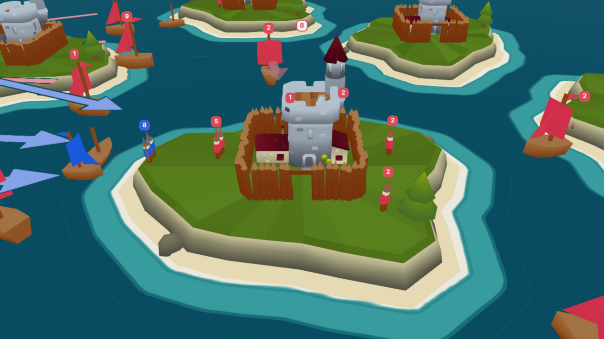
- `labelLayer.ts` and `labels.ts`: Babylon GUI labels linked to meshes. Only soldier counts and the clash labels ("−N", "× N") are drawn on the board. Castle counts and clash labels are pinned to their anchors and never move. Boat counts that overlap each other (also once a row has grown) are laid out side by side in a row, 4 px apart, centred on their anchors' mean screen position and ordered by their anchors' screen x, ties by ID ([#212](https://github.com/INTODAN/island-battles-go/issues/212)); a lone boat count stays at its anchor. So that they don't jump, a label leaves its row only once its anchor is clear by 4 px (where it is then already drawn), two labels in a row swap places only once their anchors have crossed by more than 4 px, and a label eases to a new place over about 150 ms. Then, when two labels still overlap, the lower priority one (castle count 100, boat count 80, loss 60, lost 30) fades out over 150 ms and comes back only when clear by 4 px. The castle's name and the upgrade levels are in the hover tooltip only (#166).
- `headingLines.ts`: the heading arrows of [#89](https://github.com/INTODAN/island-battles-go/issues/89), with the edge cases of [#168](https://github.com/INTODAN/island-battles-go/issues/168) fixed. Every size and choice is a value in `headingStyle` (world units). The rules, which the 2D replay follows too (see [`docs/troop-heading-lines/`](../../docs/troop-heading-lines/README.md)):
  - A line runs from just ahead of the boat's bow at its drawn scale (`BOAT_BOW` × scale + `startGap`) to the destination's shore point (`shore.ts`), where the boat will land. A line too short for its head plus `minShaft` is not drawn, checked after lanes and shared heads have moved it; one with little more shaft than that fades over `fadeLength`.
  - A boat still at its island's shore after launching has no line; it fades in over `launchFade` of sailing.
  - Groups of one team on one route are one line, the rearmost group's.
  - Visible lines that are within `parallelDegrees` of parallel (or of opposite) and closer than a lane over a shared stretch get lanes, whatever their teams, origins or destinations: lanes are half a head plus half a line plus `laneGap` apart (casings included). On one corridor, lines going one way keep to the right of their travel and lines going the other way to theirs; lines all going one way are centred on it.
  - At each castle, one team's lines arriving within `sharedArrowDegrees` (15°) in total share one arrowhead, compared round the circle; the other lines end at its base. Then every head at the castle, of every team, is moved round the shore as little as needed to keep `headGap` between neighbours; a shared or moved head points at the castle's centre.
  - A line has a gap where it passes within `castleGap` of another castle's centre, and the line of a group that is not moving (same position in the previous and next generation, or stopped by a clash this turn: `isHeld` and `stoppedByClashAt` in `animation/plan.ts`, the rule the rattle of #169 uses) is drawn at `heldOpacity`.
  - All lines are at one height, in rendering group 1 (which keeps the scene's depth), with alpha-blended materials that write no depth (`MaterialCache.overlay`) and `alphaIndex` by rank: lines never z-fight, and a later group ID is drawn over an earlier one.
- `animation/headings.ts`: the arrows during a turn (#168 case 13). `planTurnHeadings` decides once per turn, from the layouts of the turn's start and end, which groups have arrows, their lanes and their shared heads; `sampleTurnHeadings` then only moves them with the boats each frame. An arrow at both ends slides from its start lane and tip to its end ones; one only at the end fades in over the turn (a launched boat's once it leaves the shore); one only at the start fades out (until it sinks); a boat landing this turn keeps its arrow, getting shorter, until it lands. The turn starts and ends exactly as the resting views of its two generations look.
- `picking.ts`: hover highlight and tooltip (castle name, team, soldiers, upgrades, and its burst debt; a boat's destination and upgrades), double-click focus and the `F` key; `fitBoard(scene)` is the one fit the key and the game view's button share. On a touch screen a tap on a castle or boat shows the same tooltip until the next tap elsewhere.

**Dev page.** With `bun run dev`, open `http://localhost:3000/?fixture=busy-turn.json` (add `&frame=3` to start on the third frame). It draws a saved game from [`test/fixtures/`](test/fixtures/) with a frame slider and needs no backend. The fixtures are demo files: `generated-map.json` (the first turns of two teams with one castle each), `busy-turn.json` (a bot match with clashes and upgrades), `six-teams.json`, `bot-clashes.json` (generations 30 to 49 of the level 2 default bot against level 3 on the bot tournament's "archipelago" map, where all the clashes happen next to castles; written by `WEB_CLIENT_FIXTURES_DIR=<the same path> go test ./backend/services -run TestWriteWebClientBotFixture`) and `heading-arrows.json` (hand-written: one small scene per frame for the heading arrows' cases of #168: frame 1 two teams meeting at one castle, 2 opposite lanes, 3 two teams on one path, 4 lines passing other castles, 5 and 6 a group staying put, 7 shared heads, 8 a group stopped by a clash). Regenerate them by playing seeded bots with the backend's own simulation: from the repository root, run `WEB_CLIENT_FIXTURES_DIR=<absolute path to clients/island-battles-web/test/fixtures> go test ./backend/simulation -run TestWriteWebClientFixtures`. Screenshots of each frame type are in [`docs/screenshots/`](docs/screenshots/). The slider and arrows jump to a frame with no animation; **Play** plays the game on a turn at a time (`&play=1` starts playing, `&speed=2` sets the pace, `&turn=800` sets the length of a turn in milliseconds, `&still=1` freezes the castles' flags and windmills, `&fx=0` or `&fx=1` picks the graphics setting instead of the saved one). The page's **Effects** box is the same setting. `window.battlefieldDebug` has hooks for browser tests and recordings: `assets` (settles when the art has loaded), `stats()` (draw calls, active meshes and triangles of one frame), `particlePool()` (the particle pool's size, drops and busiest moment per kind), and `fixedTime(ms)` with `renderFrame()` (stop the render loop and advance a fixed time per frame).

**Map preview.** `map-preview.html` (`src/mapPreview/`) is the map builder's live 3D preview (#278), a second page of the browser build, served at `/play/map-preview.html` beside the client and, by `bun run dev`, at `http://localhost:3000/play/map-preview.html`. The map builder (`/map/builder/`, [backend/README.md](../../backend/README.md#map-builder)) shows it in a frame on the same origin and posts it the map file being edited and the game's upgrade types (`island-battles.map-preview`) after it says it listens (`island-battles.map-preview-ready`); a browser without WebGL makes it post `island-battles.map-preview-failed` with the reason instead. `previewGeneration` in `preview.ts`, pure and tested, turns the map into the board's first generation, each castle with its index as its ID, its starting soldiers or the map's default, and every upgrade type at level 1 unless the map sets another, and the page draws it with `renderGeneration`. That reuses the castles' meshes: a new team or soldier count only recolours or relabels a castle, and a castle that moves rebuilds the islands, the bridges between them (a bridge whose castles moved gets one of the new length) and the shallows' texture, which is the slow part. So `createRedrawQueue` draws an edit that moves no castle at once. During a drag on the plane, which the builder flags with `moving`, it redraws moved castles at most every 600 ms, and the drag's end at once; any other move, such as a typed position, is drawn once the castles have stopped for 150 ms, or every 600 ms at most; the shallows are sampled at 8 texels a unit instead of the game's 16, and fewer on a large board, so their texture stays within 2048 texels a side. A castle more than 100 units from the centre makes the board too large to draw: the preview then says so and draws no castles. The camera keeps the player's angle, pan and zoom while castles move (`camera: "follow"` in `renderGeneration`), and only moves back when the board grows past the view. With the dev server running, open `http://localhost:3000/map/builder/` and press **Show 3D preview**. `window.mapPreviewDebug` gives browser tests the battlefield, the number of maps drawn, whether a redraw waits, the shallows' resolution and the art's `assets` promise. The desktop build has no map builder, so it leaves the page out.

### Turn animation

`src/scene/animation/` animates the turn between two generations. A generation holds end-of-turn positions only, so the animation is rebuilt from the clashes' `time` and contact positions and from the turn's rules (backend/simulation).

- `plan.ts`: `planTurn(previous, next)` is pure (no Babylon) and returns tracks over `t` in [0, 1]: a group's path (to the contact position at `clash.time` first), each group's true position over the turn (a group sent this turn starts at its castle's centre, as on the server, and an arriving one goes on to the castle's centre and lands there at its speed; `groupLook` in `shore.ts` turns that into a boat being built, sailing or docked, and a squad walking on land), sinking after `clash.time` for `soldiers_after == 0`, clash effects, counts that roll at the clash, castle counts and team flips when a capture lands, and a castle display-level change at the start of the turn, which plays the castle's level-up pop. `sampleTurn(plan, t)` gives every pose at `t`; at `t = 1` it equals the next generation exactly. A castle's count replays the turn's arithmetic (sends and upgrade cost at `t = 0`, growth by one for a castle a team owns, not for a neutral one, then landings in group ID order); a group sent and defeated within one turn is in neither generation and is placed by the soldiers missing from its castle.
- `player.ts`: `TurnPlayer` has `play(previous, next)`, `seek(generation)` (no animation, drops the queue, never leaves anything half-way), `setSpeed`, `setLive` and `scrub` (a frozen mid-turn still). It drives a `Stage`, so tests run it with a fake stage and a fake clock. It has two paces (#176):
  - **Stepping or playing** a saved or finished game (and the dev page): a turn takes 1.5 s times the speed select. The game view and the dev page queue the next turn from the player's `onIdle`, as a turn ends, so the time left in that frame carries into the next turn and boats sail across the turn's end without a pause.
  - **Following live** (`setLive(true)`, which the game view sets while **Follow live** is on): a turn plays over about the time between arriving turns: a running average of the gaps between arrivals (up to 4 turns that arrive within a quarter of that time of each other are a burst, and share the time to the next burst), kept between 250 ms and 3 s, and eased so that it changes over about half a second, never in a step. The speed select doesn't apply. A catch-up speed eases, over a few hundred milliseconds, towards a speed set by the difference between the turns waiting and a target, never slower than 0.8x (nor than 3 s a turn). The target is the player's `LiveTiming` (`setLiveTiming`):
    - **`WATCHING`** (the default; watchers, demos and players whose bot plays): half a turn in hand (`bufferTurns: 0.5`), so that the next turn is usually known when one ends, plus what is left of the newest burst had its turns played at the pace since it arrived (`follows: "arrivals"`), so that a burst of turns plays at the pace over the time it covers. When the gaps vary (bots that answer quickly or slowly), the buffer grows by twice the running mean of how far a gap is from the average, as a share of it, by at most 1.5 turns, so an early turn is still in hand when a late one is awaited. A turn that arrives on its own starts the burst count again, so anything more waiting is a lag: turns that arrived while the tab was hidden (no frames run, while the turns keep coming), a burst that came late, what the first turns leave while the turn length eases down from 1.5 s. The catch-up gives a lag back at 1x plus the lag over 1.2 s (four times its ease, so it doesn't overshoot), at most 2x: a lag of N seconds goes in about N seconds plus 2, without a jump or a fast replay. Turns that already wait when following starts (a watcher who ticks Follow live again) replay at up to 4x, until the replay has slowed to 2x. Turns that arrive together count as at least half the average gap, so a reconnect that delivers several at once doesn't shorten the turns the catch-up then doubles; in a real-time game the view gives the player the game's pace (`setLivePace`, the live state's `turn_pace_milliseconds`), and one late turn counts as at most 1.5 times the usual gap, as for a hand player, and the catch-up's 2x is of the pace whenever the turn is shorter than it (so where turns come faster than the pace, a lag is given back more slowly). In a game that waits for its bots there is no pace: a long gap stretches the turns after it, and raises the buffer, for a few turns. So the board runs half a turn behind the open generation, measured at each turn's end, at every pace: in the tests 0.47 turn at a 0.5 s pace, 0.48 at 1 s and 0.49 at 2 s, and with ±40 ms of jitter on the arrivals 0.56, 0.53 and 0.52 on average. After a tab hidden for 6 s at a 1 s pace it is back to that within 8 turns of the tab's return. Ticking Follow live 8 turns back, the board is less than a turn behind again after 4 to 4.5 s at a 0.5 or 1 s pace. Five, seven or nine turns that arrive together after as long a stall play at no more than 2.03x the pace without a pace given, and 2.09x with it at a 0.5, 1 or 2 s pace, without running into the buffer. With gaps of 600 to 1400 ms, 1 game in 40 had a stop (of 100 ms); with gaps of 300 to 700 ms, 1 in 40 (17 ms). A turn 3 s late in a game with a 1 s pace leaves at most 0.78 turn of lag; without a pace, 1.77, given back within about 25 turns. Measured as a watcher on the local stack (Chromium with software WebGL, about 30 fps), the median lag was 0.51 to 0.56 turn at a 0.5 s pace, 0.52 at 1 s and 0.51 at 2 s, and after a tab hidden for 6 s at 1 s, or 10 s at 2 s, the board was back to it 7 s or 12 s after the tab's return, never playing faster than 2x. A tab hidden for more than 10 turns still skips to the newest turn, and below 10 frames a second, where a frame advances the player by at most 100 ms, 2x no longer catches up (at 5 fps the board stays 2 turns behind at a 1 s pace). (Until #361 the count was never given back: the board kept the first turns' leftover for good, about 1 turn behind at a 1 s pace and 2.5 to 3 at 0.5 s, and every turn that arrived while the tab was hidden.)
    - **`PLAYING`** (a player who plays by hand while their status is `playing`): nothing in hand (`bufferTurns: 0`), and the newest turn should end one turn's length after it arrived (`follows: "newest"`): the turn into generation N plays while turn N is open, so the board reaches the open generation as its turn ends. The game view also gives it the game's turn pace (`setLivePace`, hand play's `turn.paceMs`). The turn's length starts at the pace, at the game's start and after each jump back to live, instead of easing down from 1.5 s, and then follows the time between arrivals as for a watcher, so a server a little slower or faster than its pace neither stops the board at every turn nor leaves it behind; with the pace known, one late turn counts as at most 1.5 times the usual gap in that average. A late turn stops the board on the open generation until it arrives; the turns after it then run a little behind and catch up: in the tests, a turn 2 s or 4 s late at a 0.5 s or 1 s pace leaves at most 0.18 turn of lag, under 0.1 turn within 10 turns. With ±40 ms of jitter on the arrivals the board stops for 2 or 3 frames in about 15 turns of 100. Two turns that arrive together are caught up within a few turns. Its catch-up is 1x plus half the turns waiting beyond the target, up to 4x. Switching back to `WATCHING` (the team is out, the game ended) keeps at most one turn of the arrivals count; a lag is then given back as for a watcher, also when the team is out while the tab is hidden.
  - A queue that builds up while stepping plays up to 4x, also eased. More than 10 turns waiting, and it skips to the newest.
  - A frame advances the player by its real time, at most 100 ms, so a tab that comes back to the front doesn't jump: the queue rules catch up.
- `stage.ts`: `SceneStage` applies samples to the meshes `renderGeneration` built, by castle and group ID. A turn's start and end only update what exists: a boat that lands or sinks during the turn keeps its mesh and label until the turn ends, only a group sent and defeated within the turn gets a boat of its own, and the heading arrows of a generation at rest are drawn once, at a turn's end, not again at the next turn's start (the islands are rebuilt only when castles move, as before). `createScenePlayer(scene, teams)` advances with the render loop.
- `rotation.ts`: a boat faces its destination. When that heading changes (a boat stopped off its line by a clash), `turnToward` turns it there the shorter way round, 95% of the way in 200 ms; a boat placed for the first time, and a jump to a generation, face it at once (`aimGroup`, `steerBoats` and `snapBoats` in `battlefield.ts`).
- The heading arrows move every frame of a turn: their positions are written into the ribbons' existing buffers, and a new buffer is made only when an arrow's shape changes (a gap opens or closes).
- `effects.ts`: what a turn shows besides movement, behind the small `TurnEffects` interface: cannon smoke, splashes and a flash at a clash, a sinking boat, a burst of the new team's colour at a capture (`castleCaptured`, called by the stage when a castle's team changes, also when the capture lands as the turn ends), and the level-up pop with a sparkle (see [Art pass](#art-pass)).
- **Clashes on land** (#213): most clashes happen next to a castle, while a participant's true position is inside a shore reach, so it is a squad on land (#211). A clash's flash, smoke and ring are drawn where each participant is drawn: at its squad on land, at its boat afloat. On land there is no splash: dust kicks up instead (`FlashPose.onLand`, the spray's particle kind). A squad that a clash stops faces its opponents (`facingOf`, the rattle track's `facing`) and scuffles, lunging and bobbing, instead of the boat's rattle; a defeated squad topples over and fades instead of sinking, and a boat it left half built at the shore fades away. The boat at the shore neither rattles nor sinks. The scuffle and the fall are not particles, so they play with Effects off too. In the settled view, a clash ring on land is drawn on the grass, and a group lost on land (its contact inside an island's waterline) has no sunk boat, only its ring and its "× N". A group sent out and defeated at its own castle in the same turn (a bot meeting attackers at its gate) is placed by replaying each of its team's castles with its soldiers sent, or else on the island where it was lost.

  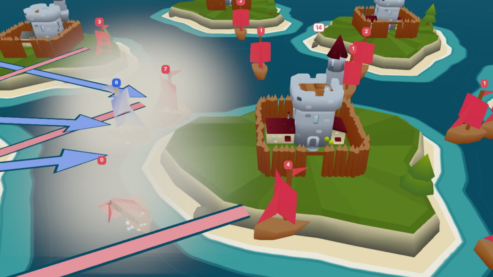

  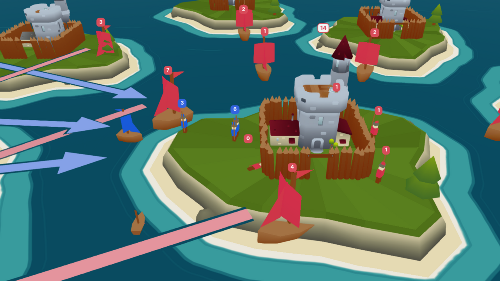

**Known limits.** A boat whose straight path crosses a third island still sails over it: only the origin's and destination's shores are handled.

### Castle models

Castles use the four castle models of the Unity game ([INTODAN/island-battles](https://github.com/INTODAN/island-battles), [#140](https://github.com/INTODAN/island-battles-go/issues/140)), one per upgrade level. Most of a castle is light grey stone; only roofs, pennants, bands, flags and the windmill's sails take the team colour.

- **Which model** (`castleLevel.ts`): `castleDisplayLevel(upgrades)` is the highest level across the castle's upgrade types, clamped to 1 to 4 (a missing type is level 1). The turn planner uses the same function. The castle's tooltip still gives each type's level; the upgrade rings of #99 are gone.
- **Team colours** (`castleAtlas.ts`): every mesh samples one 512 by 512 atlas of vertical-gradient swatches, `assets/castles/atlas.png`. `teamSwatches(hex)` gives the three swatches a team changes (stone/team, flags, accent); the flags run from the team colour to the colour mixed `FLAG_GOLD_MIX` (35%) toward gold, and neutral uses Unity's grey copy. `teamAtlas(scene, team)` paints those swatches into a copy of the atlas, one cached texture and `castle-team` material per team colour (wrapping past the sixth team); `baseAtlasMaterial(scene)` is the one `castle-base` material every castle shares. Both are for #102's boats and props too.
- **Loading** (`castles.ts`): the four GLBs load once per scene, in parallel, with Babylon's glTF 2.0 loader only (`@babylonjs/loaders`, with `KHR_mesh_quantization`, no Draco or meshopt, and no materials: the atlas materials replace them, so Babylon's PBR shaders are never downloaded). Until they are ready a castle shows #99's placeholder keep, then swaps. The build splits code (`splitting` in `build.ts`), so the loader's unused PBR code stays in chunks that are never fetched. `import`ing the GLBs and atlas gives their hashed `/play/assets/` URLs, and the desktop build serves them from its own origin.
- **On the board**: levels 1 and 2 are instances of one hidden source mesh per level and team; levels 3 and 4 are skinned, so each castle gets its own copy with its own skeleton and its own loop of the `Take 001` clip, started at an offset seeded by the castle's ID. `setCastleAnimation(false)` freezes every loop in the bind pose (for #102's slow-device setting); the dev page's `&still=1` does that. Every castle is turned (`CASTLE_YAW`) so its gate faces the default camera. A capture changes only the team material (or, for instances, the team's source mesh). A level change swaps the model at once when seeking; during a turn `popCastle(scene, id, from, to)` swaps it and plays a 0.4 s pop: the old model sinks into the island and the new one rises with a slight overshoot. The soldier count sits just over each level's model.
- **The files** (`assets/castles/`, with a row each in [`assets/LICENSES.md`](assets/LICENSES.md)) are made by [`tools/castles/convert.py`](tools/castles/convert.py) from the Unity repository at a pinned commit (`UNITY_COMMIT`, now `c8b43b3`; the script fails on any other). It imports each level's FBX with Blender, copies the per-polygon split between base and team faces from `Castle_all_team.fbx`, puts the big flags' cloth back on its joints, trims `Take 001` to the frames Unity plays, scales all four so that level 1 is 0.9 across (2: 0.96, 3: 1.16, 4: 1.19), puts each footprint's centre at the origin and its base at y = 0, writes GLBs with two materials (`castle-base`, `castle-team`), UVs and no texture, quantises them with `KHR_mesh_quantization`, and copies the atlas with its pixels unchanged. Run it with Blender, or with Blender as a Python module (CPython 3.13); both give byte-for-byte the same files:

  ```sh
  blender -b -P tools/castles/convert.py -- /path/to/island-battles
  uv run --python 3.13 --with bpy==5.2.3 python tools/castles/convert.py -- /path/to/island-battles
  ```

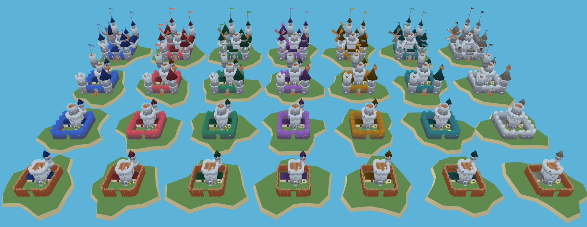

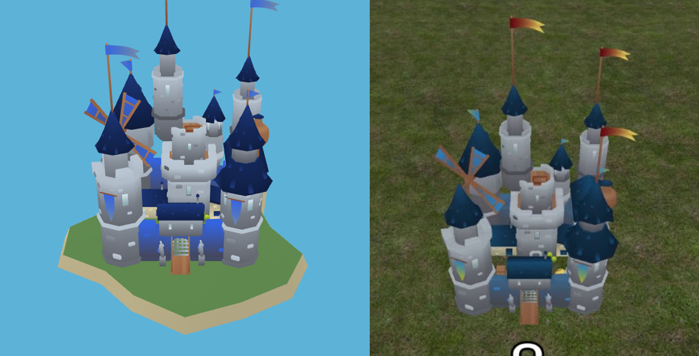

Recordings: [a level-up pop](docs/screenshots/castles-level-up.gif), [a capture recolouring roofs and flags](docs/screenshots/castles-capture.gif) and [level 3 and 4 loops out of step](docs/screenshots/castles-flags.gif).

### Art pass

The board is restyled to belong with the castles ([#102](https://github.com/INTODAN/island-battles-go/issues/102)): low-poly and flat-shaded, coloured from the castle atlas's vertical-gradient swatches, mostly light stone, warm wood and cream, with the team colour as the accent.

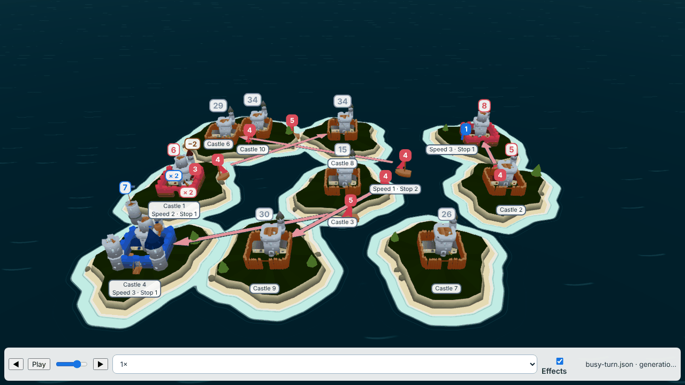

- **On the atlas** (`atlasUv.ts`, `lowPoly.ts`): `ATLAS_SWATCHES` names all seven swatches of `assets/castles/atlas.png` (cliff grey to cream, stone, ice, wood, green, flags, accent), and `swatchUv(swatch, along)` gives the UV of a point along one (0 its top row, 1 its bottom row). `FlatGeometry` builds flat-shaded meshes: every triangle has its own vertices and the face's normal, faces the side it is told to, and can multiply its atlas colour through vertex colours (`shade`). Islands, props and boat hulls use the castles' shared `castle-base` material, and sails the team's `castle-team` material (`castleAtlas.ts`), so they light and recolour exactly as castles do. Until the atlas has loaded, `MaterialCache.useBase` and `useTeam` give stand-in colours and swap them when it arrives.
- **Islands** (`landforms.ts`): the seeded outline of `islands.ts` (24 corners), a faceted cliff ring that runs from cream at the top to dark grey at the waterline, a flat grass top and a thin sand beach that slopes under the sea. The grass is flat to at least `PLATEAU_RADIUS` (0.78) in every direction, so the level 4 castle (whose base reaches 0.745) always stands on flat ground; that is why the smallest island radius went from 0.75 to 0.84. Castles of one landmass are joined by a low bridge of the same build (`bridgeOutline`, `BRIDGE_TOP`).
- **Props** (`islandProps`): seeded trees on the grass and rocks on the beach, never within `PROP_CLEARANCE` of any castle (outside every plateau), never behind a castle under its soldier count or in front of it under its name, and so never under a heading line's end. Each kind is one mesh drawn as thin instances: two draw calls for every prop on the board.
- **Sea** (`sea.ts`, `seaDistance.ts`): a toon water shader. Deep water offshore, light shallows within `SHALLOWS_WIDTH` of the nearest island's waterline (a distance field sampled into a texture when the islands change), a toon edge where they meet, a foam line at the shore that breathes, gentle swells that move the band edges, a ripple drifting out and sparse wave dashes, and a faint sky reflection toward the horizon. The low graphics setting draws only the bands and foam.
- **Boats** (`createBoat`): a low-poly wooden hull (`castle-base`), a square sail and a jib in the team's colour (the top of its stone/team swatch, as roofs) and a pennant on the flags swatch. They still grow gently with soldiers. A moving boat leaves a small foam wake (`wakes.ts`), faded in by its speed.
- **Light** (`look.ts`, `lookConstants.ts`): a warm sun, soft shadows (1024 map with percentage-closer filtering) from castles, boats and props onto islands, and a cool hemispheric fill. The environment texture `assets/environment/sky.png` is a small equirectangular sky made by `tools/environment/sky.ts`; the sea reflects it. It loads from the page's own origin like the castle files. The board's materials are Babylon's standard materials (no PBR, as #140 chose), so it is not used as image-based light.
- **Graphics setting** (`graphics.ts`, `postFx.ts`, `shadows.ts`): "high" turns on a `DefaultRenderingPipeline` (Khronos PBR Neutral tone mapping, which keeps colours' hue, a light bloom and FXAA), the sun's shadows, the sea's details and the castles' loops (`setCastleAnimation`); "low" turns all of them off and also plays no particle bursts (see **Effects** below). The game view's **Effects** box switches it and remembers it in `localStorage`; a device with two cores or 2 GB of memory or less starts on "low". The pipeline and the shadow code are chunks of their own, fetched only when turned on. Labels are drawn after post-processing, so it never touches their text or colours.
- **Effects** (`animation/effects.ts`, `particles.ts`, `particlePool.ts`, `gpuParticles.ts`): short particle bursts with textures drawn in code; GPU particles where WebGL 2 runs them, CPU particles elsewhere. Seeking puts every posed boat and castle back at once; bursts already under way finish on their own across a turn's end.
  - **Pooled systems** (#197). Building a particle system in the middle of a frame costs 30 to 48 ms (headless), so none is built while a turn plays. When the board loads, `Bursts.warmUp()` builds every system once and plays an invisible particle on each until it has compiled and drawn a few frames; a burst then takes a free system of its kind, sets its position, colours, sizes, speeds and rate (plain fields: a `GPUParticleSystem` sends them to its shader every frame, so nothing recompiles), calls `start()`, and gives it back once the last particle has died (`SystemPool` in `particlePool.ts`, which knows nothing about Babylon and is tested with a fake system). An idle system is stopped with `emitter = null`, which the scene's frame loop skips. GPU systems are made with `emitRateControl`, so a system that is started again emits what its rate says and does not refill itself with the particles of its last use (no `reset()`, which would free and rebuild its buffers).
  - **Kinds.** What a running system cannot change makes a kind: the emitter's shape (a point, or a box when the burst has a `spread`), the blend mode, the texture, the size curve (`grow`) and the capacity. `BURST_KINDS` in `particles.ts` lists the six the game uses, with their pool sizes: the clash's flash (8 systems), smoke (10), the spray together with the bubbles under a sinking boat (16), the level-up sparkle (6), a capture's burst (4) and its sparks (4). A burst whose kind is not in the table is dropped, so a new effect adds a row there (a test checks that the turn's effects find a system for each of theirs).
  - **Pool sizes** are about twice the most that were busy at once in the three fixtures played at 1.5 s a turn (`window.battlefieldDebug.particlePool()` gives the counters: `highWater` per kind, and `dropped`): flash 4, smoke 6, spray and bubbles 9, sparkle 3, capture 1, capture sparks 1 on `six-teams.json`. When more bursts start at once than a kind holds, the extra ones are dropped and the ones playing carry on; nothing is built to make room.
  - **Effects off plays no particles** (#201). With "low", `burstsFor` in `effects.ts` returns `null`: the particle code is not loaded, no `Bursts` object and no pool (the 48 systems) are made, and no burst plays. Boats still tilt and sink, and the clash flash and the castle pop still play. The effects ask `burstsFor` on every effect and every frame (`tick`), so switching to "high" during a game builds and warms the pool at once and bursts play from the next effect; switching to "low" lets bursts that are playing finish, starts no new one and leaves the pool in memory until the scene is disposed.
- **Loading** (`assetLoader.ts`, `boardAssets.ts`, `src/ui/boardLoading.ts`): the atlas, the four castle models and the environment texture download once per page, counted by bytes. The game view and the dev page show **Loading the board…** with a progress bar over the board until they are in; the board draws its stand-ins underneath, and stays usable if a file fails. The lobby screens do not wait: the ocean behind them fades in once the art has loaded.

**Contrast.** The owner decided on #102 to keep the issue's shades so the board matches the reference video: deep sea `#1f4f63` (`DEEP_SEA_COLOR`), shallows `#4fa3a5` (`SHALLOWS_COLOR`), foam `#f4f1e6` and the castle atlas's own green for the grass top (`GRASS_TINT` is [1, 1, 1]), and to drop the 3:1 minimum. The team colours are all mid-tones, so every pair of a team's roof (the top of its stone/team swatch, `teamSwatches`) or boat sail with these backgrounds comes out at 1.0 to 2.4:1. `contrast.test.ts` computes the table (run it with `CONTRAST_TABLE=1 bun test src/scene/contrast.test.ts` to print it) but enforces nothing. Team identity comes from the team-coloured label chips and heading lines. The palette stays equal to `replay.html`.

**Budgets** (measured in headless Chromium with SwiftShader, a software renderer, so frame times are only comparable with each other; real-device frame rates are for the owner to check):

| | Before #102 | Effects off | Effects on |
|---|---|---|---|
| JS fetched for the board (gzip) | 1.87 MB (450 KB) | 2.13 MB (516 KB) | 2.37 MB (576 KB) |
| Asset files | 1.73 MB | 1.74 MB | 1.74 MB |
| Draw calls, `six-teams.json`, busiest sample of a turn playing | 65 (old count, not reproducible) | 67 | 103 |
| Triangles drawn per frame, same sample | 34.5 k (old count, not reproducible) | 43.3 k | 121 k |

The JS and asset rows are sizes of the build at the time of #102 and #170, not re-measured by #275. The draw call and triangle rows were measured again for #275 with `tools/budgets/measure.mjs` (below), which replaced the earlier figures (76, 97 to 105, 36.1 k, 84 to 88 k) that could not be reproduced; the Before #102 column keeps the old figures only for comparison. Measured today, as ranges over the fixture's 15 frames or 14 turns:

| `six-teams.json`, 1280x800 | Effects off | Effects on |
|---|---|---|
| Each frame shown at rest: draw calls | 17 to 55 | 32 to 89 |
| Each frame shown at rest: triangles | 29.0 k to 55.6 k | 56.5 k to 89.9 k |
| Each turn playing, busiest of 14 samples: draw calls | 25 to 67 | 42 to 103 |
| Each turn playing, busiest of 14 samples: triangles | 35.9 k to 43.3 k | 95.4 k to 121.1 k |
| Particle systems in the scene | 0 | 48 |

**What it measures, and how to reproduce it.** `window.battlefieldDebug.stats()` renders one frame and reads Babylon's counters: draw calls from the engine's per-frame draw call count (shadow pass and particle systems included), triangles as `scene.getActiveIndices() / 3` (what Babylon counts for that render; the shadow pass's share is not separated, which is why Effects on is about twice Effects off). "At rest" shows each frame with `showFrame` and waits 500 ms; "playing" plays each turn into frames 2 to 15 with `playTurn` and keeps the sample with the most draw calls of 14 taken every 120 ms. Run `bun run dev`, then from this directory `node tools/budgets/measure.mjs [fixture.json] [url]` (needs Playwright's Chromium, `require("playwright")`; no backend, because the dev page reads the fixture). It opens `&fx=0` and `&fx=1` with software rendering (SwiftShader) and prints one line each; it takes about five minutes. Draw calls and triangles do not depend on the GPU, so they reproduce headless: two runs gave the same draw calls, and triangles within 40. Which sample is the busiest depends on timing, so a different machine may differ by a few draw calls on the playing rows. Frame times, JS size and asset size are not measured by the script.

Targets: at most 2.5 MB of JS (650 KB gzip) and 2 MB of asset files for the board, and at most about 120 draw calls and 150 k triangles for a six-team busy turn (103 and 121 k measured), which a mid-range laptop's integrated GPU draws well within 16 ms (60 fps), and a phone at 450 px within 33 ms (30 fps) with effects off.

Recordings: [a clash](docs/screenshots/art-clash.gif), [a capture](docs/screenshots/art-capture.gif) and [an upgrade](docs/screenshots/art-upgrade.gif). Before and after screenshots of the fixture frames are `docs/screenshots/art-*-before.png` and `art-*-after.png`.

## Lobby screens and the bot relay

`src/main.ts` mounts `src/ui/lobby/app.ts`, which picks the screen from the realtime stores and the last lobby round whose game view the player closed (`routeRound` in `rounds.ts`, pure and tested): no session shows the name step; a session with no lobby shows create, join or [watch](#watching-a-game); a `waiting` lobby shows the room; a `started` lobby mounts the game view of its round (`mountGameView` from `src/ui/game/`) unless the player closed that round's view. `/play/?join=CODE` (or `/?join=CODE` in dev) asks for a name and then joins that lobby.

- **Bot tutorial** (#280, `tutorial.ts`): one of two collapsible cards, side by side (stacked on narrow screens) under the start screen's create, join and watch cards with three copyable command blocks for the Python bot template (`templates/python-bot`): get it (a sparse `git clone` of the public repository, then `cp` and `uv sync`, which takes the newest SDK because the template has no `uv.lock`), serve it on localhost (`uv run island-battles-bot serve bot:play`, the bot picker's command, on every system) and build the zip for upload (`scripts/package.sh`). A choice above the steps switches them to Windows' PowerShell (`Copy-Item`, and the template's `scripts\package.cmd`), and it starts on Windows when the browser's user agent says Windows. Its test checks the commands of both against the template's scripts, that every `.sh` script has a `.cmd` twin that runs the same `uv` commands, and the install command against the template's README and `scripts/check-template.sh`, which the release runs.
- **AI tutorial** (`tutorial.ts`, `agentPrompt`): the second card, beside the bot tutorial: one prompt to copy into a coding agent on the player's own computer (Claude Code, Codex, Cursor; a cloud agent can't reach the tab's `127.0.0.1`), which does the same setup itself: the same sparse clone, `uv sync`, reading the template's `AGENTS.md` and skills, `scripts/check.sh`, and serving the bot on localhost, or giving the player the serve command when the agent can't keep it running, with each script's Windows twin named too, because the agent can tell its system. The prompt is built from the bot tutorial's commands, and its test checks that the scripts it names exist in the template.
- **Several games in one lobby** (#172): a lobby plays one game per round (`lobby.round`). **Back to lobby** in the game view keeps the player in the lobby. Once the game has ended it reopens the lobby (`POST …/reopen`), which waits again with the same players, teams and bots, everyone presses ready and the host starts the next game. While the game runs it shows the room read-only, with **Return to game**; the game goes on, and leaving stays the room's **Leave lobby** button. A player still looking at the result when another reopens the lobby stays there, with the note "The lobby is open again", and every player enters the next game when it starts. The game is followed by lobby and round (`realtime.followGame(lobbyId, round)`), and the view mounts only once that round's game exists, because until the host's start has made it the lobby's newest game is the previous one. A watcher's view follows the lobby to its next game.

- **Create form** (`form.ts`, pure and tested): lobby name, map (a default map from `GET /map/templates`, the first one once they load, or a map file checked by `POST /map/validate` before it is sent), turn limit (10 s, 30 s, 2 min, 10 min, No limit, sent as `game_settings.turn_timeout_seconds`), turn pace (a **Turn pace** select of 0.5 s, 1 s or 2 s, sent as `game_settings.turn_pace_milliseconds`, which makes a game with a player who plays by hand real-time) and game length (a **Game length** select of 150, 300, 600 or 1200 turns, sent as `game_settings.max_generations`) and **Rated** (a checkbox, off by default, sent as `game_settings.rated`; see [Rated lobbies](#rated-lobbies)). The map sets the teams, one per colour, with 2 to 6 teams; there is no generated map any more (#277), so a lobby without default maps needs a map file. Each create gets a fresh `request_id`; after a transport failure the same body goes out again with the same id.
- **Room** (`roomScreen.ts`, `botPicker.ts`): teams with their members, bot choices and ready marks, the join code with copy buttons, the map summary, the bot picker and the ready, start and leave buttons. The members' bot choices come from each snapshot member's `member_settings` (`memberSettingsBot` in `roomModel.ts`), and a seat's from its `seat_settings`. A choice publishes `lobby.changed`, so every tab sees it at once.
- **Bot seats** (#148): while the lobby waits, the host adds a bot to a team with **Add bot** (the level comes from `GET /bots/defaults`) and removes it with **Remove**. When `GET /bots/defaults` says `server_bots` (#222), the select also offers every package of the lobby, "Uploaded: Alex's bot (python)", and "Hosted bot (URL)", with a field for the URL. It always offers "My localhost bot (port)" too (#286), with a field for the port, filled with the first port that the host's localhost bots leave free: a bot on the host's machine, sent with `bot_relay_player_id`, the host's own player ID, since only the tab of the player who added a localhost bot seat relays it, whoever is host later. Each of your localhost bots needs its own port, from 1024 to 65535; the room refuses a taken one before sending, and shows the port of each seat that you added and whether its bot answers `GET /health` on it. Another person's seats are named with whose they are, and a seat whose adder left says that the start is refused until the host removes it, which the start button's hint repeats (`startBlocker`). Each click sends a fresh `request_id` (`POST .../seats`), and a transport retry resends the same one, so the seat is added once. A seat (`kind: "seat"`) shows as a bot with its level, always ready, with no lease state, and is not counted as a person. Seat problems are sentences next to the control that caused them. In a rated lobby **Add bot** offers only the default levels that no seat has ([Rated lobbies](#rated-lobbies)).
- **Change settings** (#171): while the lobby waits, the host's room has a **Change settings** button under the map summary (**Change map** before Rated joined the fields, #370). It opens the create form's map, turn limit, turn pace, game length and Rated fields (`mapFields.ts`, shared with the create form), filled with the lobby's current choice, or the first default map for a lobby whose settings choose none; **Save** sends `PUT …/settings` with the map's teams and `game_settings` (`validateMapSettings` and `changeSettingsBody` in `form.ts`). The lobby rebuilds its teams by position, so team cards, seats, the bot picker and the summary follow the new snapshot, and every player sees it from `lobby.changed` and has to press ready again. A map with fewer teams than the lobby has players and bots is refused with a sentence asking to remove a bot or pick a bigger map.
- **Problems** (`problems.ts`): each refusal shows a plain sentence next to the control that caused it; `empty_teams` also highlights the teams in `team_ids`. A `game_requirement`, such as a rated lobby's, shows the server's own sentence, and so does a seat that a rated lobby refuses.
- **Lease** (`lease.ts`): one `client_instance_id` per page load, a heartbeat every 15 s with the current `membership_generation`, a `keepalive` `DELETE` of the lease at the lobby's URL on `pagehide`, and a Leave button. A reloaded tab keeps its session and lobby, and joins again under a new instance id.
- **Start** (`startRetry.ts`): the lobby is `started` before its game exists, so the game read can get 404 or 409, or, in a later round, the previous round's game, which counts as not there yet. It is retried after 1 s, 2 s, 4 s, then every 10 s until it works or the screen leaves the lobby.
- **Build a map…** (`mapBuilder.ts`): the create form's map choice opens the map builder (`/map/builder/`, proxied by `proxy.ts` in development) in its own tab; its **Use in lobby** message (`island-battles.map-file`, accepted only from the same origin and the window the form opened) is checked by `POST /map/validate` as if the map had been loaded from a file. Not offered in the desktop app, whose window is not on the game server's origin, so the builder cannot post back to it.
- **Relay** (`src/bots/`, no DOM imports): for a player whose `GenerationState.bot` is `localhost`, each new generation's turn delivery is read from `GET /game/from-lobby/{lobby_id}/turn-delivery` (the server's `BotTurn` and a one-turn submit token) and posted to `127.0.0.1:<GenerationState.bot.port>/turn`, which answers `202`; the bot plays and submits the turn itself, and the relay never submits commands ([turn deliveries](../../backend/README.md#turn-deliveries)). A bot that is not running is asked again every 2 s; a bot that refuses the delivery (a submit host it doesn't allow, or an SDK too old for deliveries) is shown and waits for **Try again**; a failed read of the delivery is tried again after 1 s, doubling up to 8 s. A 409 (nothing to play) just waits. Once the bot has the turn (or for a default bot) the relay calls `POST /game/from-lobby/{lobby_id}/deadline` a second after `turn_deadline_at`, again after 2 s doubling up to 30 s while the turn stays open. For a player who plays by hand in a real-time game, still in it, the relay leaves the deadline to [hand play](#hand-play) (its `standDown`). For a player who added localhost bot seats as the host, `startBotRelays` also runs one relay per `GenerationState.relayed_bots` entry, one of those seats (#286): it reads the seat's delivery with `?player_id=` and posts it to the seat's port, whatever the host's own bot and `submitted` say, and leaves the deadline to the host's own relay. The banner over the game view has a line per failing bot, with **Try again**, and the player list names each relayed seat under its team. Another client can reuse `createBotRelay` with its own `fetch`, timers and stores.
- **Bot picker**: in a rated lobby, a signed-in member's bot choices have **Plays as** and the default bots are disabled (see [Rated lobbies](#rated-lobbies)). **Play by hand** is the first choice and isn't preselected (#341); it saves `{"bot": {"kind": "manual"}}`, and its line names the lobby's real-time pace from `game_settings.turn_pace_milliseconds` ("a turn every 1 s"). When any member chose it, the room's settings summary says "Real time: a turn every 1 s" instead of the turn limit (`anyPlaysByHand` and `describeSettings` in `roomModel.ts`). A bot seat can't play by hand, so **Add bot** is unchanged. "My localhost bot" has a port field (41414 by default; **Use this port** saves `{"kind": "localhost", "port": N}`, refused when one of the host's localhost seats has it) and shows connected or not running from `GET http://127.0.0.1:<port>/health` and the command to copy, with `--port` when it isn't the default, or a default level from `GET /bots/defaults`; the choice is saved as your lobby member settings, `{"bot": ...}`, with `PUT /lobby/v1/games/{game_key}/lobbies/{lobby_id}/member-settings`; a new choice clears your ready. When `GET /bots/defaults` says `server_bots` (#222), it also offers "My hosted bot (URL)", with a field for the URL and **Use this URL**, and "Uploaded: …" for each of your packages in the lobby; the server plays both, and the game view's player list says "Played by the server" under your team instead of relaying. The bot server must allow the page's origin: the official lobby and game, the local ones and the desktop app are allowed by default, and `island-battles-bot serve --allow-origin ...` adds another, such as your own deployment.
- **Bot packages** (#221, `src/bots/packages.ts`): below the choices, **Upload bot (.zip)** takes the zip that an SDK's `package` command builds. It starts the upload with `POST /game/lobbies/{lobby_id}/bot-packages`, posts the zip straight to storage with the presigned POST (with `XMLHttpRequest`, for the progress bar), and completes it with `POST …/bot-packages/{package_id}/complete`, then shows the package's language, entry or command and size, or the game's reason for refusing it. **Upload from the command line** gets an upload token (`POST …/bot-packages/upload-token`) and shows the Python and Go commands that use it, with Copy buttons. The lobby's packages are listed from `GET …/bot-packages`, read again every 10 seconds, with **Delete** on your own. Choosing a package as your bot comes later. The desktop app shows the same controls, but storage's CORS rule admits only the game's own origin, so the desktop app uploads from the command line.

Screenshots of each screen at desktop width and at 450 px are in [`docs/screenshots/`](docs/screenshots/) (`lobby-*.png`), including the room with bot seats (`lobby-seats-*.png`).

### Rated lobbies

A rated lobby's game counts for the [leaderboard](#leaderboard) (#370, part of #358; the backend's [rated lobbies](../../backend/README.md#rated-lobbies)). Everyone signs in with Google, and plays by hand or with a bot under one of their bot names; default bots play only in the bot seats the host adds, each level once.

- **The setting.** The create form and **Change settings** have a **Rated** checkbox after the game length (`mountMapFields`), off by default, with "Rated games count for the leaderboard. Everyone signs in, and plays by hand or with one of their bot names." A guest host sees it disabled, with "Sign in to host a rated lobby." `MapSettingsValues.rated`, `validateMapSettings` and `lobbyMapSettings` (`form.ts`) carry it, and the room's settings line ends with "Rated" (`describeSettings`).
- **Plays as.** In a rated lobby, a signed-in member's bot picker gives the localhost, hosted and uploaded choices each a **Plays as** select: "No name", then their bot names from the game's `GET /account`, and a **Manage bot names** link that opens the [account page](#account-page); the names are read again when it closes. The chosen name is saved as the choice's `name` (`choiceFromValue` in `roomModel.ts` takes it, and the picker compares it before saving, as it compares a port or a URL), so every member's room shows it at once, "Kraken (own bot, localhost)" (`describeBot`). A member with no bot names sees "Register a bot name in your account to play rated games with a bot."; a guest sees no select. A saved name that was deleted stays in the select, marked "(deleted)". An unrated lobby shows no **Plays as**, so it looks as before.
- **What is missing.** `ratedBlockers(room, account)` in `roomModel.ts`, pure and tested, says in the server's own terms what a rated lobby still needs: for you, "Sign in to play in this rated lobby.", "Choose a bot name, or play by hand." (also for a default bot) or "Your bot name Kraken no longer exists. Choose another."; for the host, "Remove …: a rated game allows only default bot seats, each level once." The room shows yours above the **Ready** button, which it disables until you fix it, the host's as the start's hint, and a **guest** tag beside each other person who isn't signed in. The picker's default-bot radios are disabled with "Default bots play only in bot seats in a rated lobby.", and **Add bot** offers only the default levels that no seat has (`seatOptions` in `src/bots/compute.ts`). The server still decides: a refusal of the ready gate (`rated-sign-in-required`, `rated-bot-name-required`, `rated-bot-name-gone`, `rated-same-account`, `rated-seat`) and a refused seat or name show the server's sentence (`describeProblem`).
- **The game and its end.** The game view names your bot by its bot name ("Kraken, your localhost bot on port 41414, …", `describeGameBot` in `src/bots/kinds.ts`), and the teams box starts with **Rated game** when `GenerationState.rated` is true, or when the outcome has ratings. When the outcome has `ratings`, the banner lists them under the summary, the winner first: "Kraken 1500 → 1520 (+20)", with the name in the team's colour, the numbers rounded, and a house bot as "Bot (level 2)" (`ratingLines` in `src/ui/game/ratings.ts`, pure and tested). The ratings come in the outcome, which `GenerationState` and `WatchState` carry through `LiveTurn` and `ViewState`, so a watcher and a saved demo show them too.

| | Desktop | 450 px |
|---|---|---|
| Create form | 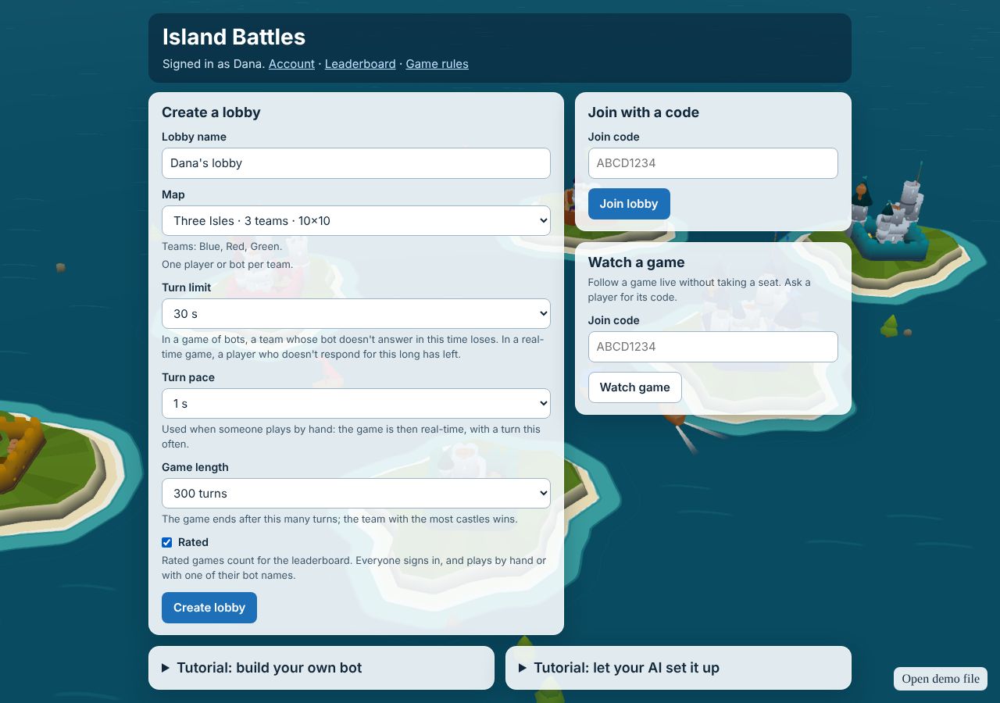 | 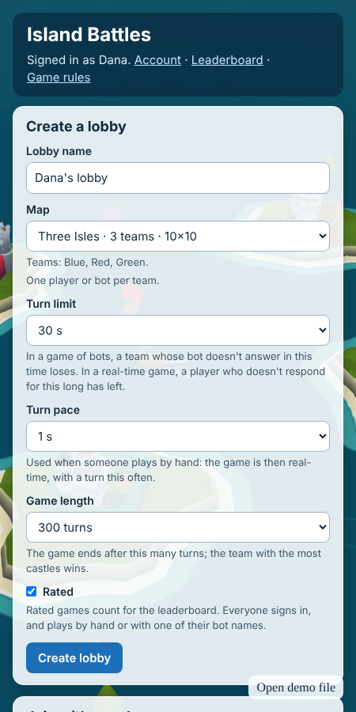 |
| A rated room with a blocker | 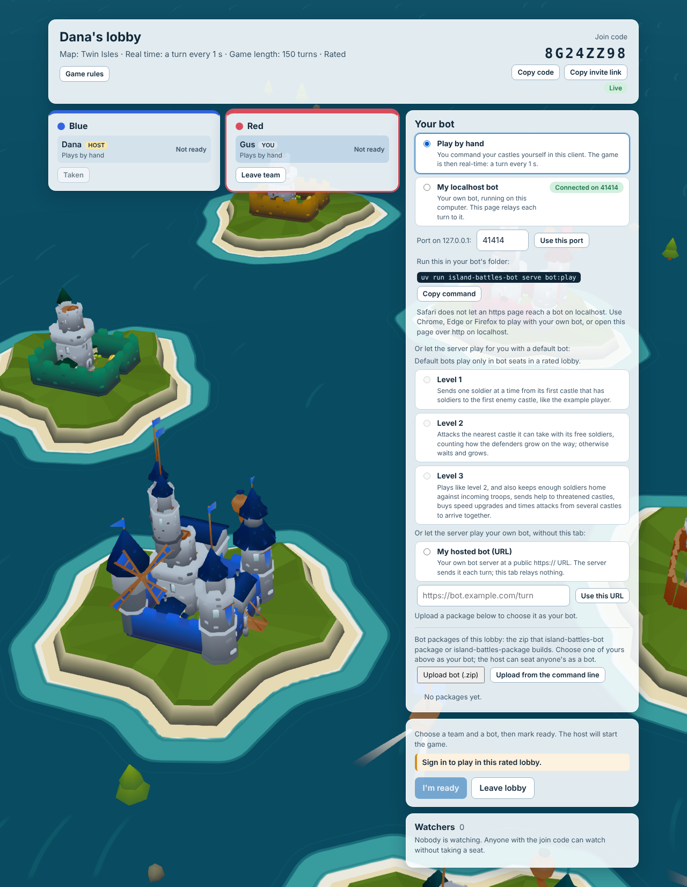 | 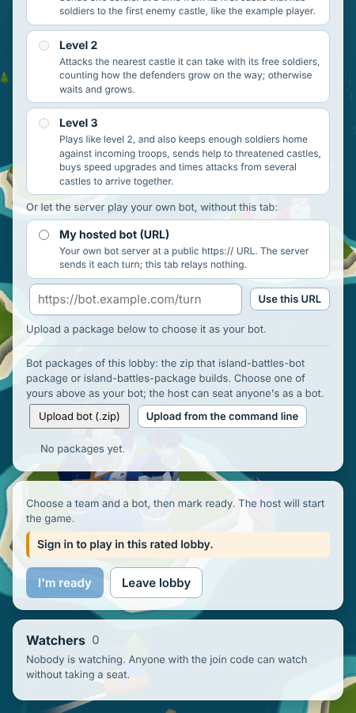 |
| Plays as | 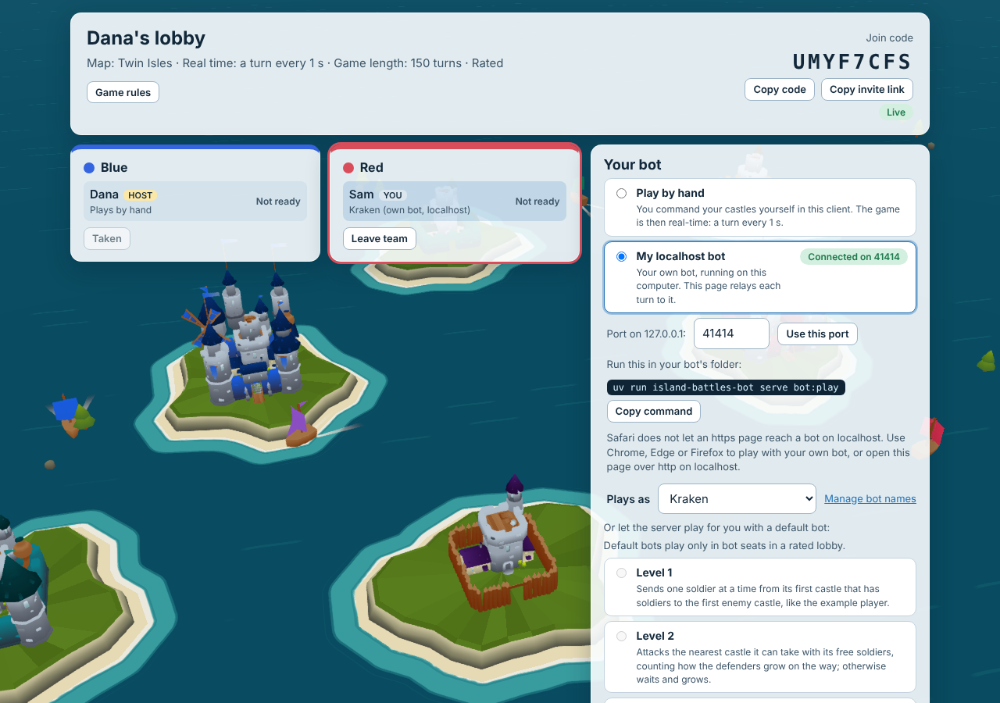 | 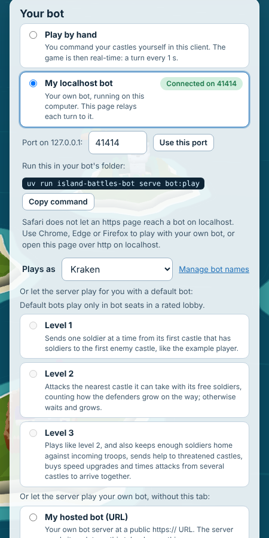 |
| The end | 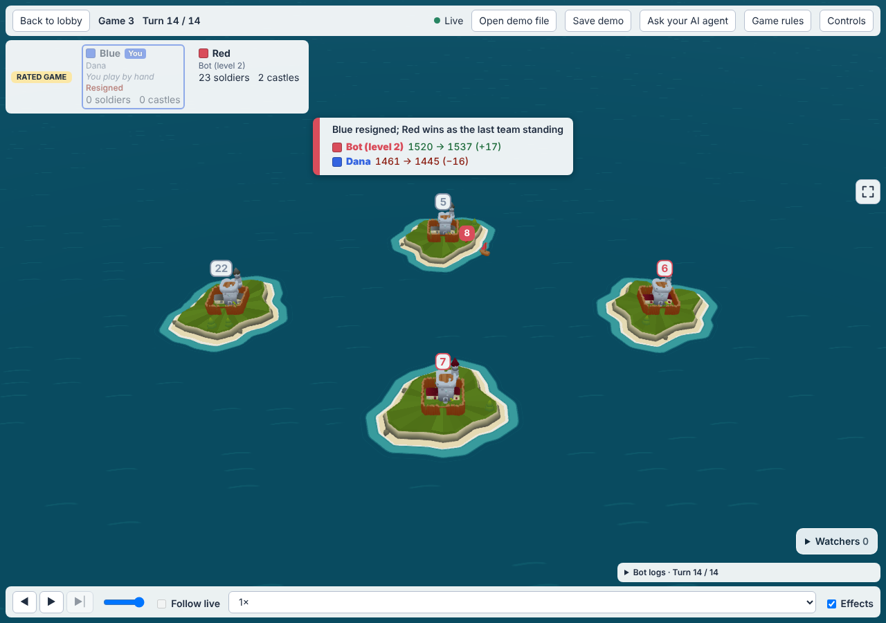 | 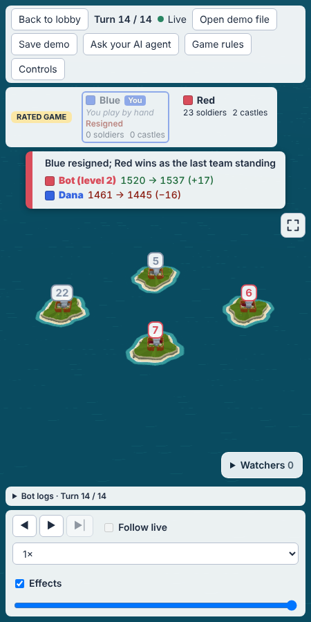 |

## Sign in with Google

When the lobby offers sign-in (`GET /lobby/v1/sign-in` answers a `google_client_id`), the browser build loads Google Identity Services (`https://accounts.google.com/gsi/client`) and the name screen shows Google's own button above the name field, a line on what signing in gives, then "or play as a guest" and today's name field (option B of [#369](https://github.com/INTODAN/island-battles-go/issues/369)'s mockups). Both are asked only once something needs them, the name screen, the silent sign-in or a sign-out, so a page that never shows the name screen (a saved session, the public leaderboard) calls neither. With sign-in off, and always in the desktop app, whose web view Google's button doesn't work in, the script is never requested and the name screen is the guest's alone. A person who signs in for the first time chooses a display name on the next step ("This is the name others see. It isn't your Google name."), with the rule, 3 to 24 letters, digits, spaces, `-` and `_`, and the sentence for a taken name under the field; **Cancel** goes back, and no account exists until **Continue** succeeds. The menu's heading then reads "Signed in as Dana. Account · Leaderboard · Game rules"; a guest's stays "Playing as … Change name · Leaderboard · Game rules".

Google's calls are in one module, `src/ui/lobby/googleSignIn.ts`, behind the `GoogleSignIn` interface (render the button, a silent sign-in, turn auto-select off), so `googleSignIn.test.ts` drives it with a stand-in for `google.accounts.id`. What the name screen does after a refusal (ask for the name, stay on the step with a sentence, or go back to the button) is `googleSignInStep` in `signIn.ts`, pure and tested. Google's button can personalise itself ("Continue as …"), and its silent sign-in shows Google's own "Signing you in" prompt: both are drawn inside Google's frame, never read by the page.

## Account page

**Account** in a signed-in person's menu heading opens the account page, a dialog like the Game rules page (`src/ui/account/`, option A of #369's mockups):

- **Display name**, with **Save**: `PUT /lobby/v1/account`, then the game's `GET /account` with a new player token, which carries the new name, so the game learns it at once. The menu's heading follows.
- **Playing by hand**: the hand play's rating, rounded, and its rated games.
- **Bot names**, "3 of 5": each name from the game's `GET /account` with its rating, rounded, its rated games ("no rated games yet" before the first) and **Delete**, after a confirmation that says its rating is deleted with it. A field and **Add** (`POST /account/bot-names`), with the name rule and the count beside it; at 5 names they are disabled with "You have 5 bot names, the most an account can have." A refused name shows the server's sentence, such as the one for a name another account has.
- **Sign out**, and **Delete account…**, after a confirmation that the display name, the bot names and every rating are deleted and can't be restored: the game's `DELETE /account` first, then Google's silent sign-in is turned off, then the lobby's `DELETE /lobby/v1/account`, then sign out. A failure stops there and says so: once the game's part is gone, the page shows no bot names and says only the account is left to delete. Deleting again is safe, since the game's part answers 204 when it is gone.

The confirmations are boxes over the page, like the Resign confirmation, not the browser's `confirm()`. The game's `/account` routes take a player token (`needsPlayerToken` in `src/api/playerTokens.ts`). What the page shows, what is disabled and each sentence is `accountModel.ts`, pure and tested; its requests are `accountService.ts`, tested with a fake lobby and game. A 401 from any of the page's requests, its player token's included, ends the realtime session with its problem (`realtime.sessionRefused`), so the page closes and the silent sign-in or the name screen follows, as for a refusal of the session's own calls.

Screenshots at desktop width and at 450 px are in [`docs/screenshots/`](docs/screenshots/): the name screen with Google's button (`signin-name-*.png`), the display name step (`signin-name-step-*.png`), the signed-in menu (`signin-menu-*.png`), the account page (`account-*.png`), at the limit of 5 names (`account-full-*.png`), with a taken name (`account-taken-*.png`) and its two confirmations (`account-confirm-*.png`). Google's button in them is a stand-in, since Google's can't sign in from the sandbox that took them.

## Game rules page

A **Game rules** button on the start screen (beside **Change name**, or **Account** for a signed-in person), in the lobby room (under its title) and in the game view's top bar opens the rules of the game in a modal dialog over the screen (`src/ui/rules/`): the goal, the board, a turn and its steps in order, the three orders a castle can get, clashes, reaching a castle, the upgrades with a table of every level's effect and cost, and how a game ends. Escape, **Close** or a click outside closes it. The text is written by hand in `rules.ts` and needs no server, so it also opens beside a demo file. `rules.test.ts` compares its upgrade levels and costs, its lists of upgrades and commands, the turn's steps and its numbers with the Go sources and `backend/api/openapi.json`. Any change to the rules updates the page in the same pull request, as the [game-rules skill](../../.agents/skills/game-rules/SKILL.md) says.

## Leaderboard

The public leaderboard (#371, part of #358) is a screen of the app shell (`src/ui/leaderboard/`), from the game's `GET /leaderboard` and `GET /leaderboard/{competitor_id}` ([the backend's leaderboard](../../backend/README.md#leaderboard)). It needs no session: anyone who opens the link sees it, before choosing a name. Without a session it calls neither the lobby nor any route that needs a token; in a tab signed in with Google it also gets a player token from the lobby, to read your own competitors from `GET /account` (below); a guest's tab doesn't ask. Google's sign-in starts only when the name screen shows, so the leaderboard doesn't load Google's script either.

**Its link.** `/play/?leaderboard` (`/?leaderboard` in development) opens the leaderboard, and `/play/?leaderboard=<competitor_id>` a competitor's page, so either can be shared. `route()` in `ui/lobby/app.ts` shows it before the name screen, the menu or the room, while whatever they would show goes on behind it: a lobby keeps its lease, and a game hidden behind it shows again. A game this tab hasn't entered yet, such as one the host starts while the leaderboard covers the room, takes over: the parameter leaves the address and the game view opens, with the bot relay and hand play (`leaderboardGivesWay` in `ui/lobby/rounds.ts`). Unlike `?join=`, the parameter stays in the address while the page shows; each step (a row, an opponent, **Back to the leaderboard**) is a new history entry, so the browser's Back works too, and the page's **Back** removes the parameter and shows the name screen or the menu. The name screen links it in a line at the foot of its panel ("Who's on top? See the leaderboard"), and the menu's heading between **Change name** and **Game rules**. The links are real links (`<a href="?leaderboard">`), so they open in a new tab too.

**The leaderboard** has the tabs **All**, **Bots**, **Hand players** and **House bots** (`kind`: none, `bot`, `manual`, `house`), the top three on a podium and the rest in a table: rank, name, rating, games, won, drawn and lost, folded into one **W–D–L** column below 520 px. A bot's name has "by" its owner under it, hand play "by hand", and a house bot a **house bot** tag. The ranks are the API's, so a tie shows as it gives it (1, 2, 2, 4). It loads 50 rows, and **Show more** the next 50 (`offset`), leaving out a competitor already shown, in case the board moved between two pages cached in different minutes. The next `offset` counts the rows the pages returned, not the rows shown, so it stays at 50, 100, …, and **Show more** goes once it reaches `total` or a page comes back empty. A line under the title says "Updated every minute", since CloudFront keeps each answer for 60 seconds. With nobody listed it says "Nobody has played a rated game yet." **How ratings work** sits beside the table, and below it on a phone. In a tab with a session, the page reads the game's `GET /account` with a player token (`needsPlayerToken` covers `/account`) and highlights your own competitors, your hand play and your bot names, with a **you** tag; a guest's is refused (403), and nothing is highlighted.

**A competitor's page** shows its name, its owner or "by hand", the day it last played, its rank among every kind, rating, games, won, drawn and lost, and its latest 50 results, newest first: the date, "Won against Kraken (1512)", "Lost to …" or "Drew with …" with every opponent and their rating before the game, and "1500 → 1520" with the change. An opponent with a `competitor_id` links to its page; "Deleted bot" and "Deleted player" aren't links. A competitor the leaderboard doesn't list (404), and an ID in the address that isn't a UUID, which isn't asked for, show "This competitor isn't on the leaderboard.", with **See the leaderboard** and **Back**.

**"How ratings work"** is data in `ratings.ts`, in the rules page's `{ id, title, paragraphs, items? }` shape: everyone starts at 1500 and is listed after their first rated game, with ratings shown rounded; which games count; each bot name and hand play has its own rating; the first 30 rated games put 40 points at stake, then 20; with more than two teams and a winner, only the winner gains; in a game without a winner, the teams still in it draw and a team that dropped out loses to each of them, and if no team is left every team draws with every other (#387); and a game that never finishes changes nothing. Its numbers are constants, and `ratings.test.ts` reads them from `backend/models/account.go` (`InitialRating`) and `backend/rating/rating.go` (`ProvisionalK`, `EstablishedK`, `ProvisionalGames`), as `rules.test.ts` reads the game's rules. A change to the rating rule changes this text in the same pull request.

**Model and tests.** `model.ts` holds what the page shows without the DOM: the address (`readLeaderboardRoute`, `leaderboardSearch`), the tabs' queries, the podium and the rows (`boardView`), the W–D–L text, the result sentences and rating changes, and the stores that load a tab with **Show more** (`BoardStore`, which drops an older tab's answer) and a competitor (`loadCompetitor`). `model.test.ts`, `api.test.ts` and `ratings.test.ts` test them; `leaderboardScreen.ts` draws them, with server text as `textContent` only.

| | Desktop | 450 px |
|---|---|---|
| Leaderboard | 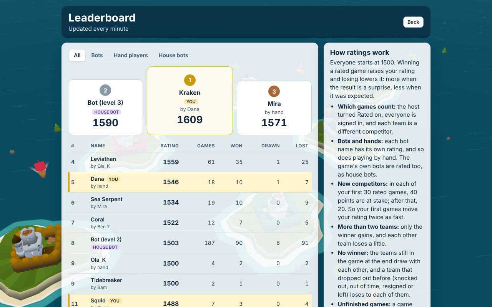 | 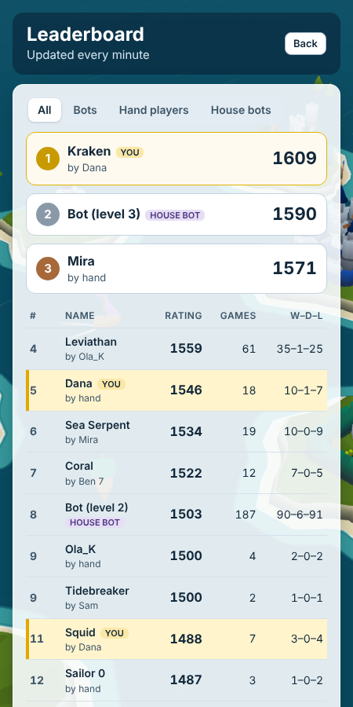 |
| A competitor | 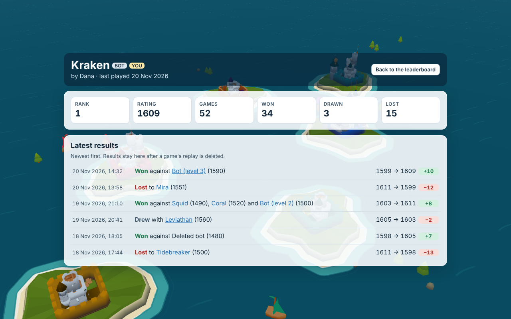 | 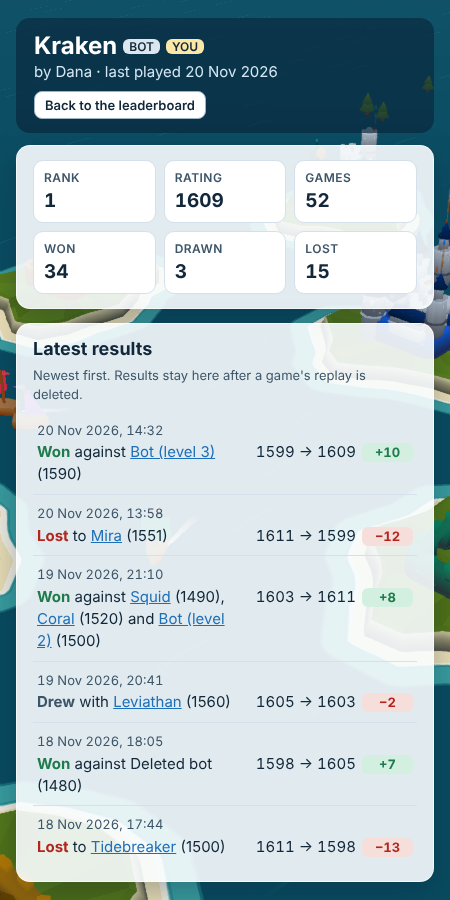 |
| Not listed | 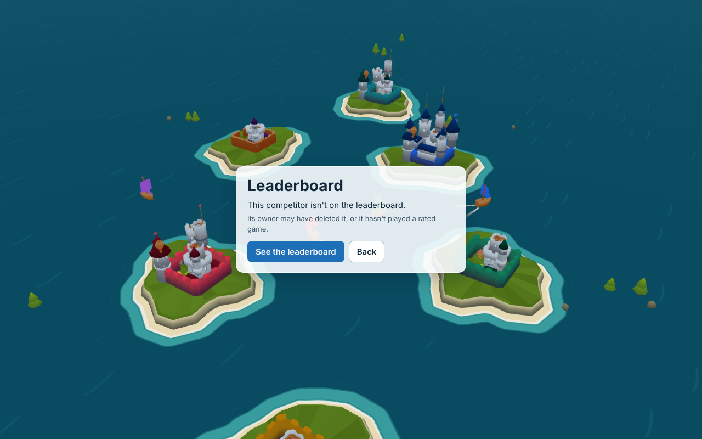 | 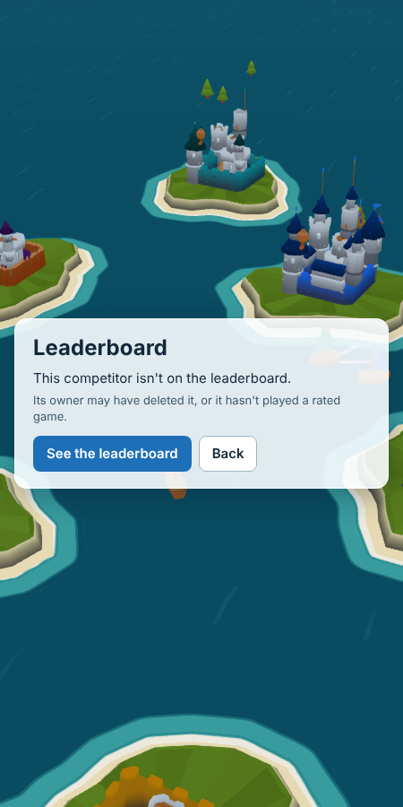 |
| Empty | 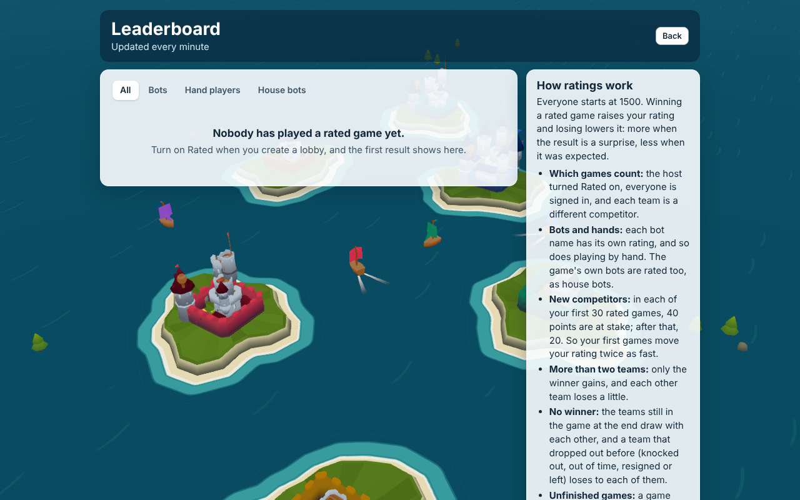 | 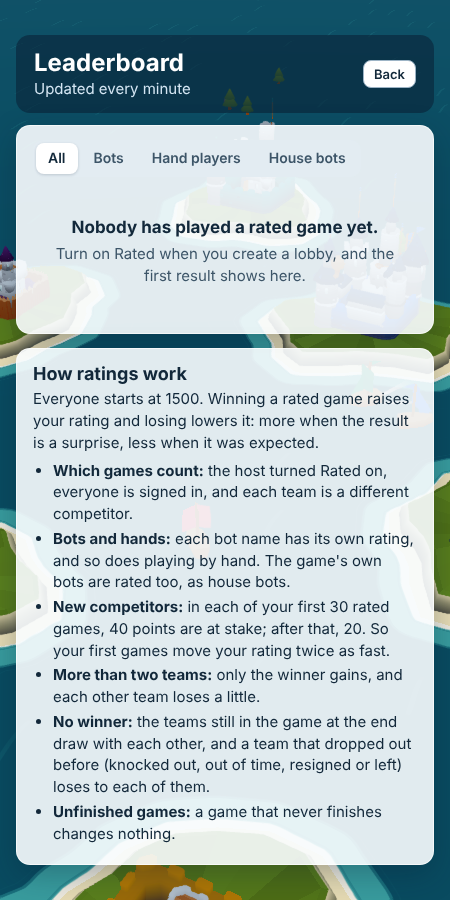 |
| Name screen's link | 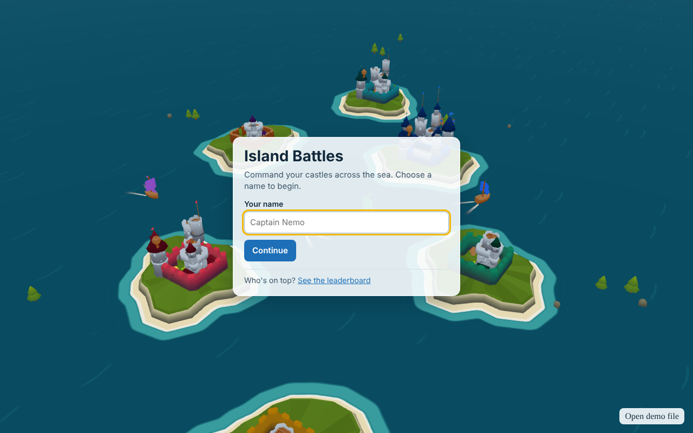 | 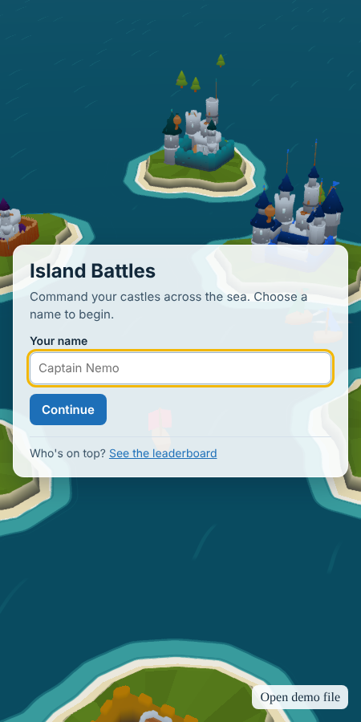 |
| Menu's link | 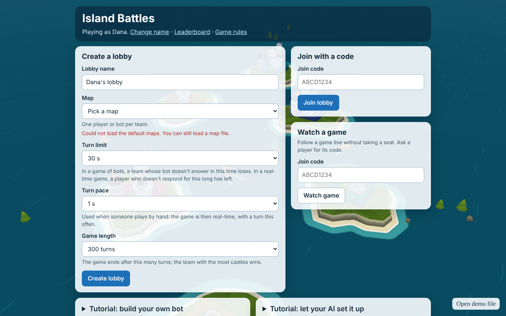 | 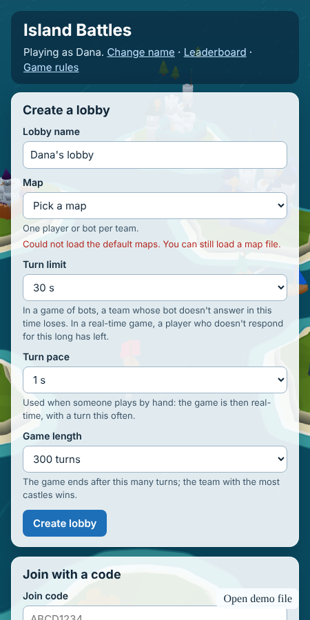 |

The screenshots use made-up names against stubbed answers, as seen by a person whose competitors are Kraken, Squid and their hand play, Dana.

## The game view

`src/ui/game/` is the screen a player sees once their lobby starts: the 3D board with a HUD, a timeline, the outcome and the bot logs. `mountGameView(container, { lobbyId, round, realtime, onBack })` shows the game of a lobby round live; `mountDemoView(container, { file, onBack })` opens a saved demo file with no server. Both return `{ dispose() }`. The lobby screens ([#98](https://github.com/INTODAN/island-battles-go/issues/98)) own the app shell and call them (an **Open demo file** button on the name and create-or-join screens opens a demo; the shell follows the game for the relay and passes the view a `realtime` whose `leaveGame()` does nothing, so the relay keeps running while the view mounts, swaps to a demo or goes away); [#103](https://github.com/INTODAN/island-battles-go/issues/103) reuses the same screen for spectators. `/?game=<lobby_id>` (for the guest session saved in the tab's `sessionStorage`) and `/?demo` or `/?demo=<fixture.json>` open them alone from the dev server, beside the app shell.

- **History** (`live.ts`): the view subscribes to the player channel first (`realtime.followGame`), then loads `GET /game/from-lobby/{lobby_id}/demo`, then merges the live generations into it by `id`, ignoring ones it holds (`history.ts`). A turn that arrives while the history loads is kept and merged after it. After a reconnect the history is read again and merged, so a turn the channel skipped is not lost. Turns are numbered by their index in the history, "Turn 37 / 120", because generation IDs have gaps.
- **Timeline** (`controller.ts`, no DOM): play/pause, step back and forward, a scrubber and **Follow live**. Playing forward and stepping forward use the turn animation of `src/scene/animation/`; scrubbing and stepping back seek with no animation. Follow live turns off when you scrub back, and on when you return to the newest turn of a running game; pausing while following stops following. When the game has an outcome, or in a demo, nothing follows, and the timeline stays usable.
- **HUD** (`screen.ts`): **Rated game** first in a rated game's teams box ([Rated lobbies](#rated-lobbies)), each team's name, colour and players, its soldiers (in castles and on the way) and castles for the shown turn, the turn, and a connection indicator. A player who plays by hand also sees their team marked, a turn pace bar, order feedback, a status row and a **Controls** panel: see [The hand player's view](#the-hand-players-view). In a real-time game, the card of a team that has left says **Resigned** or **Left the game** while the shown turn has the team out (`history.ts` `departureText` and `mergeDepartures`): from `GenerationState.departures` or `WatchState.departures` as turns arrive, during the game, and from the outcome's `departures` at the end, so a demo shows it too and scrubbing back to before the team left drops it.
- **Resign** (`resign.ts`, pure, and `screen.ts`; #348): see [Resigning](#resigning). The outcome banner prints the outcome's `summary` as it is, so "Blue resigned; Red wins as the last team standing", "Red left the game: Sam didn't respond for 30 s; …" and "The game was abandoned: …" need no code; no module lists the outcome's `reason`. Under it, a rated game's banner lists each team's rating change, the winner first ([Rated lobbies](#rated-lobbies)).
- **Bot logs** (`logs.ts`): a collapsible panel for the shown turn. The history carries the logs it could see when read; a live turn's logs are read with `GET .../logs?generation_id=N`. While teams are hidden it says "Logs of other teams appear when the game ends", and when the outcome arrives it reads them again. The open turn, the newest of a running game, has no settled logs yet: logs read while a turn was open (the history's newest turn while the game runs; the panel never asks for the open turn itself, though `live.ts` would mark such a read provisional too) are provisional and read again once a newer turn exists. While the open turn is on screen (following live), the panel shows the latest turn that has ended instead, and says so; while that turn's logs load it keeps showing the newest earlier turn it holds. The panel reads nothing while it is closed; while open, it reads a turn once it has stayed on screen for 300 ms, or, while the turn keeps changing, the turn on screen once a second.
- **Demo files** (`demoFile.ts`): a TypeScript port of `backend/demoviewer/demo-file.mjs` against the generated `Demo` type, with the same checks and messages (format, `schema_version`, the 128 MiB cap, every drawn value), and a check of the outcome's `ratings`, which only this client draws. The file is read in the browser and uploaded nowhere. A demo from an unfinished game says so. A wrong file shows its message and leaves the game or demo shown before open.
- **Ask your AI agent** (`agentPrompt.ts`, pure, and `screen.ts`): a button in the top bar of the live and demo views (#282). It copies a prompt for the player's AI agent to the clipboard: how to install and register the [island-battles MCP server](../island-battles-go/cmd/island-battles-mcp/README.md), the game (the lobby's join code for a live game, from the lobby snapshot or the watch, which loads the lobby's newest game; the file name for a demo), the player's team, and the turn the replay is on ("turn 40 of 57"). When the view doesn't know the lobby's code, the prompt says so and asks the player for it. Off production, the `claude mcp add` line passes the client's game and lobby URLs with `--game-url` and `--lobby-url`. When the clipboard refuses, as some web views do, the prompt shows in a text box to copy by hand.
- **Save demo** (`saveDemo.ts`, `sources.ts`): a button in the top bar of a live view, for a player (`GET .../demo`) and a watcher (`GET .../watch/demo`), through the API client. The response text is saved as the server sent it with a `Blob` and a temporary `<a download>` link, named from `Content-Disposition` or else `island-battles-game-<game_id>-generation-<n>.json`; the file opens again with **Open demo file** and in the 2D demo viewer. The button is disabled while the request runs and a failure shows a line under the top bar. An opened demo has no such button. Desktop app: a download link may do nothing in its web view (no Tauri plugin is used), so the owner checks it ([#119](https://github.com/INTODAN/island-battles-go/issues/119)).
- **Clash summary** (`clashes.ts`, pure): under the outcome, "Clash: Blue 5 → 3 · Red 4 → 0" for each clash of the shown turn (soldiers before and after; 0 means the group was stopped), joined with ". "; empty and hidden when nothing clashed. The same sentence as the 2D replay.

The view gets its game from a `LiveSource` (`sources.ts`): `playerSource` (the player channel, `/demo` and `/logs`) for `mountGameView`, and `watchSource` (the watch channel, `/watch/demo` and `/watch/logs`) for `mountWatchView`, described next. The turn deadline call (`POST .../deadline`) is not made here: the relay of [#98](https://github.com/INTODAN/island-battles-go/issues/98) does that, and for a player who plays by hand, hand play (below). `mountGameView` also takes `handPlay`, the player's [hand play](#hand-play), which the shell starts; the view's controls give orders through it.

## Playing by hand

A player who chose **Play by hand** gives orders on the board of the game view while their status is `playing` and the view shows the newest turn. Scrubbed back in the timeline, the board's controls are a watcher's and a row above the timeline says "Return to live to give orders".

- **Send soldiers:** press on one of your castles and drag to another castle, with a mouse or a finger. A line follows the drag from your castle's shore, in your team's colour, and snaps to the shore of the castle under the pointer, which gets a white ring; a chip over your castle shows what the drag sends, such as "12 of 23" (of its unreserved soldiers). Releasing over the castle sends the soldiers; the line stays, dimmed, until the turn with the new boat is on the board, and flashes red if the server refuses the order, whose sentence shows under the notice line. A drag that starts anywhere else turns the board as before; the board never turns for a drag that starts on your castle.
- **Cancel:** release anywhere else, press `Esc`, press the right button, or put a second finger on the board (which then pans or pinches the board).
- **The amount:** every drag sends all unless you change it, and the next drag sends all again. During a drag: `d` all, `a` half, `w` and `s` one soldier more or less (faster while held), digits type an exact number (`Backspace` edits it, and with nothing typed leaves the amount as it is; it is capped at the castle's unreserved soldiers). Keys are ignored while a text field has the focus.
- **The amount bar**, above the timeline: a slider between a **Half** and an **All** button. Before a drag it sets the share the next drag sends ("Send 50%"); during a drag it moves in whole soldiers of the dragged castle, so a touch player sets it with a second finger while the first holds the drag. Its buttons are 44 px on a touch screen. A press on its buttons, or a finger on its slider, keeps the focus on the board: Babylon's canvas `blur` listener makes up a release for every pressed pointer, which would drop the drag the first finger holds. A second finger's tap on Half or All presses the button on its `pointerup`, because a browser fires no `click` for a second finger; a mouse's press on the slider does take the focus (cancelling it would stop the browser dragging the slider), so the arrow keys then move it.

The rules live in `src/play/drag.ts` (pure, tested in `drag.test.ts`): a press on your castle holds its pointer (`holdCameraPointer` in `src/scene/camera.ts`, whose `BoardPointersInput` ignores that pointer's one-pointer moves) until it is released, whatever happens to the drag; more than 8 px makes it a drag. `src/scene/dragControls.ts` feeds it Babylon's pointer events, keys and the bar, draws the line (`dragLine.ts`, with the heading arrows' `ribbonGeometry`), and gives the order with `handPlay.send`, as a share of the unreserved soldiers resolved when it is sent, or an exact number. A release only counts from a real `PointerEvent` of the main button: Babylon makes up a release for a cancelled pointer and a blur, and those cancel. Only the held pointer's `pointercancel` and the window's own `blur` cancel a drag. Between castles too close for an arrowhead the line is a headless stub; with less than the least shaft between their shores there is none. `src/scene/dragControls.test.ts` drives the real controls and camera input in Babylon's `NullEngine` with `./battlefield` mocked.

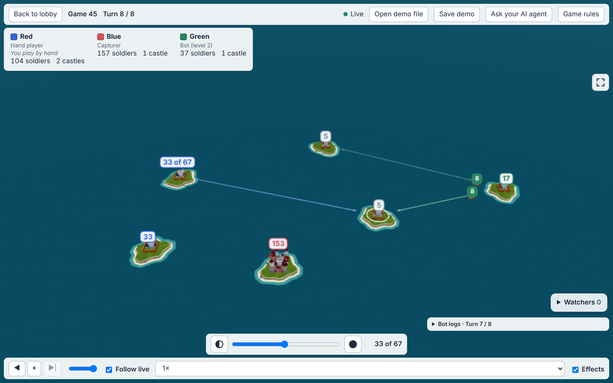

Recording: [a send, with `a` for half during the drag](../../docs/screenshots/drag-to-send.gif). At 450 px: [a drag](../../docs/screenshots/drag-to-send-450.png) and [the bar after a tap on Half](../../docs/screenshots/drag-to-send-bar-450.png); at desktop width: [the bar before a drag](../../docs/screenshots/drag-to-send-bar-desktop.png) and [during one](../../docs/screenshots/drag-to-send-bar-dragging-desktop.png).

With `debug=1` in the page's URL, `window.gameViewDebug` (`src/ui/game/debug.ts`) gives browser tests the castles' screen positions, the camera and the board's labels.

### The castle menu

A hand player buys upgrades and orders bursts from a menu on one of their castles (#344).

- **Opening it.** A right-click that didn't drag (the pointer moved less than 8 px), a double-click or a double-tap on your own castle opens its menu beside the castle, inside the board. It opens only while you play (hand play's status is `playing`) and the view shows the newest turn. A right-drag still pans the camera, and the browser's context menu never shows over the board. One menu is open at a time: opening it on another castle closes the first. For a hand player who plays, a double-click never focuses the camera, so on a castle that isn't yours it does nothing; `F` and the Fit button still refit the board. Watchers, demos, players with a bot, and a hand player whose team is out or whose game has ended keep the double-click focus.
- **Closing it.** `Esc`, the close button, or a click or tap outside it (a drag outside, which turns the camera, doesn't); and by itself when the castle stops being yours, when the game ends or your team is out, and when you scrub back from the newest turn. The focus then goes back where it was.
- **What it shows.** A heading with the castle's name and its soldiers free to spend (what this turn's orders left). One row per upgrade (Speed, Stop, Growth, Burst): what it does, the level now and the next with the effect of each, such as "Speed 2 → 3: 1 → 1.5 units a turn", and the cost. An upgrade ordered this turn shows as ordered, and the row then offers the level after it. An **Order a burst** row has a slider from 1 to the castle's burst potential, counting this turn's upgrades, and an **Order burst** button. A row that can't be ordered says why: "Maximum level", "Needs 20 soldiers; the castle has 12", "No burst potential yet", "Repaying a burst: 5 soldiers left" or "Already ordered this turn"; every row waits with "Loading the costs…" until `GET /game/upgrades` has loaded.
- **Ordering.** A click (or `Enter` or `Space` on a row) orders at once, and the menu stays open and updates, so you can buy several things. A refusal, or the server's rejection when the order settles, shows its sentence in the menu and in the order feedback line under the top bar (`HandSurface.showOrderFeedback`), which announces it.
- **Keyboard, touch and screen readers.** The menu is a non-modal dialog named after its castle; it takes the focus when it opens (its first row), `Tab` moves through the rows, the slider and the buttons. A disabled row stays focusable, marked `aria-disabled`, so a screen reader reads its reason. Rows and buttons are at least 44 px high.
- **Code.** The rules, with no DOM and no Babylon, are `src/play/castleMenu.ts` (`menuAllowed`, `MenuGestures`, `doubleClickFocuses`, `castleMenuModel`, `placeMenu`), tested in `castleMenu.test.ts`; the numbers and refusals come from hand play's ledger, `check` and upgrade table. `installBoardControls` (`src/scene/picking.ts`) feeds `MenuGestures` from its right-button presses, its taps (Babylon's `POINTERTAP`, a right-click among them) and its double taps, and calls its `onCastleMenu` option. Babylon counts two presses within 300 ms anywhere as a double tap, so the menu opens only when both were on the same castle, and a finger's second tap on the same castle up to 450 ms after the first counts too. `src/scene/castleMenuInput.ts` projects the castle onto the screen, as `LabelLayer` places its labels; `src/ui/game/castleMenu.ts` draws the menu in the game view's overlay and moves it after every frame, so it follows its castle while the camera moves and turns play.

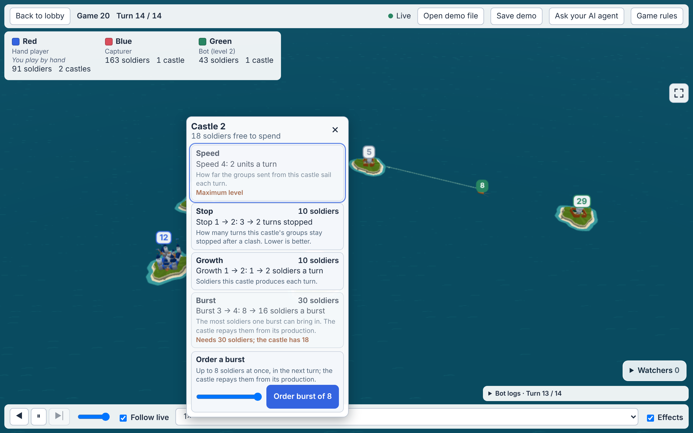

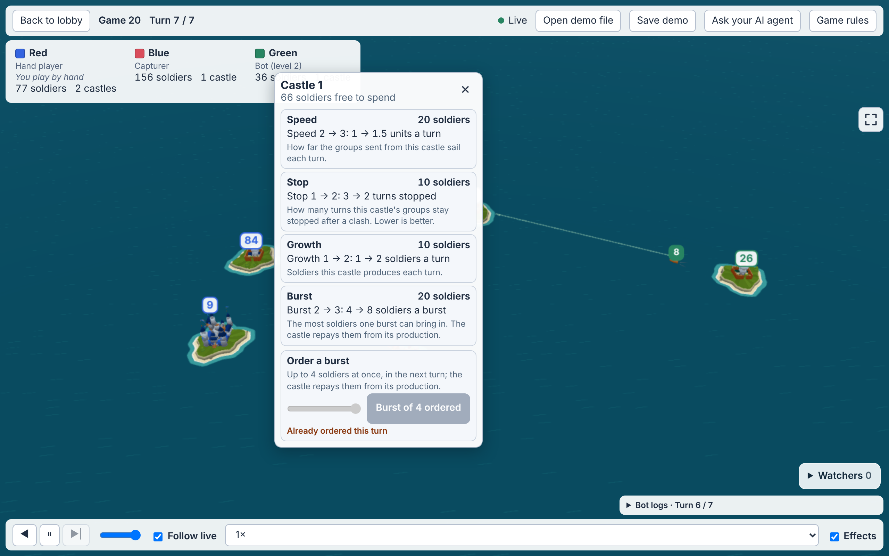

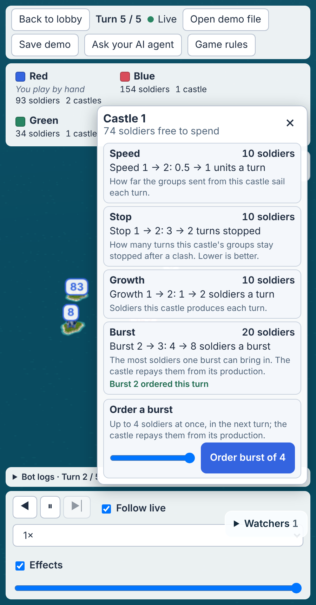

### The hand player's view

What the game view adds for a player who plays by hand (#345). `handView.ts` (pure) decides it from hand play's `status` and the view, and `screen.ts` and `handHud.ts` draw it. A watcher, a demo and a player whose bot plays (whose hand play stays `idle`, though its `turn` and `castles` are filled) get one constant, `NO_HAND`: today's view.

- **Your team.** Its card has an outline in its colour and a **You** tag, and the line under it says "You play by hand". It stays marked after the team is out.
- **The turn pace.** While the status is `playing` in a real-time game, a thin bar beside the turn fills over each turn, from `turn.startsAt`, `endsAt` and `paceMs` (`paceSegment`). It is a Web Animation on `transform`, restarted for each turn, so no script runs per frame: a turn that ends late leaves it full until the next state arrives, one that ends early restarts it at once, and after a hidden tab it is where the time says. With `prefers-reduced-motion: reduce` it is the words "1 s a turn". Screen readers get "A turn every 1 s" (`role="img"`).
- **Order feedback.** Its own line under the problem line (`p.gv-notice.gv-order-notice`, `role="alert"`), written only through `HandSurface.showOrderFeedback(sentence, orderId?)` (`notices.ts`): the newest sentence shows for 5 s, each call restarting the time; from the second order refused within that time a count follows, "(3 orders refused)", which also makes a screen reader announce a sentence that repeats; one order is counted once, whether the drag, the castle menu or hand play reports it, and a refusal before sending (no order id) counts each time, so a repeated sentence is announced too. The game view subscribes to `onSettled` once, so every rejection shows, also of an order whose control is gone. The problem line (`setNotice`: connection, session, demo file) is untouched.
- **The status row** above the timeline (`div.gv-hand-status`, its sentence in a `role="status"` span): scrubbed back in a running game, "Return to live to give orders" with a **Return to live** button; when the team has no castle and no soldier group, "Your team is out. You are watching the rest of the game." until the outcome. The status follows the open generation, so that sentence comes about a turn before the board has played the capture.
- **Back to live.** For a player who plays by hand, **Return to live**, ticking **Follow live**, and a tab that comes back to the front with two or more turns waiting all jump to the newest turn (`controller.scrubTo`) instead of replaying the turns missed at up to 4x, so orders are given against the open generation at once. The speed select is hidden while they follow live, where it does nothing.
- **The board keeps up.** While the status is `playing`, the turn player times live turns with `PLAYING` instead of `WATCHING` ([Turn animation](#turn-animation)), so the board shows the open generation as its turn ends: measured on the local stack at a 1 s pace as how far the board is behind the open generation when the next one arrives, a median of 0.00 turn (p95 0.05, about 48 ms) after the first few turns, against 0.98 turn (about 1 s) with the watcher's timing as it was then; at a 0.5 s pace 0.01 (p95 0.08) against 3.1 turns. The watcher's timing now keeps half a turn behind at any pace (#361), so a hand player sees the open generation about half a turn sooner than a watcher. The price: a turn that arrives late stops the boats until it does, so the board never shows an old generation for a new one. Without added delay that was under one stop per 100 turns; with up to 150 ms of delay on each turn's end, 14 short stops per 100 turns, the longest 92 ms. The counts the drag's chip and the castle menu show come from hand play's `castles`, not from the animated board.
- **Controls.** A **Controls** button in the top bar, after **Game rules**, opens a panel in the top stack, above the fit button, listing the controls from one table (`controls.ts`): the drag, the amount keys, the amount bar with Half and All, the castle menu, cancelling, fitting the board and the camera. A touch screen (`pointer: coarse`, the primary pointer) gets the touch rows, other devices the mouse and keyboard rows; a device with both kinds of pointer can switch. It opens by itself the first time someone plays by hand, without taking the focus, remembered in `localStorage` (`island-battles-web.controls-seen`; where storage is blocked it doesn't open by itself). Opened with the button, the focus goes to its Close button and comes back when it closes; `Esc` closes it while the focus is in it, and otherwise belongs to the board's controls.

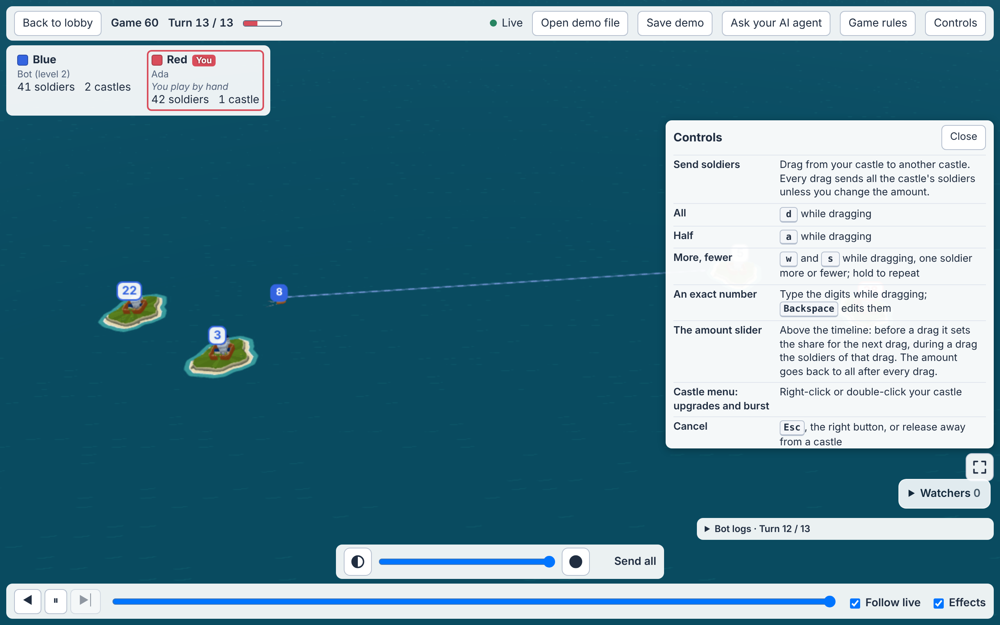

At desktop width: [the view](../../docs/screenshots/hand-view-desktop.png) and [scrubbed back, with Return to live](../../docs/screenshots/hand-view-scrubbed-desktop.png). At 450 px: [the Controls panel](../../docs/screenshots/hand-view-controls-450.png), [the view](../../docs/screenshots/hand-view-450.png) and [scrubbed back](../../docs/screenshots/hand-view-scrubbed-450.png).

### Resigning

A hand player can leave the game for good from the game view (#348). The **Resign** button is the last button of the top bar, shown only while `handPlay.state.status` is `playing`: a `manual` player in a real-time game, whose team is in it, with no outcome. A watcher and a demo have no hand play. A player with a bot has one whose status is `idle`, and a roster player's source is the only one with `resign`; none of them sees the button.

- **The question.** The button opens an in-page dialog (`role="alertdialog"`, not `window.confirm`): "Resign? Your team loses this game." with **Resign** and **Keep playing**. Focus goes to **Keep playing** and Tab stays inside; **Keep playing**, a click outside and `Esc` close it and give the focus back. `Esc` is read only while the dialog is open and not when `event.defaultPrevented`, because other features use it too (`confirmationKey`). The dialog closes by itself when the team goes out or the game ends under it.
- **The request** (`requestResign`, `playerSource.resign`). `POST /game/from-lobby/{lobby_id}/resign` through `gameApi`. A repeat is safe on the server, so a transport failure, a 5xx or a 429 is tried again twice (after 1 s, then 2 s) and then says "The resignation could not be sent: the game didn't answer. Try again." A 409 `game-ended` or `team-out` means the team is out already and the view reads the game again (`realtime.refreshGame()`). Any other refusal shows the server's sentence. Sentences appear on the order-feedback line (`hand.showOrderFeedback`), where a refused order's sentence appears. The answer, a `GenerationState`, is installed with `realtime.adoptGame`: when every other player has already finished the turn (bots do at once) the turn plays in that request and the answer is the next state, or the outcome.
- **The states** (`resignControl`, pure). **Resign**; **Resigning…** (disabled) while the request runs; after it succeeded **You resigned** in the button's place, until the turn plays and the hand play's status leaves `playing` (the team is out, or the game over). Against a hand player the turn plays at its end, at most one pace later; the view shows the outcome banner or, in a game with more teams, the team's card says **Resigned**.
- **Screenshots.** The question and the three endings' banners (the team cards say Resigned or Left the game), at desktop width and at 450 px:

  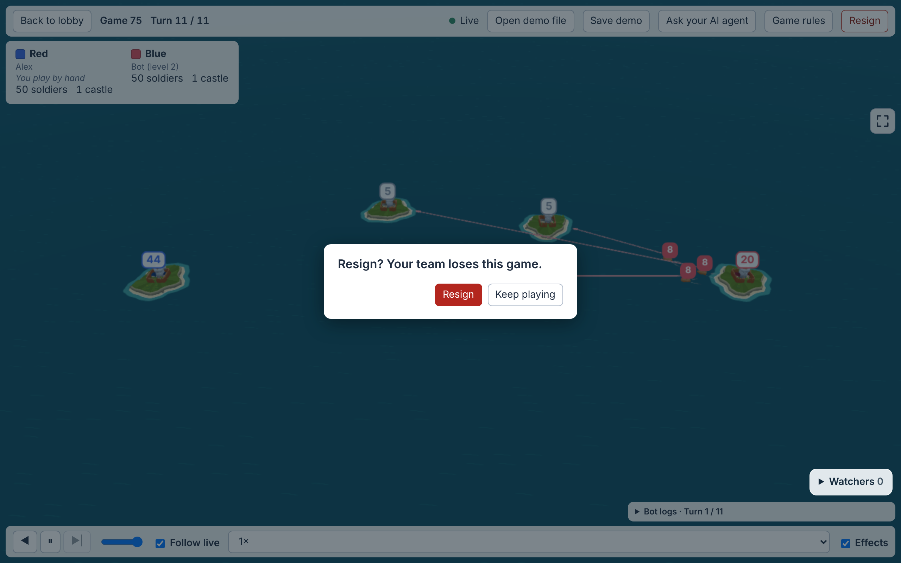 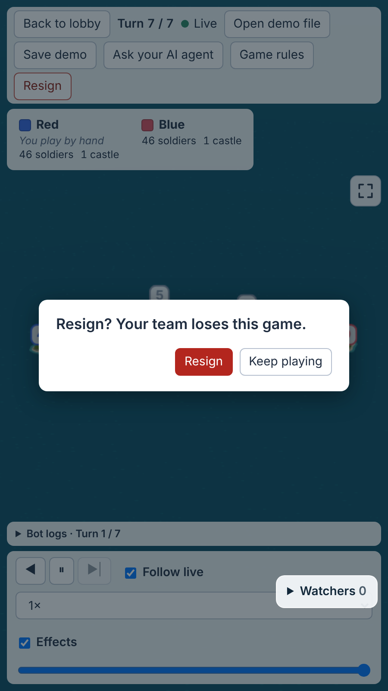

  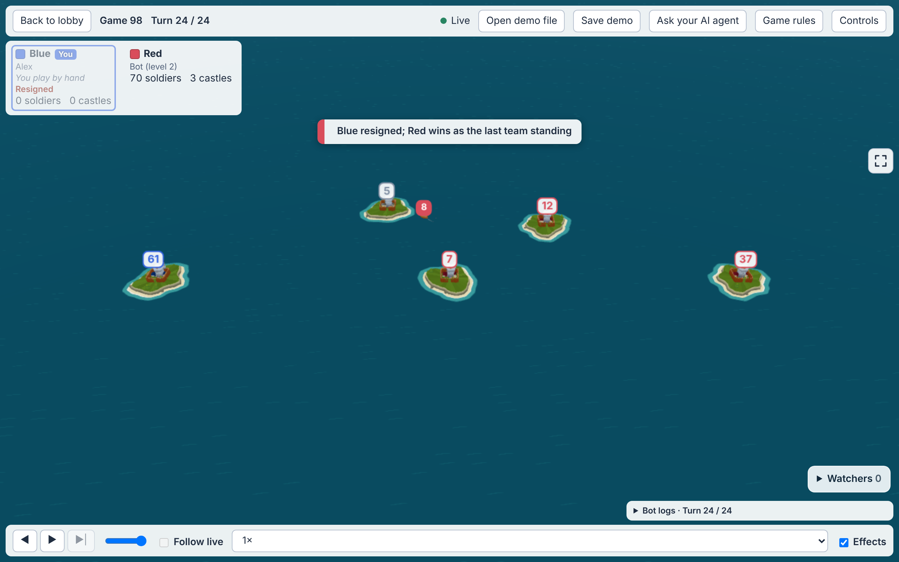 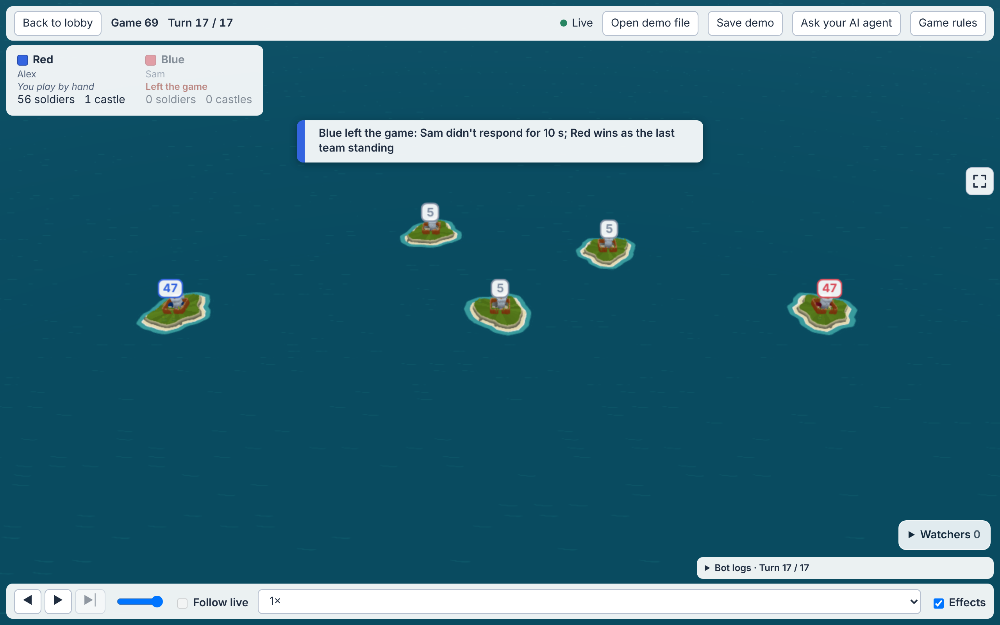 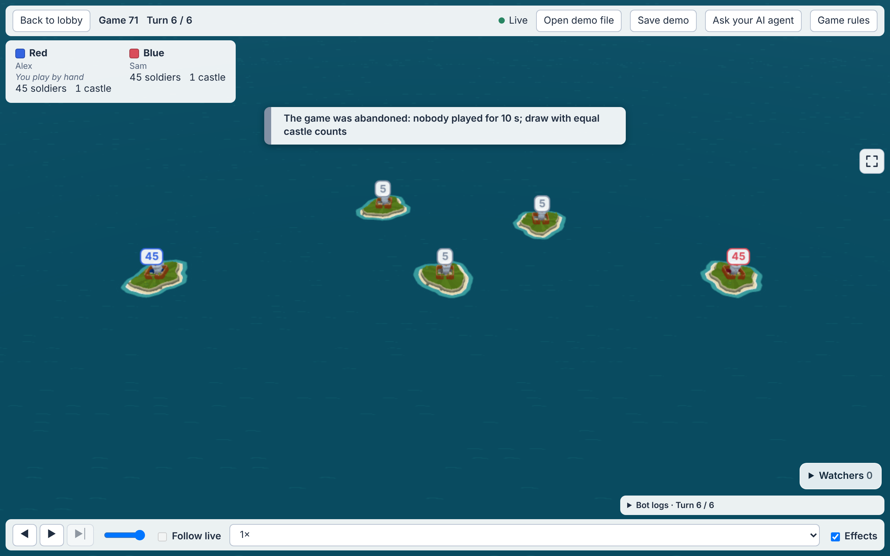

  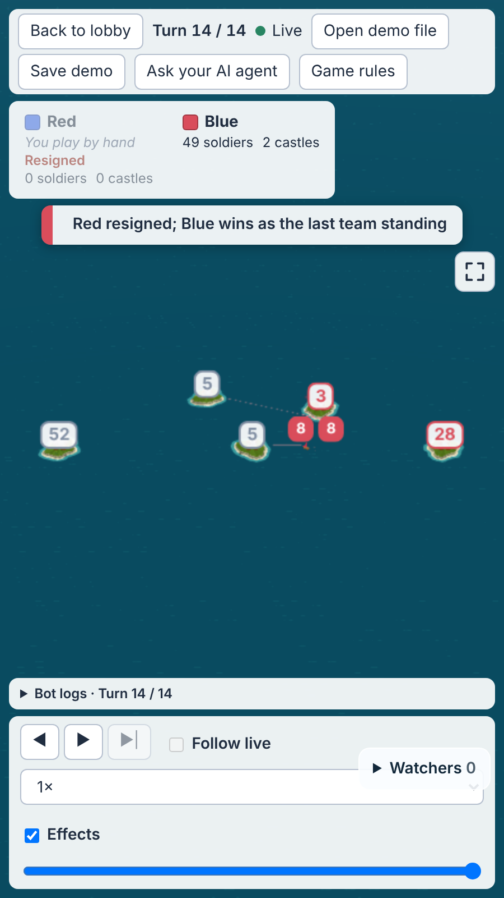 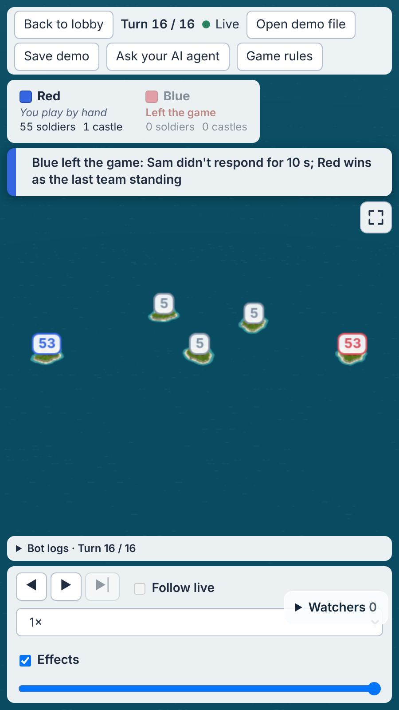 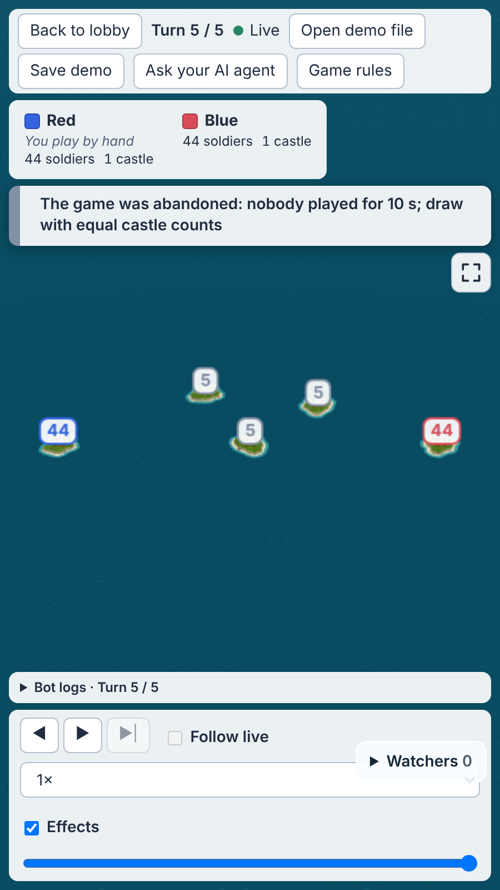

- **The animation.** When a team leaves, its castles are team colour 0 in the next generation with their soldiers, and its soldier groups are gone with no clash and no arrival. A group that vanishes without a clash would otherwise be planned as landing at its destination, so `planTurn` goes by the state's `departures` (`teamsDepartedAt`) to find the teams that left. Only for an old demo, saved before `departures` existed, does it fall back to the castles (`departedTeams`: a castle of theirs is neutral in the next generation, which fighting never causes). It turns their castles neutral at the start of the turn without growth, and sinks their groups where they lie.
- **While a resignation is pending** (the request is running, or it succeeded and the turn has not played) the board stands down: the drag, the castle menu and the status row's ask to return to live stop taking input, because the team's orders are no longer taken.

## Hand play

`src/play/` plays the seat of a player who plays by hand (bot kind `manual`, #342). It has no DOM and no Babylon imports. The app shell starts it in `enterGame` beside the relays (`startHandPlay({ realtime, lobbyId })`), hands it to the game view (`mountGameView`'s `handPlay`), and stops it with the game, so it keeps running behind the read-only room after **Back to lobby**. For any other player it stays `idle` and makes no request.

- **Orders.** `send`, `upgrade` and `burst` check an order as the server does (`rules.ts`, which mirrors `validateCommands` and `turnReservations` in `backend/services/`): a castle that isn't yours, zero soldiers, the same castle twice, more than the unreserved soldiers, an upgrade past its maximum or beyond the soldiers, a burst above the potential, with a debt or a second one in the turn. The castles' unreserved soldiers, levels and bursts count this turn's orders: those the server accepted, and those still being sent while their batch names the open generation. Costs, levels and burst potentials come from `GET /game/upgrades`, read once. An order that passes is sent at once as its own batch, `complete: false`, with a new `request_id`, one request at a time and in order; a hand player never completes a turn, the server ends it ([real-time games](../../backend/README.md#real-time-games)).
- **Failures.** Each request has 2 s to answer. With no answer, a 5xx or a 429, the same body goes again with the same `request_id` after 100 ms, doubling to 1 s; an order is not sent again when another attempt (the delay plus its 2 s to answer) could run past 5 s after its first, so it is never in flight longer than 5 s; then it, and every order queued behind it, is dropped with "The server didn't answer; the order may not have been given." A batch refused because its turn ended (problem type `urn:island-battles:problem:stale-generation`, or a 409 with no type from a server without it) is checked against the next generation and sent once more, or dropped with its sentence. Any other refusal drops the order with a sentence for its problem type. After the outcome, or once the team has no castle and no soldier group, orders are refused.
- **The turn clock.** In a real-time game (`turn_pace_milliseconds` isn't null) it calls `POST /game/from-lobby/{lobby_id}/deadline` 10 ms after `turn_deadline_at` by the local clock, and no later than the pace after the state arrived. While the answer shows the same turn open it asks again after 100 ms, doubling to 1 s. When one answer shows that a call went early (this computer's clock is ahead of the server's), it times the rest of the game by the pace alone. Answers are installed with `realtime.adoptGame`. A 401, 403 or 404 has `realtime` read the game again and the calls go on every 5 s. A turn that another client ended before this tab's call gets one call anyway if this tab hasn't called for 2 s, so the server keeps hearing from the player. The relay's own deadline watch stands down for exactly this player (`playsByHand`, passed as the relay's `standDown`), so a tab makes one deadline call a turn; once the team is out the relay's slower watch takes over, as it does for a player with a default bot, so a game of default bots still moves.
- **A hidden tab.** The server takes out a player it hasn't heard from for the lobby's turn limit (#347), and the deadline call is what it hears from an idle player. Browsers slow a hidden tab's timers, Chrome to once a minute after about five minutes, so hand play's timers run in a dedicated Worker (`ticker.ts`, an inline script from a Blob URL, so neither the build nor the dev server bundles anything) that posts each one back when it is due. Where a Worker can't start (a content security policy without `blob:` workers, for one), the timers fall back to `setTimeout`. Only Chrome was measured, with `tools/handplay/hidden-tab.mjs` (Chrome 153 on Linux, a 1 s pace, the tab hidden behind another tab for 8 minutes): its deadline calls came at most 1.06 s apart, all answered 200, while a plain 1 s `setTimeout` chain in the same tab slowed to once a minute. Firefox, Safari, Chrome's Energy Saver and Memory Saver, and phones weren't measured. A browser that suspends the page altogether, as phones do when the player switches apps, can't be helped: the player is out after the turn limit; a host who wants more slack picks a longer turn limit. The lobby heartbeat (`app.ts`) still runs on page timers; in that measurement it kept its pace, at most 16 s between beats.

### Using `src/play/`

Import from `src/play` (`index.ts`). The controls of the game view get the module as `handPlay` and call it; they never call the API themselves.

```ts
interface HandPlay {
  readonly state: ReadableStore<PlayState>;   // get() and subscribe(listener)
  send(originCastleId: number, destinationCastleId: number, amount: Amount): OrderResult;
  upgrade(castleId: number, upgradeType: UpgradeType): OrderResult;
  burst(castleId: number, amount: Amount): OrderResult;
  check(spec: OrderSpec): CheckResult;        // the same check, without giving the order
  onSettled(listener: (order: PlayOrder) => void): () => void;
  dispose(): void;                            // the shell's job
}
type Amount = number | { share: number };     // an exact number, or 0 < share <= 1
```

- **`state.get()`** is a `PlayState`: `status` (`idle` before the first turn or for a player who doesn't play by hand, `playing`, `eliminated`, `ended`); `teamColor`; `turn` (`gameId`, `generationId`, `turnNumber`, `paceMs`, and `startsAt` and `endsAt` in local epoch ms, fixed for the turn, for a pace bar; both null once the state has an outcome); `castles`, a map from castle ID to `CastleLedger` holding exactly your castles in the open generation, each with `soldiers` (the server's count, not the animated board's), `unreserved` (what this turn's orders left), `levels` and `ordered` per upgrade type (counting this turn's upgrades), `burstDebt`, `burstPotential` (null until the table loaded), `bursting` and `burstRefusal` (null when a burst of 1 would pass); `orders`, this turn's orders as `PlayOrder` snapshots (`id`, `spec`, `soldiers`, `generationId`, `state` `sending`, `accepted` or `rejected`, and `sentence` when rejected), which leave when the next generation arrives; and `upgrades`, the `GET /game/upgrades` table, or null until it loaded. `castles` and `turn` only mean something while `status` isn't `idle`: a player who doesn't play by hand has them filled but makes no request.
- **Giving an order** returns `{ ok: false, refusal, sentence }` when it is refused here, with nothing sent, or `{ ok: true, order, settled }`: `order` is its first snapshot and `settled` resolves (never rejects) with the last one, `accepted` or `rejected` with its `sentence`. A `PlayOrder` never changes; follow an order by `id` in `state.orders`, or by `settled`. **`onSettled`** calls its listener once for every order when it settles, including those of other controls; it is how to show every rejection, since at a 0.5 s pace a rejected order can leave `state.orders` before a render sees it. **`dispose()`** calls no `onSettled` listener, not even for the orders it drops (their `settled` promises resolve `rejected`), and leaves `state` at its last value.
- **Amounts.** A send's `{share}` is of the origin's unreserved soldiers and a burst's of the castle's burst potential (a burst takes no soldiers), resolved when the order is sent: rounded down, at least 1 (`resolveAmount`). So `{share: 1}` still means all when the castle grew meanwhile. An exact number is sent as it is. Until `upgrades` has loaded the burst potential is unknown: a burst by `{share}` is refused (`upgrades-not-loaded`), an exact burst goes to the server to check.
- **Disabled controls and their reasons.** `check(spec)` answers `{ ok: true, order }` with the soldiers resolved, or `{ ok: false, refusal, sentence }`. A `Refusal` has a `kind` and the numbers (such as `{ kind: "insufficient-soldiers", unreserved: 12, needed: 20, upgrade: { type: "speed", level: 3 } }`, or `{ kind: "burst-debt", debt: 5 }`), so a control can word its own reason; `refusalSentence(refusal)` is the module's wording. `upgradeCost`, `upgradeValue` and `upgradeTypes` read the table; `upgradeName` in `src/scene/format.ts` names a type (Speed, Stop, Growth, Burst).
- **Who plays by hand.** `playsByHand(state)` is true for a `manual` player in a real-time game, still in it, with no outcome. `realtime.adoptGame(state)` installs a `GenerationState` that another call answered (such as resign's) as a state read does.

## Watching a game

Someone outside the roster can watch a game live and scrub its history with only its join code ([#103](https://github.com/INTODAN/island-battles-go/issues/103)). **Watch a game** on the start screen takes a code, and `/play/?watch=CODE` (or `/?watch=CODE` in dev) asks for a name and then watches that game.

- **Starting.** The shell calls `POST /lobby/v1/watches`. A member of that lobby gets their own lobby instead. Anyone else gets the watch view, `mountWatchView(container, { lobbyId, channel, realtime, onBack })`, the game view in read-only mode: there is no lease, heartbeat, bot relay or deadline call. A reloaded tab watches again with the code it saved in `sessionStorage`. **Stop watching** removes the watcher row with `DELETE …/watch`.
- **Live turns.** `realtime.followWatch({ lobbyId, channel })` subscribes to the watch channel and keeps `realtime.watch` (the latest `WatchState`), reading `GET /game/from-lobby/{lobby_id}/watch` on every subscribe, by the install rules of the player's game. The history comes from `GET …/watch/demo`. A watcher who arrives before the start waits on the channel; the first turn loads the view.
- **Logs.** A watcher belongs to no team, and bots often log their plans, so while the game runs the logs panel says "Bot logs appear when the game ends" and reads nothing. Once the outcome arrives, it reads each shown turn's logs with `GET …/watch/logs?generation_id=N`, which then has every team's lines.
- **Kicked.** The host's kick unsubscribes the watcher at once. The read that follows gets 403, `realtime.problem` gets scope `watch`, and the view says "The host removed you from this game's watchers" and "Not receiving turns", keeping the turns it has. The code no longer lets them watch.
- **For members.** The lobby room has a **Watchers** card (`watchersPanel.ts`) with the count and names, read again on every lobby change; the host has a **Kick** button for each. The game view shows the same list in a small **Watchers** box over the board.

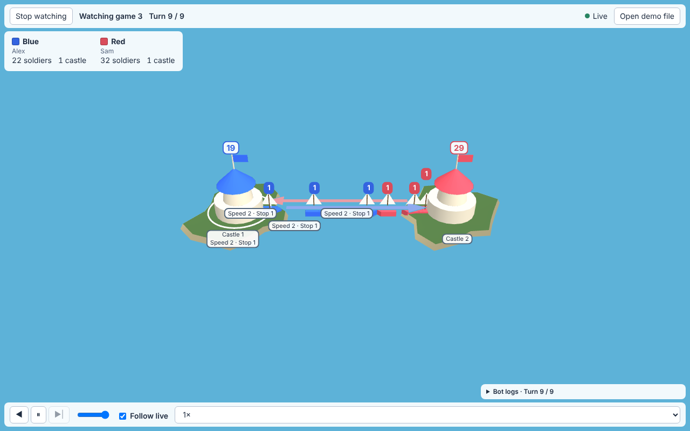

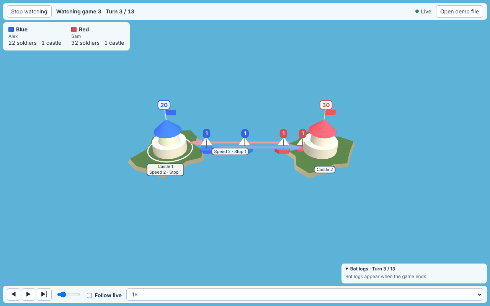

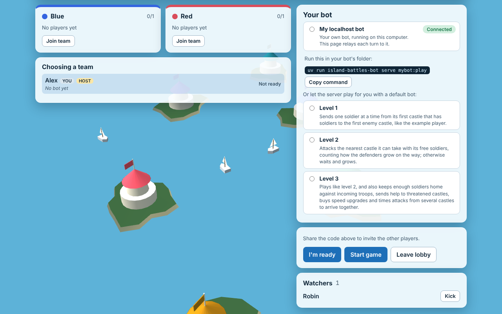

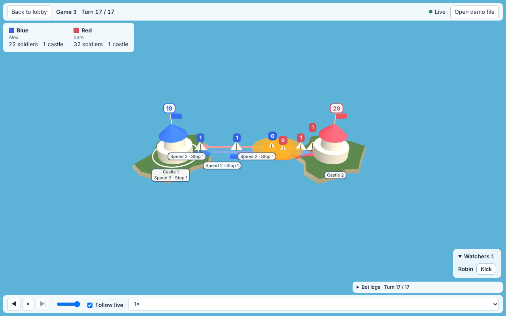

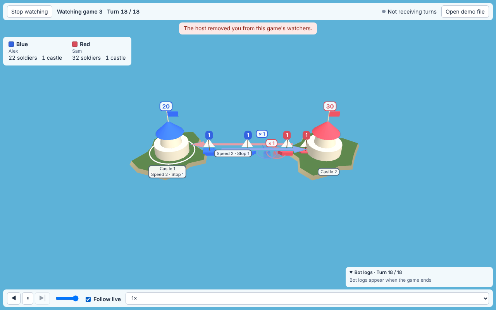

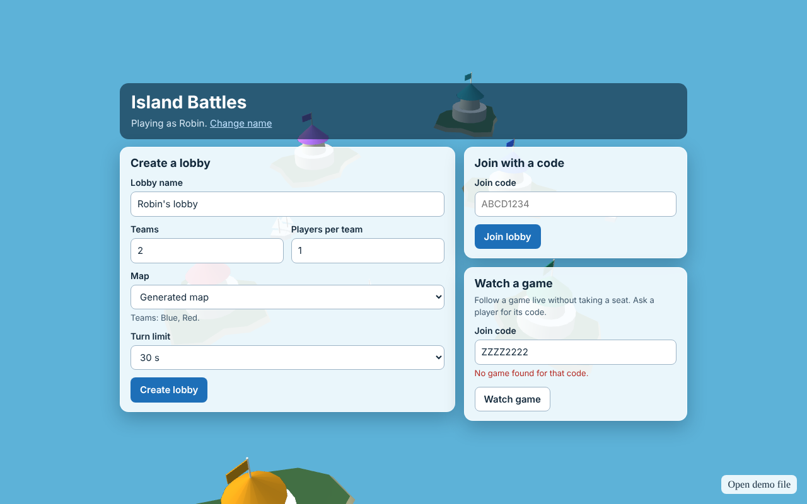

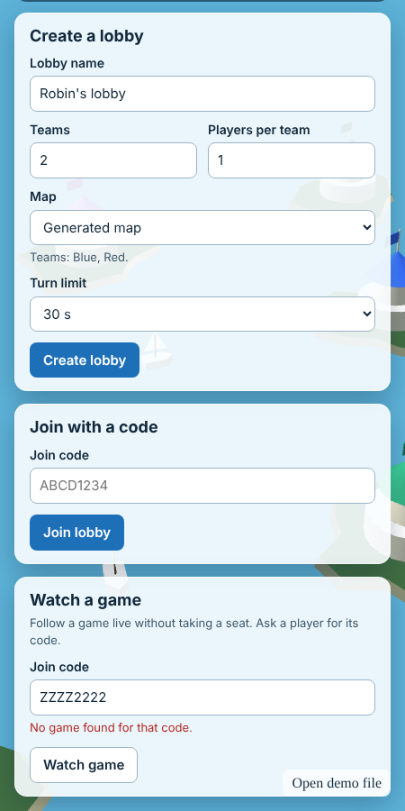 Screenshots of a live match, its outcome and a 450 px wide screen are in [`docs/screenshots/`](docs/screenshots/) (`game-*.png`).

## Layout

- `index.html`, `src/main.ts`, `src/styles.css`: the page and the Babylon scene. `src/main.ts` starts the dev page when the URL has `?fixture=`, and the lobby app otherwise. `@babylonjs/core` is imported from its ES module paths so the bundle tree-shakes; add the side-effect imports a feature needs (for example `StandardMaterial`) instead of importing the package root.
- `src/realtime/`: the Centrifugo session, described above.
- `src/bots/`: the localhost bot relay.
- `src/play/`: hand play, the orders and turn clock of a player who plays by hand, described above; `tools/handplay/`: its checks against the local stack.
- `src/ui/lobby/`: the lobby screens and the app shell's flow; `src/ui/game/`: the game view; `src/ui/rules/`: the Game rules page; `src/ui/account/`: the account page; `src/ui/leaderboard/`: the leaderboard; all described above.
- `src/scene/`: the 3D board, described above.
- `dev.ts` and `proxy.ts`: the dev server and its proxy rules.
- `assets/`: files the client loads (the castle models and atlas, and the environment texture), each with a row in `assets/LICENSES.md`; `tools/castles/`: the script that makes the castle files; `tools/environment/`: the script that makes the environment texture.
- `build.ts`: the production build, served under `/play/`; with `--desktop` the build for the desktop app, which talks to the servers in `desktopServers.ts`.
- `src/platform.ts` and `src/desktop.ts`: the game's and the lobby's URLs (from `config.json` in the browser), and what differs in the desktop app (built-in URLs, storage, HTTP plugin).
- `src-tauri/`: the Tauri shell of the desktop app, described above.

CI runs `bun install --frozen-lockfile`, `bun run check` and `bun run build` in [`.github/workflows/web-client.yml`](../../.github/workflows/web-client.yml). It deploys nothing.
