# Island Battles web client

A 3D browser client for Island Battles, written in TypeScript with [Babylon.js](https://www.babylonjs.com/). It has its own lobby screens (name, create or join, lobby room with a bot picker) over an orbiting ocean, delivers turns to a player's localhost bot, and switches to the game view when the game starts. The `src/scene/` layer draws any one generation as a 3D board, with the Unity game's castle models and the sea, islands, boats, light and effects restyled to match them (see [The 3D board](#the-3d-board) and [Art pass](#art-pass)). See [#94](https://github.com/INTODAN/island-battles-go/issues/94) for the plan.

The tooling is [Bun](https://bun.sh/) (runtime, package manager, bundler, dev server and test runner) and [Biome](https://biomejs.dev/) (lint, format and import sorting). Bun does not type-check, so `tsc` does.

## Prerequisites

- [Bun](https://bun.sh/) 1.4.4, the version pinned in `packageManager` in `package.json`. CI reads the same field.
- Docker with Compose (or Podman) and Go, to run the backend with `./scripts/dev.sh`.

## Run it locally

From the repository root, start the backend, Postgres and Centrifugo:

```sh
./scripts/dev.sh
```

Then, in this directory:

```sh
bun install
bun run dev
```

Open **http://localhost:3000/**. The dev server hot-reloads and proxies `/lobby/v1/*`, `/game/*`, `/generation/*`, `/map/*`, `/bots/*`, `/healthz` and `/openapi.json` to the backend on `http://localhost:8888`, so the browser talks to one origin and needs no CORS (the backend sends none). The Centrifugo WebSocket goes straight to `:8000`, whose allowed origins already include `http://localhost:3000`. The proxied paths live in [`proxy.ts`](proxy.ts). The dev proxy drops `content-encoding` and `content-length` from what it forwards, because Bun unpacks the gzipped demo itself.

## Commands

| Command | Does |
|---|---|
| `bun run dev` | Dev server with hot reload on `:3000` |
| `bun run build` | Production build to `dist/` with hashed asset names, for the `/play/` base path |
| `bun run generate` | Regenerates `src/api/generated/` from the API contract |
| `bun run generate --check` | Regenerates into a temporary directory and fails on any difference |
| `bun run check` | `biome ci`, then `generate --check`, then `tsc --noEmit`, then `bun test` |
| `blender -b -P tools/castles/convert.py -- <island-battles checkout>` | Rebuilds the castle models in `assets/castles/` from the Unity game (see [Castle models](#castle-models)) |
| `bun run tools/environment/sky.ts` | Rebuilds the environment texture `assets/environment/sky.png` (see [Art pass](#art-pass)) |

`bunx biome check --write .` fixes formatting, lint and import order. Commit `bun.lock`; CI installs with `--frozen-lockfile`.

## Desktop app

The same client as an app for Windows, macOS and Linux, built with [Tauri v2](https://v2.tauri.app/) ([#105](https://github.com/INTODAN/island-battles-go/issues/105)). It wraps the output of `bun run build.ts --desktop` in the system's web view (a few MB, not an Electron-sized download) and adds no game code. `src-tauri/` holds the shell: `tauri.conf.json` (window, bundle, CSP), `capabilities/` (what the window may call), `icons/` and a Rust crate that only registers the HTTP plugin.

**Build it.** Install Rust ([rustup](https://rustup.rs/)) and Tauri's [system libraries](https://v2.tauri.app/start/prerequisites/) (on Debian and Ubuntu: `libwebkit2gtk-4.1-dev build-essential curl wget file libxdo-dev libssl-dev libayatana-appindicator3-dev librsvg2-dev patchelf`), then, in this directory:

| Command | Does |
|---|---|
| `bun run build:desktop` | Builds the web client into `dist-desktop/`, served from `/`, talking to `https://island-battles.elidan.org` |
| `bun run desktop:build` | The above, then `tauri build`: installers in `src-tauri/target/release/bundle/` (`.msi` on Windows, `.dmg` on macOS, `.AppImage` and `.deb` on Linux) |
| `bun run desktop:dev` | A desktop **dev build**: the client built against `http://localhost:8888` (start `./scripts/dev.sh` first) and opened with `tauri dev` using `src-tauri/tauri.dev.conf.json`, which adds the local backend and its Centrifugo (`ws://localhost:8000`) to the CSP and HTTP scope. There is no hot reload; rebuild with the command |

The **Desktop app** workflow ([`desktop.yml`](../../.github/workflows/desktop.yml)) builds all three on manual dispatch (Actions, Desktop app, Run workflow) and keeps them as artifacts: `island-battles-windows`, `island-battles-macos-universal` (a universal `.dmg` for Apple silicon and Intel) and `island-battles-linux`. It publishes and deploys nothing.

**Unsigned builds.** Nothing is signed or notarized yet. Windows SmartScreen says "Windows protected your PC" (More info, then Run anyway); macOS says the app "cannot be opened" because the developer cannot be verified (open it once with right-click, Open, or allow it under System Settings, Privacy & Security); Linux shows no warning. Code signing, notarization and auto-update are follow-ups.

**One base URL, three environments.** `build.ts` replaces `__DESKTOP_API_BASE__` (read in `src/platform.ts`), so the browser build has none and uses its own origin (`/play/`, unchanged), `--desktop` uses `https://island-battles.elidan.org`, and `--desktop --dev` uses `http://localhost:8888`. `createApiClients` takes this as its default `baseUrl`, and nothing else in the client knows which build it is in, except the share link (`webClientUrl`, which points at the game's `/play/` rather than the window's `tauri://localhost`).

**Cross-origin: the HTTP plugin, not CORS.** The window's origin is `tauri://localhost` (macOS and Linux) or `http://tauri.localhost` (Windows), and the backend has no CORS on purpose. Two options were open: allow those origins with CORS on the backend, or send requests through [`tauri-plugin-http`](https://v2.tauri.app/plugin/http-client/), which makes them from Rust. The plugin was chosen because it needs no change to the backend, which stays free of CORS for every other client; it can be limited to exactly the game hostname and the bot port, so a bug or injected script in the web view cannot call anything else with the player's token; and system web views differ in what they allow cross-origin (Safari blocks `http://127.0.0.1` from an `https` or custom-scheme page), which requests made from Rust avoid. Every call of the client goes through `platformFetch` (`src/platform.ts`): the page's `fetch` in the browser, and in the desktop build the plugin's `fetch`, installed once at start-up by `src/desktop.ts`, which also resolves a path such as `/lobby/v1/sessions` against the base URL. (`globalThis.fetch` is deliberately left alone: Tauri's own IPC calls it, so replacing it with the plugin makes every call recurse forever.) The plugin's scope is in `src-tauri/capabilities/main.json`: `https://island-battles.elidan.org/*` and `http://127.0.0.1:41414/*`; `dev.json` adds `http://localhost:8888/*` for a dev build only.

**WebSocket.** `centrifuge-js` still runs in the web view and opens its WebSocket from the window's origin, which Centrifugo checks. The deployed template (`deploy/ansible/roles/app/templates/centrifugo-config.toml.j2`, via `app_desktop_origins`), `lobby/centrifugo/centrifugo-config.toml`, `docker-compose.yml`, `.env.example` and `scripts/dev.sh` allow `tauri://localhost` and `http://tauri.localhost`; any other origin is still refused. The CSP (`tauri.conf.json`) allows `wss://vm.elidan.org` for the production Centrifugo (`websocket_url` from `POST /lobby/v1/connection-token`); if the VM's hostname changes, change it there too.

**Localhost bots.** The relay's deliveries and the health check go to `http://127.0.0.1:41414` through the plugin, so no system web view decides whether a page may reach localhost (Safari refuses it from an https page; Windows and macOS web views differ). The plugin sends the web view's `Origin` (`tauri://localhost` or `http://tauri.localhost`), and `island-battles-bot serve` refuses origins it does not know, so both are in the bot server's default origins (`DEFAULT_ORIGINS` in `island_battles_client/cli.py`): the player passes no `--allow-origin`. Bot servers older than this change need `--allow-origin tauri://localhost --allow-origin http://tauri.localhost`.

**The guest session.** A browser tab keeps its session, room and watch in `sessionStorage`. The desktop app keeps them in `localStorage` (`tabStorage()` in `src/platform.ts`), which the web view stores in the app's data folder, so closing and reopening the app within the session's 24 hours signs in again with the same guest, and joins the same lobby again.

## API types and client

**Turn deliveries are a breaking change; bot servers must upgrade.** The relay now delivers each turn as a `TurnDelivery` to `127.0.0.1:41414/turn` and expects `202`; the bot submits its answer itself. A bot served by an older `island-battles-python` or Go SDK answers `422` and the relay asks the player to upgrade it.

**This is a breaking change; clients must upgrade.** The regenerated types add the lobby's `game_requirement` error code with its `type` field, `BotChoice`/`LobbyBots` and `PUT /game/lobbies/{lobby_id}/bot`, the required `GenerationState.bot` and `BotTurn.upgrades`. What to do: rebuild against the new types (`bun run generate`). Getting ready now needs a bot choice, so the web client's own lobby flow must show the bot picker and, for a localhost bot, relay each turn to it; that is [#98](https://github.com/INTODAN/island-battles-go/issues/98). Until then, choose the bot through the lobby page or the API.

**Member settings are a breaking change; clients must upgrade.** The bot choice moved into the lobby: `PUT /game/lobbies/{lobby_id}/bot`, `GET /game/lobbies/{lobby_id}/bots` and the `LobbyBots` type are gone, and a member's bot is their lobby `member_settings`, `{"bot": {...}}`, saved with `setLobbyMemberSettings` (`PUT /lobby/v1/games/{game_key}/lobbies/{lobby_id}/member-settings`) and shown in every snapshot member. What to do: rebuild against the new types and read the bots from the snapshot.

`src/api/generated/` is generated, never edited by hand, from the server's checked-in contract: `lobby/api/openapi.json` and `backend/api/openapi.json` with [openapi-typescript](https://openapi-ts.dev/), and `lobby/api/events.json` with [json-schema-to-typescript](https://github.com/bcherny/json-schema-to-typescript). After any change to those files, run `bun run generate` and commit the result. `bun run check` (and so CI, which also triggers on `lobby/api/**` and `backend/api/**`) fails while the generated files are stale. The generators live in the `tools/codegen` workspace because they need TypeScript 5, while the client itself uses TypeScript 7.

`src/api/client.ts` exports `lobbyApi` and `gameApi` ([openapi-fetch](https://openapi-ts.dev/openapi-fetch/)) for the page's own origin; `createApiClients({ baseUrl })` builds clients for another base URL. Call `setAccessToken` after creating a session: every lobby request except `POST /lobby/v1/sessions` then sends `Authorization: Bearer <token>`. The game client never sends the guest credential: its player routes (`/game/from-lobby/…` and `POST /generation/commands`) take a player token, which `src/api/playerTokens.ts` gets from the lobby's `POST /lobby/v1/player-tokens`, renews at 80 % of its life and once more when the game answers 401 (#218). Calls resolve with `{ data }` and reject with `ApiError` (`src/api/errors.ts`): `kind` is `problem` (with `code` for lobby, `problemType` for game, `title`, `detail`), `http` (error status without a problem body) or `transport` (no response). Responses are not validated, so unknown fields such as `$schema` are ignored.

## Realtime session

`src/realtime/` keeps one [centrifuge-js](https://github.com/centrifugal/centrifuge-js) connection (pinned at an exact version) and follows a lobby and its game. A watcher outside the roster follows a game with `followWatch` instead (see [Watching a game](#watching-a-game)). It has no DOM or Babylon imports, so `bun test` runs it. `createRealtime()` returns four typed stores with a tiny `get()` / `subscribe(listener)` API: `session`, `lobby` (`Snapshot | null`), `game` (latest `GenerationState | null`) and `connection` (`connecting | connected | disconnected`), plus `problem` for a session, lobby or game that ended.

- `signIn(name)` creates a guest session, or reuses the one saved in `sessionStorage` (`localStorage` in the desktop app) until `expires_at`. A 401 from any call, or from `getToken` (which re-calls `POST /lobby/v1/connection-token` when the 5-minute connection token expires), ends the session.
- `followLobby({ gameKey, lobbyId })` (or `adoptSnapshot(snapshot)` with a snapshot an HTTP call returned) reads the snapshot, subscribes to its channel and re-reads it on `subscribed` and on each `lobby.changed` with a newer `version`. `followGame(lobbyId)` subscribes to `player:<id>` and reads `GET /game/from-lobby/{lobby_id}/generation` on `subscribed`.
- Install rules (`install.ts`): a generation older than the one held, a duplicate, another game's state and anything after the outcome are ignored. Results of reads that finished after `leaveLobby()` / `leaveGame()` are dropped by an epoch counter.
- Every `connected`, `subscribed` and `unsubscribed` event asks for a reconciling read. Requests close together share one read, a failed read is retried with backoff, and nothing polls while idle.

Tests inject a fake Centrifugo client (`createClient`), fake `fetch` and fake storage. The turn deadline call (`POST /game/from-lobby/{lobby_id}/deadline`) is not part of this module.

## The 3D board

`src/scene/` draws one `Generation` (the `Generation` type from `src/api/generated/game.ts`) and knows nothing about the server. `renderGeneration(scene, generation, teams)` builds or updates meshes by castle, group and clash ID, so a later call moves and relabels what is already there rather than rebuilding it. Castles are the Unity game's models (see [Castle models](#castle-models)); the islands, boats, props, sea, light and effects are built in code in their style (see [Art pass](#art-pass)).

- `coordinates.ts`: the one map-to-world mapping. One map unit is `WORLD_SCALE` (1.75) world units, so the islands, castles and boats keep their size while the sea between them grows; `toWorldDistance` and `toMapDistance` convert distances, and sizes of things in the scene stay in world units; the map's `(x, y)` becomes `(x, 0, -y)`, so the board is laid out as the 2D replay is.
- `palette.ts`: the team palette, checked against `backend/services/replay.html` by a test.
- `board.ts` and `camera.ts`: the board fits the castles with a minimum of 8 by 6 units; the camera is a 3/4 `ArcRotateCamera` with tilt, zoom and pan limits. Double-click a castle to focus it, `F` to refit.
- `islands.ts`: island shapes are seeded by castle ID and never change; castles closer than 1.5 units share a landmass. An island's radius runs from 0.84 (`MIN_ISLAND_RADIUS`, 0.75 before #102) to 1.25 units.
- `shore.ts` (#167): where boats leave and land. The server moves a group in a straight line between castle centres, so a boat that has just left or is about to arrive is inside an island. `shorePoint(castle, towards)` is where the line from the castle's centre towards `towards` crosses that island's real, uneven waterline, plus `SHORE_MARGIN` (0.35 world units, about a boat length) out to sea; `drawnPosition(position, origin, destination)` gives the position to draw: the origin's shore point while the true position is nearer the origin than that, the destination's shore point while it is nearer the destination, else the true position. Both take and return map units (the islands are sized in world units, so the geometry is done in world units around the castle and converted with `coordinates.ts`). Between two castles of one landmass the point is where the line leaves the island's own outline and the boat crosses the bridge. The settled view (`updateGroup`, clash rings), the turn plan (`plan.ts`: every sampled pose and flash) and the tests all use it; heading arrows (#168) start where the boat is drawn and end at the destination's shore point.
  - **The land part of a trip** (#211): `groupLook(position, origin, destination)` says how to draw a group from its true position. While that position is inside a shore reach, the boat waits at the shore point and the group is a **squad** of soldiers walking on the island along the line between castle and shore. At the origin the squad walks from the gate (`GATE_RADIUS`, 0.42 world units from the centre) to just inside the grass edge while its boat is built at the shore (`build`: the hull rises from the keel, then the sail is hoisted), and is complete when they reach the edge; they then hop down into it over the last `BOARDING_SHARE` (20%) of the land part and the boat sails. At the destination the boat docks, the squad steps off and walks to the gate, and the empty boat shrinks away (`boatScale`). A trip between two castles of one landmass is walked the whole way, over the bridge, with no boat. Everything follows the true position, so a generation at rest and the end of the turn into it look the same. A squad (`createSquad` in `art.ts`) shows 1 soldier for 1 to 4, one more per doubling of the group, 5 at most (`squadSize`), in a small column, on the castles' shared and team materials (two meshes per squad); it bobs with the distance walked and its count label follows it.

    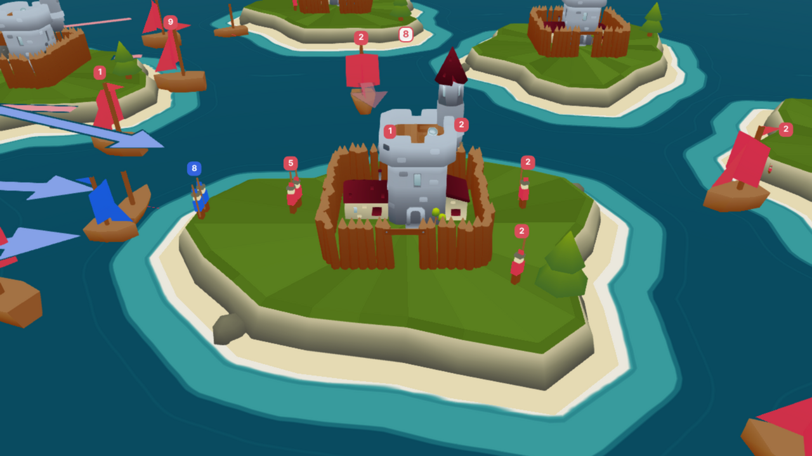
- `labelLayer.ts` and `labels.ts`: Babylon GUI labels linked to meshes. Only soldier counts and the clash labels ("−N", "× N") are drawn on the board. Castle counts and clash labels are pinned to their anchors and never move. Boat counts that overlap each other (also once a row has grown) are laid out side by side in a row, 4 px apart, centred on their anchors' mean screen position and ordered by their anchors' screen x, ties by ID ([#212](https://github.com/INTODAN/island-battles-go/issues/212)); a lone boat count stays at its anchor. So that they don't jump, a label leaves its row only once its anchor is clear by 4 px (where it is then already drawn), two labels in a row swap places only once their anchors have crossed by more than 4 px, and a label eases to a new place over about 150 ms. Then, when two labels still overlap, the lower priority one (castle count 100, boat count 80, loss 60, lost 30) fades out over 150 ms and comes back only when clear by 4 px. The castle's name and the upgrade levels are in the hover tooltip only (#166).
- `headingLines.ts`: the heading arrows of [#89](https://github.com/INTODAN/island-battles-go/issues/89), with the edge cases of [#168](https://github.com/INTODAN/island-battles-go/issues/168) fixed. Every size and choice is a value in `headingStyle` (world units). The rules, which the 2D replay follows too (see [`docs/troop-heading-lines/`](../../docs/troop-heading-lines/README.md)):
  - A line runs from just ahead of the boat's bow at its drawn scale (`BOAT_BOW` × scale + `startGap`) to the destination's shore point (`shore.ts`), where the boat will land. A line too short for its head plus `minShaft` is not drawn, checked after lanes and shared heads have moved it; one with little more shaft than that fades over `fadeLength`.
  - A boat still at its island's shore after launching has no line; it fades in over `launchFade` of sailing.
  - Groups of one team on one route are one line, the rearmost group's.
  - Visible lines that are within `parallelDegrees` of parallel (or of opposite) and closer than a lane over a shared stretch get lanes, whatever their teams, origins or destinations: lanes are half a head plus half a line plus `laneGap` apart (casings included). On one corridor, lines going one way keep to the right of their travel and lines going the other way to theirs; lines all going one way are centred on it.
  - At each castle, one team's lines arriving within `sharedArrowDegrees` (15°) in total share one arrowhead, compared round the circle; the other lines end at its base. Then every head at the castle, of every team, is moved round the shore as little as needed to keep `headGap` between neighbours; a shared or moved head points at the castle's centre.
  - A line has a gap where it passes within `castleGap` of another castle's centre, and the line of a group that is not moving (same position in the previous and next generation, or stopped by a clash this turn: `isHeld` and `stoppedByClashAt` in `animation/plan.ts`, the rule the rattle of #169 uses) is drawn at `heldOpacity`.
  - All lines are at one height, in rendering group 1 (which keeps the scene's depth), with alpha-blended materials that write no depth (`MaterialCache.overlay`) and `alphaIndex` by rank: lines never z-fight, and a later group ID is drawn over an earlier one.
- `animation/headings.ts`: the arrows during a turn (#168 case 13). `planTurnHeadings` decides once per turn, from the layouts of the turn's start and end, which groups have arrows, their lanes and their shared heads; `sampleTurnHeadings` then only moves them with the boats each frame. An arrow at both ends slides from its start lane and tip to its end ones; one only at the end fades in over the turn (a launched boat's once it leaves the shore); one only at the start fades out (until it sinks); a boat landing this turn keeps its arrow, getting shorter, until it lands. The turn starts and ends exactly as the resting views of its two generations look.
- `picking.ts`: hover highlight and tooltip (castle name, team, soldiers, upgrades; a boat's destination and upgrades), double-click focus and the `F` key. On a touch screen a tap on a castle or boat shows the same tooltip until the next tap elsewhere.

**Dev page.** With `bun run dev`, open `http://localhost:3000/?fixture=busy-turn.json` (add `&frame=3` to start on the third frame). It draws a saved game from [`test/fixtures/`](test/fixtures/) with a frame slider and needs no backend. The fixtures are demo files: `generated-map.json` (the generated map's first turns), `busy-turn.json` (a bot match with clashes and upgrades), `six-teams.json`, `bot-clashes.json` (generations 30 to 49 of the level 2 default bot against level 3 on the bot tournament's "archipelago" map, where all the clashes happen next to castles; written by `WEB_CLIENT_FIXTURES_DIR=<the same path> go test ./backend/services -run TestWriteWebClientBotFixture`) and `heading-arrows.json` (hand-written: one small scene per frame for the heading arrows' cases of #168: frame 1 two teams meeting at one castle, 2 opposite lanes, 3 two teams on one path, 4 lines passing other castles, 5 and 6 a group staying put, 7 shared heads, 8 a group stopped by a clash). Regenerate them by playing seeded bots with the backend's own simulation: from the repository root, run `WEB_CLIENT_FIXTURES_DIR=<absolute path to clients/island-battles-web/test/fixtures> go test ./backend/simulation -run TestWriteWebClientFixtures`. Screenshots of each frame type are in [`docs/screenshots/`](docs/screenshots/). The slider and arrows jump to a frame with no animation; **Play** plays the game on a turn at a time (`&play=1` starts playing, `&speed=2` sets the pace, `&turn=800` sets the length of a turn in milliseconds, `&still=1` freezes the castles' flags and windmills, `&fx=0` or `&fx=1` picks the graphics setting instead of the saved one). The page's **Effects** box is the same setting. `window.battlefieldDebug` has hooks for browser tests and recordings: `assets` (settles when the art has loaded), `stats()` (draw calls, active meshes and triangles of one frame), `particlePool()` (the particle pool's size, drops and busiest moment per kind), and `fixedTime(ms)` with `renderFrame()` (stop the render loop and advance a fixed time per frame).

### Turn animation

`src/scene/animation/` animates the turn between two generations. A generation holds end-of-turn positions only, so the animation is rebuilt from the clashes' `time` and contact positions and from the turn's rules (backend/simulation).

- `plan.ts`: `planTurn(previous, next)` is pure (no Babylon) and returns tracks over `t` in [0, 1]: a group's path (to the contact position at `clash.time` first), each group's true position over the turn (a group sent this turn starts at its castle's centre, as on the server, and an arriving one goes on to the castle's centre and lands there at its speed; `groupLook` in `shore.ts` turns that into a boat being built, sailing or docked, and a squad walking on land), sinking after `clash.time` for `soldiers_after == 0`, clash effects, counts that roll at the clash, castle counts and team flips when a capture lands, and a castle display-level change at the start of the turn, which plays the castle's level-up pop. `sampleTurn(plan, t)` gives every pose at `t`; at `t = 1` it equals the next generation exactly. A castle's count replays the turn's arithmetic (sends and upgrade cost at `t = 0`, growth by one for a castle a team owns, not for a neutral one, then landings in group ID order); a group sent and defeated within one turn is in neither generation and is placed by the soldiers missing from its castle.
- `player.ts`: `TurnPlayer` has `play(previous, next)`, `seek(generation)` (no animation, drops the queue, never leaves anything half-way), `setSpeed`, `setLive` and `scrub` (a frozen mid-turn still). It drives a `Stage`, so tests run it with a fake stage and a fake clock. It has two paces (#176):
  - **Stepping or playing** a saved or finished game (and the dev page): a turn takes 1.5 s times the speed select. The game view and the dev page queue the next turn from the player's `onIdle`, as a turn ends, so the time left in that frame carries into the next turn and boats sail across the turn's end without a pause.
  - **Following live** (`setLive(true)`, which the game view sets while **Follow live** is on): a turn plays over about the time between arriving turns: a running average of the gaps between arrivals (up to 4 turns that arrive within a quarter of that time of each other are a burst, and share the time to the next burst), kept between 250 ms and 3 s, and eased so that it changes over about half a second, never in a step. The speed select doesn't apply. A catch-up speed keeps about half a turn in hand, so that the next turn is usually known when one ends: it compares the turns waiting with those that would wait had every turn played at the pace since it arrived, and eases towards 1x plus half the difference (between 0.8x, never slower than 3 s a turn, and 4x) over a few hundred milliseconds.
  - A queue that builds up while stepping plays up to 4x, also eased. More than 10 turns waiting, and it skips to the newest.
  - A frame advances the player by its real time, at most 100 ms, so a tab that comes back to the front doesn't jump: the queue rules catch up.
- `stage.ts`: `SceneStage` applies samples to the meshes `renderGeneration` built, by castle and group ID. A turn's start and end only update what exists: a boat that lands or sinks during the turn keeps its mesh and label until the turn ends, only a group sent and defeated within the turn gets a boat of its own, and the heading arrows of a generation at rest are drawn once, at a turn's end, not again at the next turn's start (the islands are rebuilt only when castles move, as before). `createScenePlayer(scene, teams)` advances with the render loop.
- `rotation.ts`: a boat faces its destination. When that heading changes (a boat stopped off its line by a clash), `turnToward` turns it there the shorter way round, 95% of the way in 200 ms; a boat placed for the first time, and a jump to a generation, face it at once (`aimGroup`, `steerBoats` and `snapBoats` in `battlefield.ts`).
- The heading arrows move every frame of a turn: their positions are written into the ribbons' existing buffers, and a new buffer is made only when an arrow's shape changes (a gap opens or closes).
- `effects.ts`: what a turn shows besides movement, behind the small `TurnEffects` interface: cannon smoke, splashes and a flash at a clash, a sinking boat, a burst of the new team's colour at a capture (`castleCaptured`, called by the stage when a castle's team changes, also when the capture lands as the turn ends), and the level-up pop with a sparkle (see [Art pass](#art-pass)).
- **Clashes on land** (#213): most clashes happen next to a castle, while a participant's true position is inside a shore reach, so it is a squad on land (#211). A clash's flash, smoke and ring are drawn where each participant is drawn: at its squad on land, at its boat afloat. On land there is no splash: dust kicks up instead (`FlashPose.onLand`, the spray's particle kind). A squad that a clash stops faces its opponents (`facingOf`, the rattle track's `facing`) and scuffles, lunging and bobbing, instead of the boat's rattle; a defeated squad topples over and fades instead of sinking, and a boat it left half built at the shore fades away. The boat at the shore neither rattles nor sinks. The scuffle and the fall are not particles, so they play with Effects off too. In the settled view, a clash ring on land is drawn on the grass, and a group lost on land (its contact inside an island's waterline) has no sunk boat, only its ring and its "× N". A group sent out and defeated at its own castle in the same turn (a bot meeting attackers at its gate) is placed by replaying each of its team's castles with its soldiers sent, or else on the island where it was lost.

  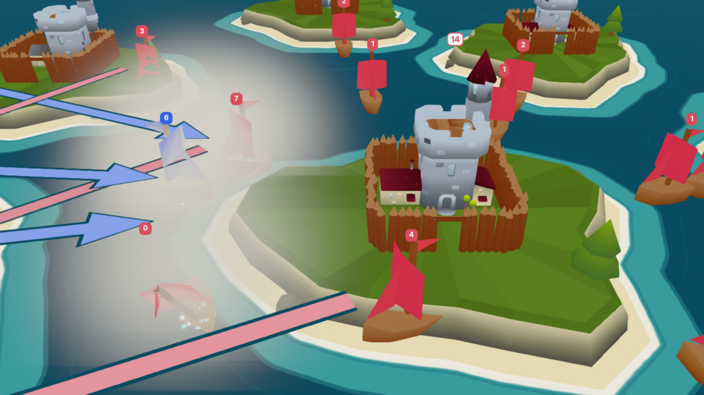

  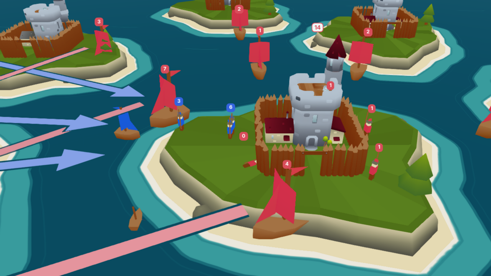

**Known limits.** A boat whose straight path crosses a third island still sails over it: only the origin's and destination's shores are handled.

### Castle models

Castles use the four castle models of the Unity game ([INTODAN/island-battles](https://github.com/INTODAN/island-battles), [#140](https://github.com/INTODAN/island-battles-go/issues/140)), one per upgrade level. Most of a castle is light grey stone; only roofs, pennants, bands, flags and the windmill's sails take the team colour.

- **Which model** (`castleLevel.ts`): `castleDisplayLevel(upgrades)` is the highest level across the castle's upgrade types, clamped to 1 to 4 (a missing type is level 1). The turn planner uses the same function. The castle's tooltip still gives each type's level; the upgrade rings of #99 are gone.
- **Team colours** (`castleAtlas.ts`): every mesh samples one 512 by 512 atlas of vertical-gradient swatches, `assets/castles/atlas.png`. `teamSwatches(hex)` gives the three swatches a team changes (stone/team, flags, accent); the flags run from the team colour to the colour mixed `FLAG_GOLD_MIX` (35%) toward gold, and neutral uses Unity's grey copy. `teamAtlas(scene, team)` paints those swatches into a copy of the atlas, one cached texture and `castle-team` material per team colour (wrapping past the sixth team); `baseAtlasMaterial(scene)` is the one `castle-base` material every castle shares. Both are for #102's boats and props too.
- **Loading** (`castles.ts`): the four GLBs load once per scene, in parallel, with Babylon's glTF 2.0 loader only (`@babylonjs/loaders`, with `KHR_mesh_quantization`, no Draco or meshopt, and no materials: the atlas materials replace them, so Babylon's PBR shaders are never downloaded). Until they are ready a castle shows #99's placeholder keep, then swaps. The build splits code (`splitting` in `build.ts`), so the loader's unused PBR code stays in chunks that are never fetched. `import`ing the GLBs and atlas gives their hashed `/play/assets/` URLs, and the desktop build serves them from its own origin.
- **On the board**: levels 1 and 2 are instances of one hidden source mesh per level and team; levels 3 and 4 are skinned, so each castle gets its own copy with its own skeleton and its own loop of the `Take 001` clip, started at an offset seeded by the castle's ID. `setCastleAnimation(false)` freezes every loop in the bind pose (for #102's slow-device setting); the dev page's `&still=1` does that. Every castle is turned (`CASTLE_YAW`) so its gate faces the default camera. A capture changes only the team material (or, for instances, the team's source mesh). A level change swaps the model at once when seeking; during a turn `popCastle(scene, id, from, to)` swaps it and plays a 0.4 s pop: the old model sinks into the island and the new one rises with a slight overshoot. The soldier count sits just over each level's model.
- **The files** (`assets/castles/`, with a row each in [`assets/LICENSES.md`](assets/LICENSES.md)) are made by [`tools/castles/convert.py`](tools/castles/convert.py) from the Unity repository at a pinned commit (`UNITY_COMMIT`, now `c8b43b3`; the script fails on any other). It imports each level's FBX with Blender, copies the per-polygon split between base and team faces from `Castle_all_team.fbx`, puts the big flags' cloth back on its joints, trims `Take 001` to the frames Unity plays, scales all four so that level 1 is 0.9 across (2: 0.96, 3: 1.16, 4: 1.19), puts each footprint's centre at the origin and its base at y = 0, writes GLBs with two materials (`castle-base`, `castle-team`), UVs and no texture, quantises them with `KHR_mesh_quantization`, and copies the atlas with its pixels unchanged. Run it with Blender, or with Blender as a Python module (CPython 3.13); both give byte-for-byte the same files:

  ```sh
  blender -b -P tools/castles/convert.py -- /path/to/island-battles
  uv run --python 3.13 --with bpy==5.2.3 python tools/castles/convert.py -- /path/to/island-battles
  ```

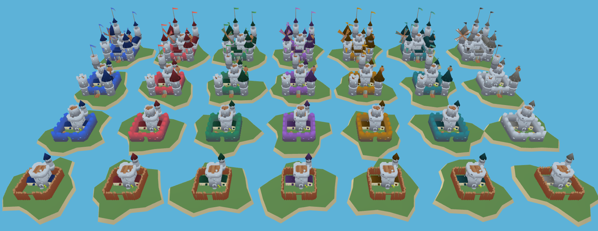

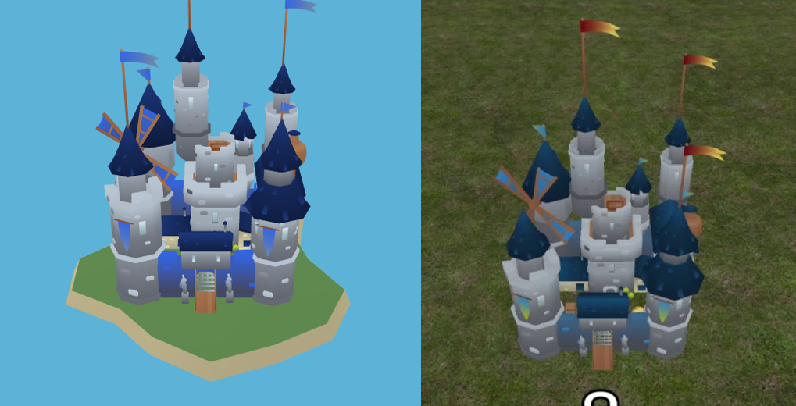

Recordings: [a level-up pop](docs/screenshots/castles-level-up.gif), [a capture recolouring roofs and flags](docs/screenshots/castles-capture.gif) and [level 3 and 4 loops out of step](docs/screenshots/castles-flags.gif).

### Art pass

The board is restyled to belong with the castles ([#102](https://github.com/INTODAN/island-battles-go/issues/102)): low-poly and flat-shaded, coloured from the castle atlas's vertical-gradient swatches, mostly light stone, warm wood and cream, with the team colour as the accent.

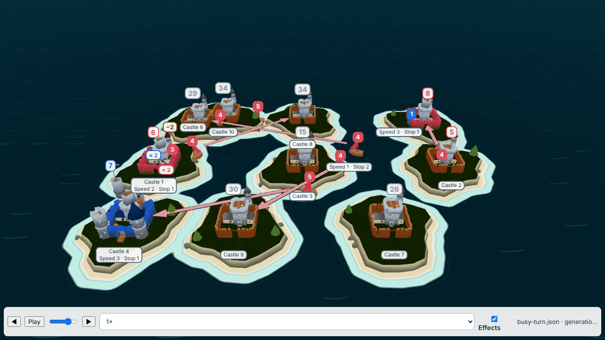

- **On the atlas** (`atlasUv.ts`, `lowPoly.ts`): `ATLAS_SWATCHES` names all seven swatches of `assets/castles/atlas.png` (cliff grey to cream, stone, ice, wood, green, flags, accent), and `swatchUv(swatch, along)` gives the UV of a point along one (0 its top row, 1 its bottom row). `FlatGeometry` builds flat-shaded meshes: every triangle has its own vertices and the face's normal, faces the side it is told to, and can multiply its atlas colour through vertex colours (`shade`). Islands, props and boat hulls use the castles' shared `castle-base` material, and sails the team's `castle-team` material (`castleAtlas.ts`), so they light and recolour exactly as castles do. Until the atlas has loaded, `MaterialCache.useBase` and `useTeam` give stand-in colours and swap them when it arrives.
- **Islands** (`landforms.ts`): the seeded outline of `islands.ts` (24 corners), a faceted cliff ring that runs from cream at the top to dark grey at the waterline, a flat grass top and a thin sand beach that slopes under the sea. The grass is flat to at least `PLATEAU_RADIUS` (0.78) in every direction, so the level 4 castle (whose base reaches 0.745) always stands on flat ground; that is why the smallest island radius went from 0.75 to 0.84. Castles of one landmass are joined by a low bridge of the same build (`bridgeOutline`, `BRIDGE_TOP`).
- **Props** (`islandProps`): seeded trees on the grass and rocks on the beach, never within `PROP_CLEARANCE` of any castle (outside every plateau), never behind a castle under its soldier count or in front of it under its name, and so never under a heading line's end. Each kind is one mesh drawn as thin instances: two draw calls for every prop on the board.
- **Sea** (`sea.ts`, `seaDistance.ts`): a toon water shader. Deep water offshore, light shallows within `SHALLOWS_WIDTH` of the nearest island's waterline (a distance field sampled into a texture when the islands change), a toon edge where they meet, a foam line at the shore that breathes, gentle swells that move the band edges, a ripple drifting out and sparse wave dashes, and a faint sky reflection toward the horizon. The low graphics setting draws only the bands and foam.
- **Boats** (`createBoat`): a low-poly wooden hull (`castle-base`), a square sail and a jib in the team's colour (the top of its stone/team swatch, as roofs) and a pennant on the flags swatch. They still grow gently with soldiers. A moving boat leaves a small foam wake (`wakes.ts`), faded in by its speed.
- **Light** (`look.ts`, `lookConstants.ts`): a warm sun, soft shadows (1024 map with percentage-closer filtering) from castles, boats and props onto islands, and a cool hemispheric fill. The environment texture `assets/environment/sky.png` is a small equirectangular sky made by `tools/environment/sky.ts`; the sea reflects it. It loads from the page's own origin like the castle files. The board's materials are Babylon's standard materials (no PBR, as #140 chose), so it is not used as image-based light.
- **Graphics setting** (`graphics.ts`, `postFx.ts`, `shadows.ts`): "high" turns on a `DefaultRenderingPipeline` (Khronos PBR Neutral tone mapping, which keeps colours' hue, a light bloom and FXAA), the sun's shadows, the sea's details and the castles' loops (`setCastleAnimation`); "low" turns all of them off and also plays no particle bursts (see **Effects** below). The game view's **Effects** box switches it and remembers it in `localStorage`; a device with two cores or 2 GB of memory or less starts on "low". The pipeline and the shadow code are chunks of their own, fetched only when turned on. Labels are drawn after post-processing, so it never touches their text or colours.
- **Effects** (`animation/effects.ts`, `particles.ts`, `particlePool.ts`, `gpuParticles.ts`): short particle bursts with textures drawn in code; GPU particles where WebGL 2 runs them, CPU particles elsewhere. Seeking puts every posed boat and castle back at once; bursts already under way finish on their own across a turn's end.
  - **Pooled systems** (#197). Building a particle system in the middle of a frame costs 30 to 48 ms (headless), so none is built while a turn plays. When the board loads, `Bursts.warmUp()` builds every system once and plays an invisible particle on each until it has compiled and drawn a few frames; a burst then takes a free system of its kind, sets its position, colours, sizes, speeds and rate (plain fields: a `GPUParticleSystem` sends them to its shader every frame, so nothing recompiles), calls `start()`, and gives it back once the last particle has died (`SystemPool` in `particlePool.ts`, which knows nothing about Babylon and is tested with a fake system). An idle system is stopped with `emitter = null`, which the scene's frame loop skips. GPU systems are made with `emitRateControl`, so a system that is started again emits what its rate says and does not refill itself with the particles of its last use (no `reset()`, which would free and rebuild its buffers).
  - **Kinds.** What a running system cannot change makes a kind: the emitter's shape (a point, or a box when the burst has a `spread`), the blend mode, the texture, the size curve (`grow`) and the capacity. `BURST_KINDS` in `particles.ts` lists the six the game uses, with their pool sizes: the clash's flash (8 systems), smoke (10), the spray together with the bubbles under a sinking boat (16), the level-up sparkle (6), a capture's burst (4) and its sparks (4). A burst whose kind is not in the table is dropped, so a new effect adds a row there (a test checks that the turn's effects find a system for each of theirs).
  - **Pool sizes** are about twice the most that were busy at once in the three fixtures played at 1.5 s a turn (`window.battlefieldDebug.particlePool()` gives the counters: `highWater` per kind, and `dropped`): flash 4, smoke 6, spray and bubbles 9, sparkle 3, capture 1, capture sparks 1 on `six-teams.json`. When more bursts start at once than a kind holds, the extra ones are dropped and the ones playing carry on; nothing is built to make room.
  - **Effects off plays no particles** (#201). With "low", `burstsFor` in `effects.ts` returns `null`: the particle code is not loaded, no `Bursts` object and no pool (the 48 systems) are made, and no burst plays. Boats still tilt and sink, and the clash flash and the castle pop still play. The effects ask `burstsFor` on every effect and every frame (`tick`), so switching to "high" during a game builds and warms the pool at once and bursts play from the next effect; switching to "low" lets bursts that are playing finish, starts no new one and leaves the pool in memory until the scene is disposed.
- **Loading** (`assetLoader.ts`, `boardAssets.ts`, `src/ui/boardLoading.ts`): the atlas, the four castle models and the environment texture download once per page, counted by bytes. The game view and the dev page show **Loading the board…** with a progress bar over the board until they are in; the board draws its stand-ins underneath, and stays usable if a file fails. The lobby screens do not wait: the ocean behind them fades in once the art has loaded.

**Contrast.** The owner decided on #102 to keep the issue's shades so the board matches the reference video: deep sea `#1f4f63` (`DEEP_SEA_COLOR`), shallows `#4fa3a5` (`SHALLOWS_COLOR`), foam `#f4f1e6` and the castle atlas's own green for the grass top (`GRASS_TINT` is [1, 1, 1]), and to drop the 3:1 minimum. The team colours are all mid-tones, so every pair of a team's roof (the top of its stone/team swatch, `teamSwatches`) or boat sail with these backgrounds comes out at 1.0 to 2.4:1. `contrast.test.ts` computes the table (run it with `CONTRAST_TABLE=1 bun test src/scene/contrast.test.ts` to print it) but enforces nothing. Team identity comes from the team-coloured label chips and heading lines. The palette stays equal to `replay.html`.

**Budgets** (measured in headless Chromium with SwiftShader, a software renderer, so frame times are only comparable with each other; real-device frame rates are for the owner to check):

| | Before #102 | Effects off | Effects on |
|---|---|---|---|
| JS fetched for the board (gzip) | 1.87 MB (450 KB) | 2.13 MB (516 KB) | 2.37 MB (576 KB) |
| Asset files | 1.73 MB | 1.74 MB | 1.74 MB |
| Draw calls, six-team busy turn | 65 | 76 | 97 to 105 |
| Triangles drawn per frame | 34.5 k | 36.1 k | 84 to 88 k (with the shadow pass) |

Targets: at most 2.5 MB of JS (650 KB gzip) and 2 MB of asset files for the board, and at most about 120 draw calls and 150 k triangles for a six-team busy turn, which a mid-range laptop's integrated GPU draws well within 16 ms (60 fps), and a phone at 450 px within 33 ms (30 fps) with effects off.

Recordings: [a clash](docs/screenshots/art-clash.gif), [a capture](docs/screenshots/art-capture.gif) and [an upgrade](docs/screenshots/art-upgrade.gif). Before and after screenshots of the fixture frames are `docs/screenshots/art-*-before.png` and `art-*-after.png`.

## Lobby screens and the bot relay

`src/main.ts` mounts `src/ui/lobby/app.ts`, which picks the screen from the realtime stores and the last lobby round whose game view the player closed (`routeRound` in `rounds.ts`, pure and tested): no session shows the name step; a session with no lobby shows create, join or [watch](#watching-a-game); a `waiting` lobby shows the room; a `started` lobby mounts the game view of its round (`mountGameView` from `src/ui/game/`) unless the player closed that round's view. `/play/?join=CODE` (or `/?join=CODE` in dev) asks for a name and then joins that lobby.

- **Several games in one lobby** (#172): a lobby plays one game per round (`lobby.round`). **Back to lobby** in the game view keeps the player in the lobby. Once the game has ended it reopens the lobby (`POST …/reopen`), which waits again with the same players, teams and bots, everyone presses ready and the host starts the next game. While the game runs it shows the room read-only, with **Return to game**; the game goes on, and leaving stays the room's **Leave lobby** button. A player still looking at the result when another reopens the lobby stays there, with the note "The lobby is open again", and every player enters the next game when it starts. The game is followed by lobby and round (`realtime.followGame(lobbyId, round)`), and the view mounts only once that round's game exists, because until the host's start has made it the lobby's newest game is the previous one. A watcher's view follows the lobby to its next game.

- **Create form** (`form.ts`, pure and tested): lobby name, 2 to 6 teams, players per team, map (generated, a default map from `GET /map/templates`, or a map file checked by `POST /map/validate` before it is sent) and turn limit (10 s, 30 s, 2 min, 10 min, No limit, sent as `game_settings.turn_timeout_seconds`). A template or file fixes the team count. Each create gets a fresh `request_id`; after a transport failure the same body goes out again with the same id.
- **Room** (`roomScreen.ts`, `botPicker.ts`): teams with their members, bot choices and ready marks, the join code with copy buttons, the map summary, the bot picker and the ready, start and leave buttons. The members' bot choices come from each snapshot member's `member_settings` (`memberSettingsBot` in `roomModel.ts`), and a seat's from its `seat_settings`. A choice publishes `lobby.changed`, so every tab sees it at once.
- **Bot seats** (#148): while the lobby waits, the host adds a bot to a team with **Add bot** (the level comes from `GET /bots/defaults`) and removes it with **Remove**. Each click sends a fresh `request_id` (`POST .../seats`), and a transport retry resends the same one, so the seat is added once. A seat (`kind: "seat"`) shows as a bot with its level, always ready, with no lease state, and is not counted as a person. Seat problems are sentences next to the control that caused them.
- **Change map** (#171): while the lobby waits, the host's room has a **Change map** button under the map summary. It opens the create form's map, team count and turn limit fields (`mapFields.ts`, shared with the create form), filled with the lobby's current choice; **Save** sends `PUT …/settings` with the map's teams and `game_settings` (`validateMapSettings` and `changeSettingsBody` in `form.ts`). The lobby rebuilds its teams by position, so team cards, seats, the bot picker and the summary follow the new snapshot, and every player sees it from `lobby.changed` and has to press ready again. A map with fewer teams than the lobby has players and bots is refused with a sentence asking to remove a bot or pick a bigger map.
- **Problems** (`problems.ts`): each refusal shows a plain sentence next to the control that caused it; `empty_teams` also highlights the teams in `team_ids`.
- **Lease** (`lease.ts`): one `client_instance_id` per page load, a heartbeat every 15 s with the current `membership_generation`, a `keepalive` `DELETE` of the lease on `pagehide`, and a Leave button. A reloaded tab keeps its session and lobby, and joins again under a new instance id.
- **Start** (`startRetry.ts`): the lobby is `started` before its game exists, so the game read can get 404 or 409, or, in a later round, the previous round's game, which counts as not there yet. It is retried after 1 s, 2 s, 4 s, then every 10 s until it works or the screen leaves the lobby.
- **Build a map…** (`mapBuilder.ts`): the create form's map choice opens the map builder (`/map/builder/`, proxied by `proxy.ts` in development) in its own tab; its **Use in lobby** message (`island-battles.map-file`, accepted only from the same origin and the window the form opened) is checked by `POST /map/validate` as if the map had been loaded from a file. Not offered in the desktop app, whose window is not on the game server's origin, so the builder cannot post back to it.
- **Relay** (`src/bots/`, no DOM imports): for a player whose `GenerationState.bot` is `localhost`, each new generation's turn delivery is read from `GET /game/from-lobby/{lobby_id}/turn-delivery` (the server's `BotTurn` and a one-turn submit token) and posted to `127.0.0.1:41414/turn`, which answers `202`; the bot plays and submits the turn itself, and the relay never submits commands ([turn deliveries](../../backend/README.md#turn-deliveries)). A bot that is not running is asked again every 2 s; a bot that refuses the delivery (a submit host it doesn't allow, or an SDK too old for deliveries) is shown and waits for **Try again**; a failed read of the delivery is tried again after 1 s, doubling up to 8 s. A 409 (nothing to play) just waits. Once the bot has the turn (or for a default bot) the relay calls `POST /game/from-lobby/{lobby_id}/deadline` a second after `turn_deadline_at`, again after 2 s doubling up to 30 s while the turn stays open. Another client can reuse `createBotRelay` with its own `fetch`, timers and stores.
- **Bot picker**: "My localhost bot" shows connected or not running from `GET http://127.0.0.1:41414/health` and the command to copy, or a default level from `GET /bots/defaults`; the choice is saved as your lobby member settings, `{"bot": ...}`, with `PUT /lobby/v1/games/{game_key}/lobbies/{lobby_id}/member-settings`; a new choice clears your ready. The bot server must allow the page's origin (`island-battles-bot serve --allow-origin ...`; `http://localhost:3000` and `http://localhost:8888` are allowed already).
- **Bot packages** (#221, `src/bots/packages.ts`): below the choices, **Upload bot (.zip)** takes the zip that an SDK's `package` command builds. It starts the upload with `POST /game/lobbies/{lobby_id}/bot-packages`, posts the zip straight to storage with the presigned POST (with `XMLHttpRequest`, for the progress bar), and completes it with `POST …/bot-packages/{package_id}/complete`, then shows the package's language, entry or command and size, or the game's reason for refusing it. **Upload from the command line** gets an upload token (`POST …/bot-packages/upload-token`) and shows the Python and Go commands that use it, with Copy buttons. The lobby's packages are listed from `GET …/bot-packages`, read again every 10 seconds, with **Delete** on your own. Choosing a package as your bot comes later. The desktop app shows the same controls, but storage's CORS rule admits only the game's own origin, so the desktop app uploads from the command line.

Screenshots of each screen at desktop width and at 450 px are in [`docs/screenshots/`](docs/screenshots/) (`lobby-*.png`), including the room with bot seats (`lobby-seats-*.png`).

## The game view

`src/ui/game/` is the screen a player sees once their lobby starts: the 3D board with a HUD, a timeline, the outcome and the bot logs. `mountGameView(container, { lobbyId, round, realtime, onBack })` shows the game of a lobby round live; `mountDemoView(container, { file, onBack })` opens a saved demo file with no server. Both return `{ dispose() }`. The lobby screens ([#98](https://github.com/INTODAN/island-battles-go/issues/98)) own the app shell and call them (an **Open demo file** button on the name and create-or-join screens opens a demo; the shell follows the game for the relay and passes the view a `realtime` whose `leaveGame()` does nothing, so the relay keeps running while the view mounts, swaps to a demo or goes away); [#103](https://github.com/INTODAN/island-battles-go/issues/103) reuses the same screen for spectators. `/?game=<lobby_id>` (for the guest session saved in the tab's `sessionStorage`) and `/?demo` or `/?demo=<fixture.json>` open them alone from the dev server, beside the app shell.

- **History** (`live.ts`): the view subscribes to the player channel first (`realtime.followGame`), then loads `GET /game/from-lobby/{lobby_id}/demo`, then merges the live generations into it by `id`, ignoring ones it holds (`history.ts`). A turn that arrives while the history loads is kept and merged after it. After a reconnect the history is read again and merged, so a turn the channel skipped is not lost. Turns are numbered by their index in the history, "Turn 37 / 120", because generation IDs have gaps.
- **Timeline** (`controller.ts`, no DOM): play/pause, step back and forward, a scrubber and **Follow live**. Playing forward and stepping forward use the turn animation of `src/scene/animation/`; scrubbing and stepping back seek with no animation. Follow live turns off when you scrub back, and on when you return to the newest turn of a running game; pausing while following stops following. When the game has an outcome, or in a demo, nothing follows, and the timeline stays usable.
- **HUD** (`screen.ts`): each team's name, colour and players, its soldiers (in castles and on the way) and castles for the shown turn, the turn, and a connection indicator.
- **Bot logs** (`logs.ts`): a collapsible panel for the shown turn. The history carries the logs it could see when read; a live turn's logs are read with `GET .../logs?generation_id=N`. While teams are hidden it says "Logs of other teams appear when the game ends", and when the outcome arrives it reads them again.
- **Demo files** (`demoFile.ts`): a TypeScript port of `backend/demoviewer/demo-file.mjs` against the generated `Demo` type, with the same checks and messages (format, `schema_version`, the 128 MiB cap, every drawn value). The file is read in the browser and uploaded nowhere. A demo from an unfinished game says so. A wrong file shows its message and leaves the game or demo shown before open.
- **Save demo** (`saveDemo.ts`, `sources.ts`): a button in the top bar of a live view, for a player (`GET .../demo`) and a watcher (`GET .../watch/demo`), through the API client. The response text is saved as the server sent it with a `Blob` and a temporary `<a download>` link, named from `Content-Disposition` or else `island-battles-game-<game_id>-generation-<n>.json`; the file opens again with **Open demo file** and in the 2D demo viewer. The button is disabled while the request runs and a failure shows a line under the top bar. An opened demo has no such button. Desktop app: a download link may do nothing in its web view (no Tauri plugin is used), so the owner checks it ([#119](https://github.com/INTODAN/island-battles-go/issues/119)).
- **Clash summary** (`clashes.ts`, pure): under the outcome, "Clash: Blue 5 → 3 · Red 4 → 0" for each clash of the shown turn (soldiers before and after; 0 means the group was stopped), joined with ". "; empty and hidden when nothing clashed. The same sentence as the 2D replay.

The view gets its game from a `LiveSource` (`sources.ts`): `playerSource` (the player channel, `/demo` and `/logs`) for `mountGameView`, and `watchSource` for `mountWatchView`, described next. The turn deadline call (`POST .../deadline`) is not made here: the relay of [#98](https://github.com/INTODAN/island-battles-go/issues/98) does that.

## Watching a game

Someone outside the roster can watch a game live and scrub its history with only its join code ([#103](https://github.com/INTODAN/island-battles-go/issues/103)). **Watch a game** on the start screen takes a code, and `/play/?watch=CODE` (or `/?watch=CODE` in dev) asks for a name and then watches that game.

- **Starting.** The shell calls `POST /lobby/v1/watches`. A member of that lobby gets their own lobby instead. Anyone else gets the watch view, `mountWatchView(container, { lobbyId, channel, realtime, onBack })`, the game view in read-only mode: there is no lease, heartbeat, bot relay or deadline call. A reloaded tab watches again with the code it saved in `sessionStorage`. **Stop watching** removes the watcher row with `DELETE …/watch`.
- **Live turns.** `realtime.followWatch({ lobbyId, channel })` subscribes to the watch channel and keeps `realtime.watch` (the latest `WatchState`), reading `GET /game/from-lobby/{lobby_id}/watch` on every subscribe, by the install rules of the player's game. The history comes from `GET …/watch/demo`. A watcher who arrives before the start waits on the channel; the first turn loads the view.
- **Logs.** A watcher belongs to no team, so the logs panel says "Bot logs appear when the game ends"; when the outcome arrives the view reads the history again, which then holds every team's logs.
- **Kicked.** The host's kick unsubscribes the watcher at once. The read that follows gets 403, `realtime.problem` gets scope `watch`, and the view says "The host removed you from this game's watchers" and "Not receiving turns", keeping the turns it has. The code no longer lets them watch.
- **For members.** The lobby room has a **Watchers** card (`watchersPanel.ts`) with the count and names, read again on every lobby change; the host has a **Kick** button for each. The game view shows the same list in a small **Watchers** box over the board.

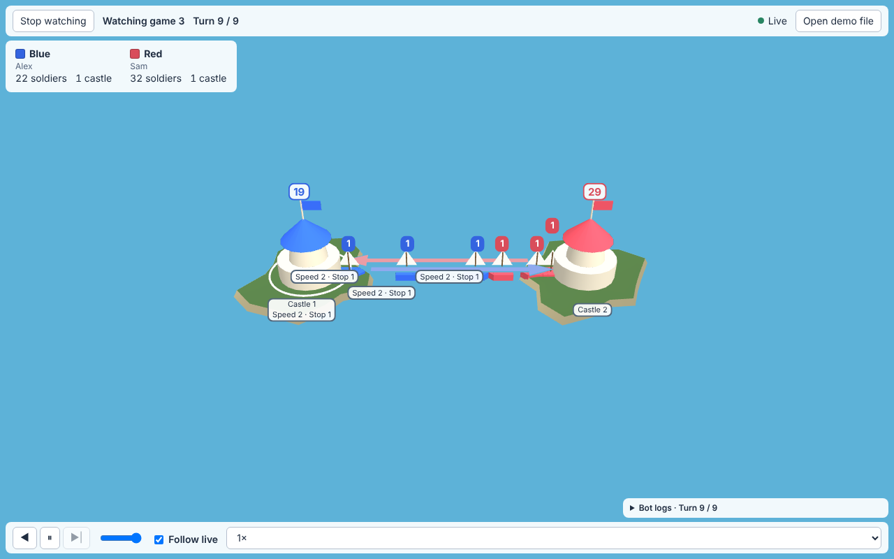

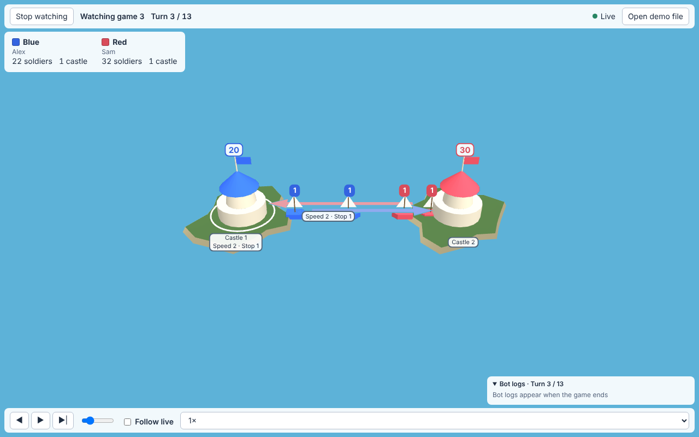

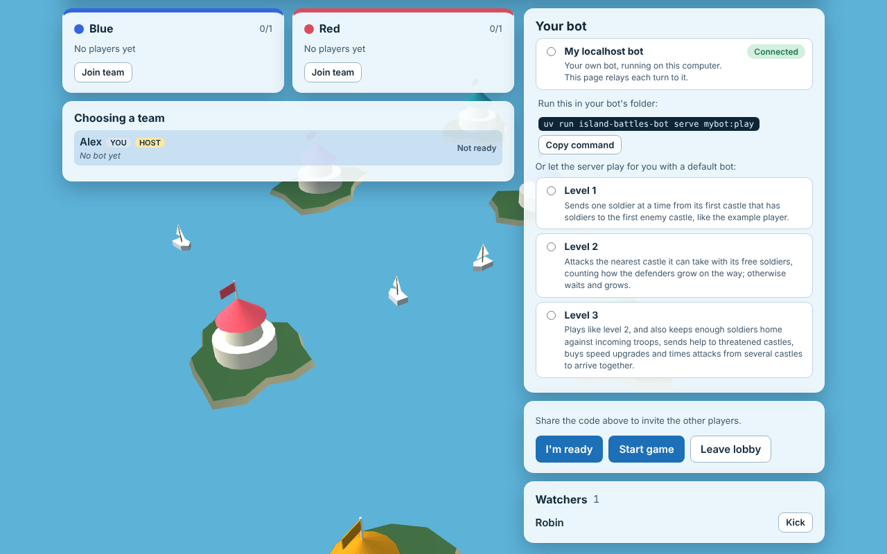

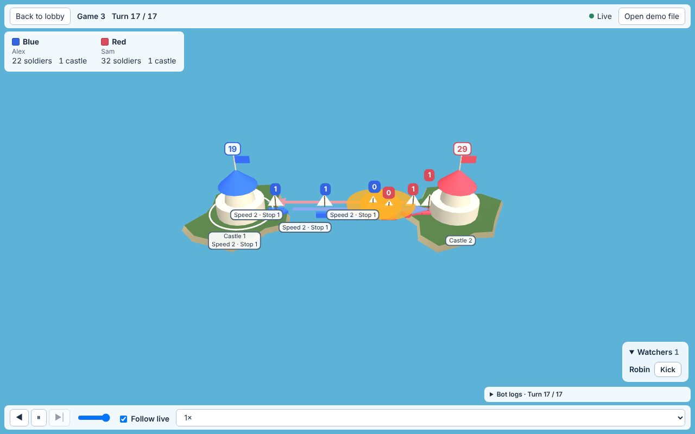

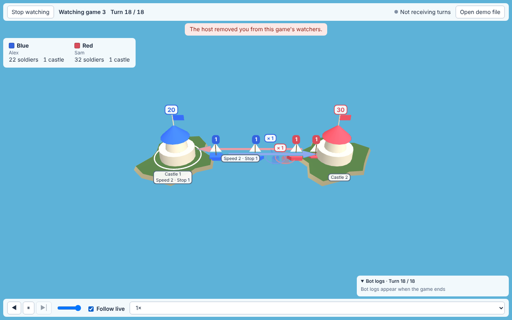

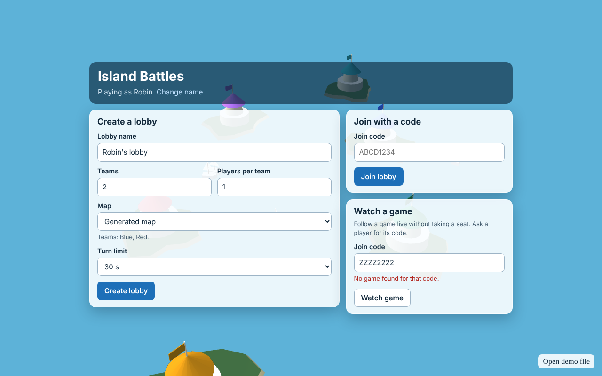

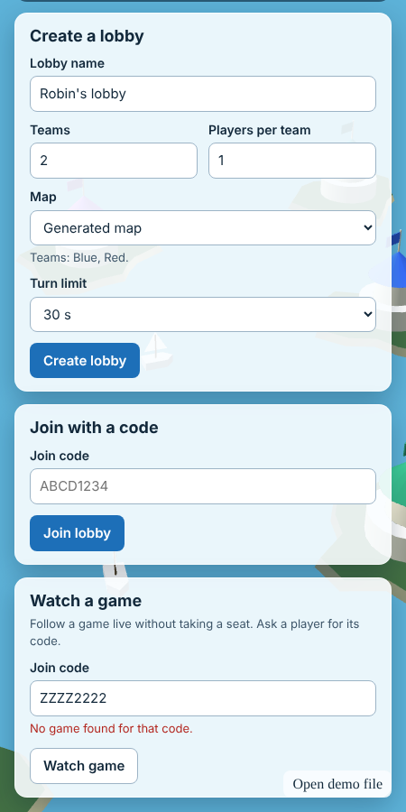 Screenshots of a live match, its outcome and a 450 px wide screen are in [`docs/screenshots/`](docs/screenshots/) (`game-*.png`).

## Layout

- `index.html`, `src/main.ts`, `src/styles.css`: the page and the Babylon scene. `src/main.ts` starts the dev page when the URL has `?fixture=`, and the lobby app otherwise. `@babylonjs/core` is imported from its ES module paths so the bundle tree-shakes; add the side-effect imports a feature needs (for example `StandardMaterial`) instead of importing the package root.
- `src/realtime/`: the Centrifugo session, described above.
- `src/bots/`: the localhost bot relay.
- `src/ui/lobby/`: the lobby screens and the app shell's flow; `src/ui/game/`: the game view, described above.
- `src/scene/`: the 3D board, described above.
- `dev.ts` and `proxy.ts`: the dev server and its proxy rules.
- `assets/`: files the client loads (the castle models and atlas, and the environment texture), each with a row in `assets/LICENSES.md`; `tools/castles/`: the script that makes the castle files; `tools/environment/`: the script that makes the environment texture.
- `build.ts`: the production build, served under `/play/`; with `--desktop` the build for the desktop app.
- `src/platform.ts` and `src/desktop.ts`: what differs in the desktop app (base URL, storage, HTTP plugin).
- `src-tauri/`: the Tauri shell of the desktop app, described above.

CI runs `bun install --frozen-lockfile`, `bun run check` and `bun run build` in [`.github/workflows/web-client.yml`](../../.github/workflows/web-client.yml). It deploys nothing.
