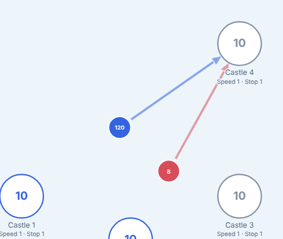
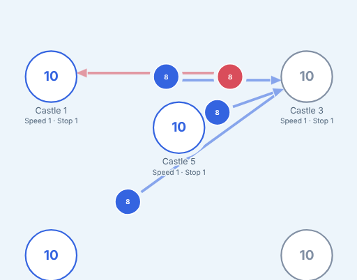
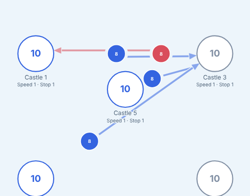
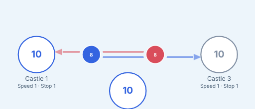
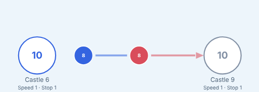
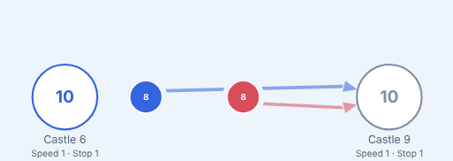
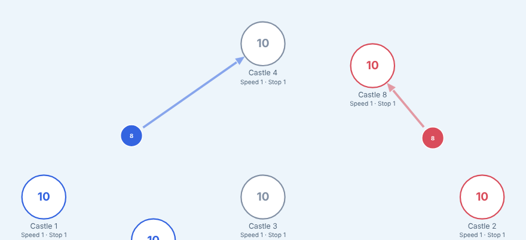

# Troop heading lines

Each moving troop group shows an arrow to the castle it is heading for: in the 2D replay (`backend/services/replay.html`, the block between `// heading-lines:begin` and `// heading-lines:end`, tested by `backend/demoviewer/heading-lines.test.mjs`) and on the 3D board (`clients/island-battles-web/src/scene/headingLines.ts` and `animation/headings.ts`, tested by `headingLines.test.ts` and `animation/headings.test.ts`). The look was picked on [#89](https://github.com/INTODAN/island-battles-go/issues/89); [#168](https://github.com/INTODAN/island-battles-go/issues/168) fixed the edge cases. The `impl-*` pictures here are from #89.

## Rules

Both implementations take the same steps, in pixels (2D) or map units (3D), and their tests are alike, named by #168's case numbers.

1. A line runs from the group to its destination: in 2D from the group's centre (under its circle) to just outside the castle's circle; in 3D from just ahead of the boat's bow, at the boat's drawn scale, to the castle's shore point, where the boat will land. A line too short for its head and a little shaft (`minShaft`) is not drawn; this is checked again after lanes and shared heads have moved the line.
2. Groups of one team on one route are one line, the rearmost group's.
3. Visible lines that are within a few degrees (`parallelDegrees`) of parallel or of opposite, and closer than a lane over a shared stretch longer than a head, are put in parallel lanes, whatever their teams, origins and destinations (cases 3, 4 and 5). Lanes are half a head plus half a line plus `laneGap` apart, casings included, so no line, casing or head touches another lane. On one corridor, lines going one way keep to the right of their travel and lines going the other way to theirs; lines all going one way are centred on it.
4. At each castle, one team's lines arriving within 15 degrees in total share one arrowhead, comparing angles round the circle (cases 2, 7 and 8). The other lines of that head end at its base (case 6).
5. Every head at a castle, of every team, is then moved round the castle as little as needed to keep `headGap` between neighbours (case 1). A shared or moved head points at the castle's centre; any other points along its line.
6. The line of a group that is not moving (at the same position in the previous and the next generation, or stopped by a clash this turn) is dashed in 2D and drawn at 40% opacity in 3D (case 14).
7. 2D only: a line passing under another castle gets a field-coloured gap ring round that castle, and groups get a halo. 3D only: the line leaves a gap where it passes another castle's model (case 12), all lines are at one height and drawn in a fixed order with no depth test between them (case 15), and during a turn the arrows are decided once from the turn's start and end and fade in or out instead of popping (case 13).

## Before and after (#168)

| Case | Before | After |
|---|---|---|
| 1: two teams meet at one castle |  |  |
| 2: a laned and a plain line of one team |  |  |
| 3: opposite directions |  |  |
| 5: two teams on one path |  |  |
| 14: a group that did not move (blue) |  |  |

The 3D pictures are in [`clients/island-battles-web/docs/screenshots/`](../../clients/island-battles-web/docs/screenshots/), named `arrows-case<N>-before.png` and `arrows-case<N>-after.png`. All of them show scenes of the hand-written fixture `clients/island-battles-web/test/fixtures/heading-arrows.json`.
